# Setting up output: ENTTEC USB Pro, uDMX, Art-Net and sACN

> **English version** of [Ausgabe einrichten: ENTTEC USB Pro, uDMX, Art-Net und sACN](ANLEITUNG.md).
> LightOS itself speaks German: every button, menu and field is quoted here **exactly as it
> appears on screen**, with an English translation in brackets the first time it shows up.
> The screenshots are the same as in the German guide.

> LightOS calculates 512 DMX channels for every universe. For them to reach your fixtures,
> every universe needs an **output**: an **ENTTEC DMX USB Pro** on a USB port, a
> **uDMX adapter** (USB without a COM port), or an **Art-Net** or **sACN (E1.31)**
> receiver on the network. The output applies
> **per universe** — you can mix the four ways freely, up to 32 universes. This guide
> shows the dialog *Ausgabe konfigurieren* (configure output), the two monitors for
> checking, and the warnings in the status bar. The red numbers in the pictures match the
> numbered points in the text.

## What you need

- A show with at least one patched fixture. How to do that is shown in
  [Erste Schritte](../anleitung_erste_schritte/ANLEITUNG.md) (German).
- **For USB:** an ENTTEC DMX USB Pro. Windows brings the driver along; notes are in
  [INSTALL.md](../../INSTALL.md#enttec-dmx-usb-pro) (German).
- **For USB without a COM port:** a uDMX adapter, see
  [uDMX adapters (USB)](#2b-udmx-adapters-usb). It needs the package `pyusb` (included in
  the Windows setup package) and, on Linux, an access right once. **On Windows it needs a
  driver that neither Windows nor LightOS ships** – you assign it once by hand; after
  that the adapter works.
- **For network:** an Art-Net or sACN node (or a fixture with a built-in network input)
  and a computer **on the same network**, see
  [Network pitfall](#network-pitfall-with-art-net-and-sacn).

The pictures show an **example configuration**: Universe 1 via an ENTTEC on
`/dev/ttyUSB0`, Universe 2 via Art-Net to a node with the address `192.0.2.50`.
Port and addresses are examples — on your computer you will see your own. On Windows the
port is called `COM3`, for example, on Linux usually `/dev/ttyUSB0`.
The **status bar** at the bottom of the pictures is not part of this example configuration:
the pictures are made on a computer without a connected ENTTEC, which is why it says
„Enttec: nicht gefunden“ (Enttec: not found) there.

---

## 1. Open the dialog

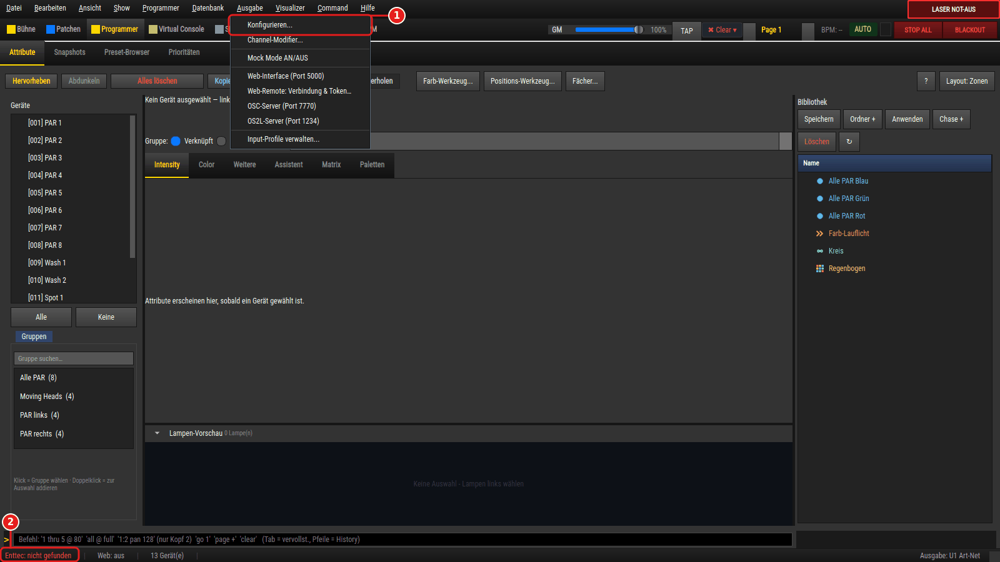

1. Menu **Ausgabe** (Output) → **Konfigurieren...** (Configure...)
2. Or: click the Enttec indicator at the bottom left of the status bar
   (`Enttec: …`). It opens the same dialog.

The dialog **Ausgabe konfigurieren** has six tabs: **Enttec Pro USB**, **uDMX (USB)**, **Art-Net**,
**sACN (E1.31)**, **DMX-Eingang** (DMX input) and **Universen** (universes). There are two ways:

- **Individual tabs** (steps 2–4): put one universe on one output and connect right
  away.
- **Universen tab** (step 5): all universes in one table, saved and applied with one
  click.

Both write to the same file `universes.json` in the LightOS data folder
(Windows `%APPDATA%\LightOS`, Linux `~/.local/share/LightOS`), so you can mix them. On the next start LightOS automatically sets up the outputs saved there again.
**Schließen** (close) ends the dialog; afterwards LightOS updates the status bar.

Above the tabs is the button **Interface einrichten…** (set up interface) — it opens the
[assistant](#the-interface-einrichten-assistant), which shows the DMX interfaces
connected to this computer and sets them up and tests them.

The **DMX-Eingang** tab is not part of the output: there LightOS receives DMX from
outside (Art-Net on port 6454, sACN on port 5568) and mixes it into a universe of its
own. Receiving triggers a firewall prompt once on Windows — see
[Receiving DMX: the firewall prompt](#receiving-dmx-the-firewall-prompt).

## The "Interface einrichten…" assistant

The button **Interface einrichten…** above the tabs (or **Ausgabe → Interface
einrichten…**) opens an assistant with three tabs. Which interfaces LightOS knows and
which driver each needs is listed in [Supported DMX interfaces](INTERFACES.md) (German).

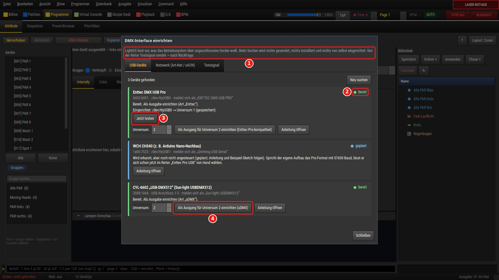

1. **Header** — LightOS only reads what the operating system knows about the connected
   devices. Searching sends nothing, installs nothing and sets nothing up by itself.
   **Nur der Reiter Testsignal sendet — nach Rückfrage** (only the test signal tab sends
   — after asking).
2. **USB-Geräte tab** (USB devices) — one card per adapter with a traffic light and plain
   text: `bereit` (ready), `eingerichtet` (set up), `Typ unklar` (type unclear),
   `Treiber fehlt` (driver missing), `keine Berechtigung` (no permission), `belegt`
   (busy), `geplant` (planned), `nicht unterstützt` (not supported). Below it, what to
   do (on Linux a command to copy — LightOS does not run it; on Windows the
   manufacturer's driver page).
3. **Jetzt testen** (test now) — appears in the card after setting up. It takes you to
   the **Testsignal** tab and asks before sending.
4. **Als Ausgang für Universum … einrichten** (set up as output for universe …) — sets
   the adapter up the same way as **Verbinden** in the matching tab (including the
   question **Laufende Ausgabe ersetzen?** if something else already runs on the
   universe).

The **Netzwerk (Art-Net / sACN)** tab shows the addresses of this computer (display
only) and leads to the Art-Net tab.

If no (recognised) interface is plugged in, the list stays empty:

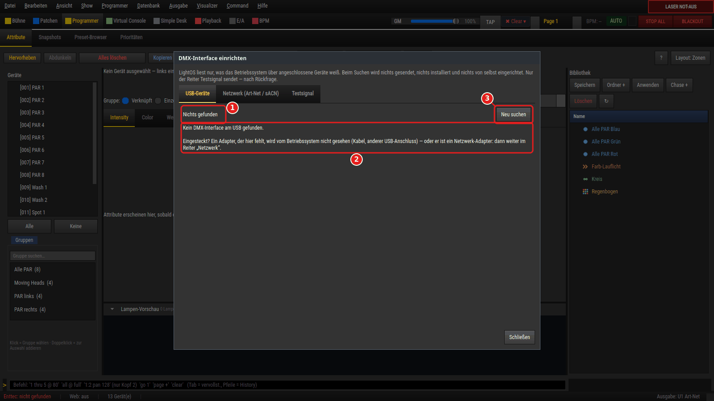

1. **Nichts gefunden** (nothing found) — the operating system reports no known DMX
   adapter.
2. The **explanation** below: check the cable or try another USB port — or it is a
   network adapter (Art-Net/sACN node), then continue in the **Netzwerk** tab.
3. **Neu suchen** (search again) — look again after plugging it in.

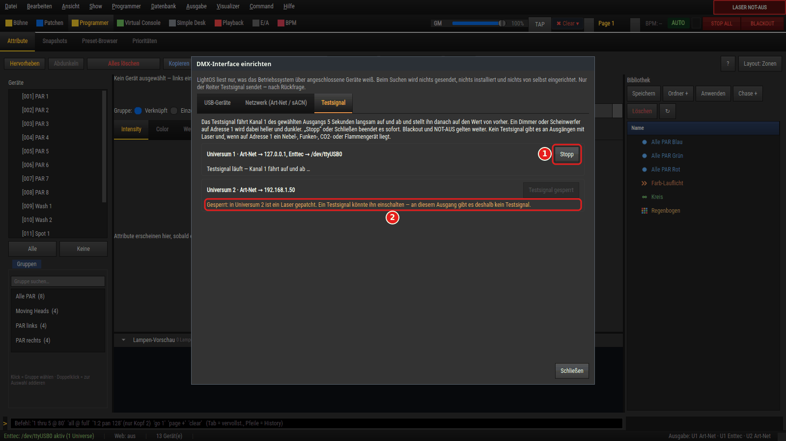

**Testsignal** tab — one row per universe that has an output:

1. **Testsignal senden** (send test signal) moves channel 1 of the output slowly up and
   down for five seconds; afterwards channel 1 is back at its previous value. LightOS
   asks first and names what the patch has on address 1; if **BLACKOUT** is active or the
   **Grand Master** is at 0 %, the question says the signal would not be visible. While
   it runs the button reads **Stopp**; **Stopp** or **Schließen** ends the signal at once.
2. The test signal is **gesperrt** (locked), with the reason,
   - while the **LASER NOT-AUS** (laser emergency stop) is triggered,
   - on every output through which a **laser** can be reached — also when the laser is in
     another universe that sends through the same output (e.g. two universes on the same
     Art-Net universe). What counts as a laser is the same as for the emergency stop and
     blackout, see the [laser guide](../anleitung_laser/ANLEITUNG_LASER.md),
   - when a device without light that a channel value could trigger sits on
     **address 1** (fog, haze, sparks, CO2, flames, confetti, bubbles). Such a device on
     another address does not lock it — the signal only moves channel 1.

   If a laser is added or the emergency stop is triggered while it runs, the signal ends
   immediately. A device LightOS does not know (not patched) can still react — that is
   why it asks.

The whole sequence as an animation — **Testsignal senden** (1), the confirmation with
**Abbrechen** (cancel) as the default (3; only **Testsignal senden** in the question (4)
starts it), the running test with **Stopp** (5, 6) and then **Gestoppt** (stopped, 7).
The output with a laser stays **gesperrt** (locked) the whole time (2):

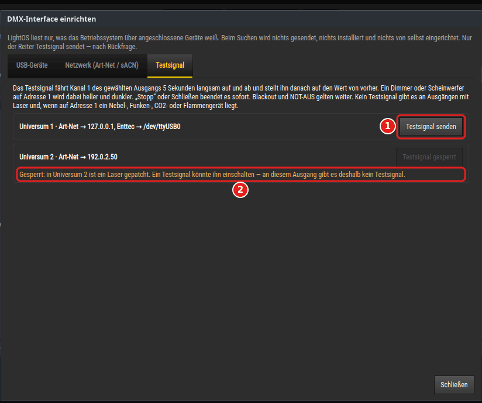

## 2. ENTTEC DMX USB Pro

Tab **Enttec Pro USB**:

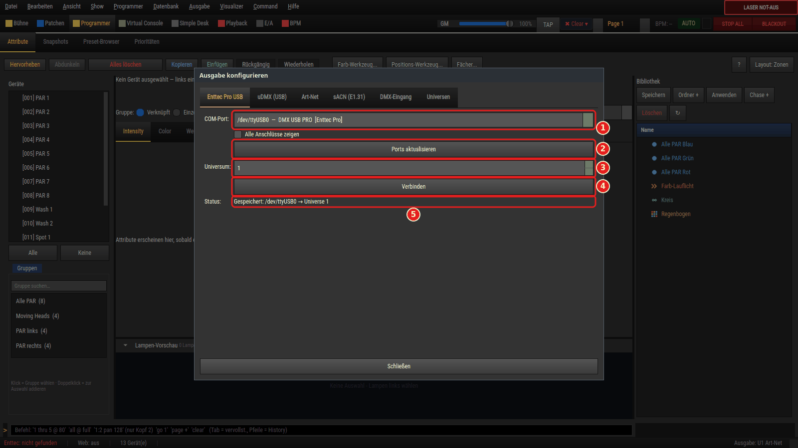

1. **COM-Port:** — the serial ports that have a **USB device** behind them. A detected
   ENTTEC carries the suffix `[Enttec DMX USB Pro]`, is listed **first** and is **preselected**
   on a fresh computer. Ports without a USB device (the built-in port `COM1`,
   Bluetooth, empty `/dev/ttyS…`) are hidden; the checkbox **Alle Anschlüsse zeigen**
   (show all ports) below brings them into the list. An adapter with the ENTTEC's FTDI
   chip that does not identify itself as an ENTTEC (many Pro-compatible adapters, but
   also "Open DMX" cables) carries `[FTDI-Adapter, Typ unklar]` (FTDI adapter, type
   unclear) — it is preselected as before; whether it really is Pro-compatible is shown
   by the test signal in the [assistant](#the-interface-einrichten-assistant). If no ENTTEC is detected, the
   selection stays empty — LightOS then does not pick a port by itself. If the saved
   port is not there at the moment, it is listed with `— derzeit nicht gefunden`
   (currently not found) instead of silently jumping to another port; if nothing is
   connected to it, it is marked `(kein USB-Gerät erkannt)` (no USB device detected).
   In both cases the line below the list names the detected adapter. Without any port
   it says `Kein Port gefunden` (no port found).
2. **Ports aktualisieren** (refresh ports) — read the list in again after plugging in.
   The selection is kept; if nothing was selected yet, the ENTTEC you just plugged in
   is preselected.
3. **Universum:** (universe) — which LightOS universe goes out through this adapter. The field is
   pre-filled with the saved value; set it deliberately **before** you click
   **Verbinden** (connect).
4. **Verbinden** — removes any other output of this universe, opens the adapter and
   saves the assignment. **One adapter carries exactly one universe:** if the same
   adapter was on another universe before, that row loses it (the row stays as
   `Aus` (off)), and the status says so, for example
   `… · war Universum 2 — jetzt Universum 1` (was universe 2 — now universe 1). The status
   then first reports
   `Eingerichtet: … (gespeichert), verbinde …` (set up: … (saved), connecting …) and
   shortly afterwards the result: `Verbunden: … (gespeichert)` (connected: … (saved)),
   or `Port lässt sich nicht öffnen — gespeichert, aber es geht kein DMX raus` (port
   cannot be opened — saved, but no DMX is going out), or
   `antwortet nicht — Port/Kabel prüfen` (not responding — check port/cable).
5. **Status:** — when the dialog opens, this shows what is **saved**
   (`Gespeichert: /dev/ttyUSB0 → Universum 1` = saved: …). Whether the adapter really
   sends is only shown by the status bar (step 8).

**Question before replacing.** If a **different** output is already running on the
chosen universe (another route, port or target IP), LightOS asks
**Laufende Ausgabe ersetzen?** (replace the running output?) before setting it up – with
**Nein** (no) everything stays as it is. This applies to **Verbinden** here and in the
uDMX (USB) tab, to **Übernehmen** in the Art-Net and sACN tabs, and likewise when you
click **Als Ausgang … einrichten** in the assistant — it is the same question. Setting up
the same output again does not trigger a question.

## 2b. uDMX adapters (USB)

Tab **uDMX (USB)** — for adapters that sit directly on USB and have **no COM port**:
the *Anyma uDMX* and its clones, and the *CYL-6602 "USB-DMX512"* (reports itself as
"Sun-light USBDMX512"). One adapter carries **one** universe. This tab has no picture
yet.

- **Adapter:** — the adapters found, with name, USB ID and serial number or port.
  LightOS searches when the tab is first opened and on **Adapter suchen** (search
  adapters). The saved adapter stays in the list even when it is missing
  (`— derzeit nicht gefunden` = currently not found).
- **Universum:** and **Verbinden** (connect) — as with the ENTTEC. The status first says
  `Eingerichtet: … (gespeichert), verbinde …` and then `Verbunden: …` (connected) or
  `sendet nicht — gespeichert, aber es geht kein DMX raus` (not sending — saved, but no
  DMX is going out).
- Below the status you then find the **reason** and what to do. The most common ones:
  - *No access rights* (Linux): set up a udev rule once.
  - *Treiber fehlt* (driver missing, Windows): assign the WinUSB driver to the adapter,
    see below.
  - *pyusb missing*: if LightOS runs from source, install the package; update an older
    setup package (newer ones include it).

  All three are described in [INSTALL.md](../../INSTALL.md#udmx-adapter-usb). LightOS
  installs no drivers itself and changes no system settings.

**On Windows: "Treiber fehlt" (driver missing).** Windows ships no driver for uDMX
adapters, and LightOS neither ships nor installs one. If an adapter without a driver is
plugged in, the tab says so right after **Adapter suchen**: the list shows
`— Treiber fehlt (WinUSB zuweisen)` behind the adapter, and below it you find the steps
with clickable links. LightOS opens no device and changes nothing for this – it only
asks Windows.

1. Get the program Zadig: https://zadig.akeo.ie – a free program from another vendor.
2. Plug in the adapter and start Zadig (Windows asks for administrator rights).
3. In Zadig, switch on *List All Devices* in the *Options* menu and pick the adapter
   from the list – recognisable by the USB ID `2008 1066` (CYL-6602) or `16C0 05DC`
   (Anyma uDMX).
4. Choose *WinUSB* as the driver and click *Install Driver* (or *Replace Driver*).
5. Back in LightOS: **Adapter suchen**, then **Verbinden**.

> **Careful:** pick exactly the adapter in Zadig. Zadig replaces the driver of the
> selected device – a mouse or keyboard stops working afterwards until you uninstall it
> in the Windows Device Manager (with "delete driver") and plug it in again.

The **Windows setup package** (x64) includes the parts needed (`pyusb` and the libusb
library – libraries, not drivers): after installation uDMX works as soon as the driver
is assigned as described above. A setup package built before 12 October 2026 does not
contain them yet; the tab then says so and recommends updating. On Windows ARM64, uDMX
is not included.

If two identical adapters have no serial number, LightOS tells them apart by their USB
port. If you move one of them, select it again in the tab.

> **Test status.** Tested on the CYL-6602 device: communication yes; output with a
> connected fixture not yet confirmed; OUT2 untested. The Anyma uDMX is built to the
> specification and tested with a mock only. On Windows the WinUSB route has not been
> tried on a device yet.

> **Important for lasers and blackout.** Blackout, grand master and the laser emergency
> stop take effect before LightOS hands the frame to the adapter — as with every other
> output. A uDMX adapter has its own small processor, though, and probably **keeps
> sending its last frame** when the USB cable is pulled or the PC crashes (not
> measured). The emergency stop in LightOS only works while computer, cable and adapter
> work. Key switch and interlock on the laser remain the real safeguard.

## 3. Art-Net

Tab **Art-Net**:

1. **Art-Net aktivieren** (enable Art-Net) — tick the box. Without the tick,
   **Übernehmen** (apply) removes the Art-Net output of the universe that was last
   assigned via this tab.
2. **Netzwerkkarte:** (network card) — which card Art-Net **and** sACN go out through.
   `Automatisch (Betriebssystem entscheidet)` (automatic, the operating system decides)
   uses the default route. The other entries show name, address and broadcast for each
   card, for example `eth0 — 192.0.2.10  (Broadcast 192.0.2.255)`. With a card
   selected, Art-Net goes to that card's broadcast instead of `255.255.255.255` —
   routers do not pass that one on. The choice applies to **this computer**, not to the
   show; new connections use it immediately, existing ones from the next start.
3. **Universum:** — the LightOS universe that **Übernehmen** acts on. Only this one;
   other universes stay unchanged.
4. **Ziel-IP / Broadcast:** (target IP / broadcast) — the address of the node (here
   `192.0.2.50`) or `255.255.255.255` for everyone on the network. Empty also means
   `255.255.255.255`.
5. **Art-Net Startuniversum:** (Art-Net start universe) — the Art-Net universe number
   the node expects. It is pre-filled with the LightOS universe minus 1: so Universe 2
   sends on Art-Net universe `1`, Universe 1 on `0`.
6. **Übernehmen** — sets up the output and saves it. The status then shows
   `Aktiv → <Adresse> · Universum <n> (gespeichert)` (active → \<address> · Universe \<n>
   (saved)); when the dialog opens, it shows the saved state
   (`Gespeichert: 192.0.2.50 · Universum 2`).

## 4. sACN (E1.31)

Tab **sACN (E1.31)**:

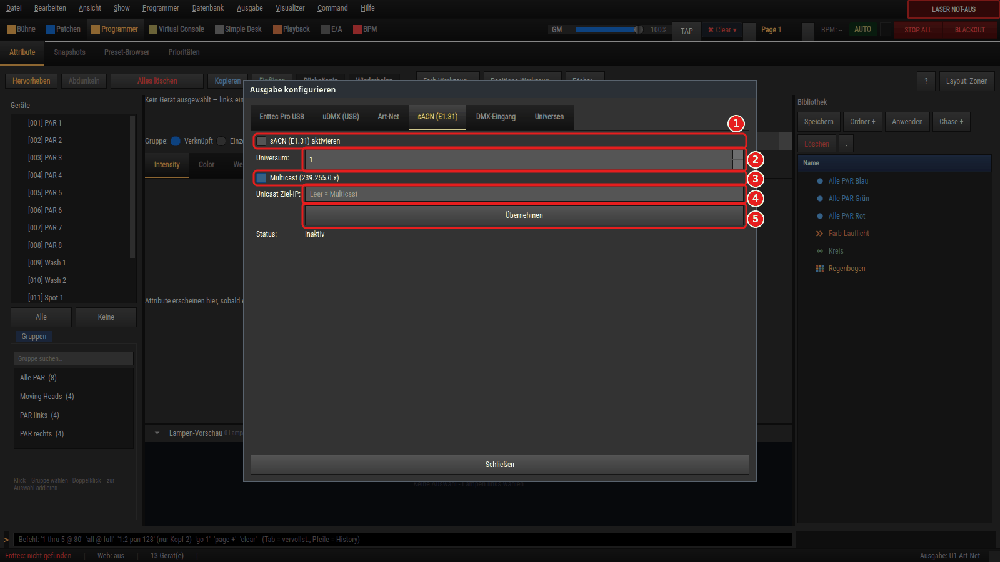

1. **sACN (E1.31) aktivieren** (enable sACN (E1.31)) — tick the box (without the tick,
   **Übernehmen** removes the sACN output again).
2. **Universum:** — the LightOS universe. It sends on the sACN universe number with the
   same number.
3. **Multicast (239.255.0.x)** — the default. Every sACN receiver on the network that
   listens to this universe gets the data.
4. **Unicast Ziel-IP:** (unicast target IP) — only when the Multicast box is
   **unticked**: the address of a single receiver. If it stays empty, it is multicast.
5. **Übernehmen** — sets up the output and saves it; the status reads, for example,
   `Aktiv · Multicast (239.255.0.x) · Universum 1 (gespeichert)`.

## 5. All universes at once: the Universen tab

Tab **Universen** — here you see and edit all outputs in one table:

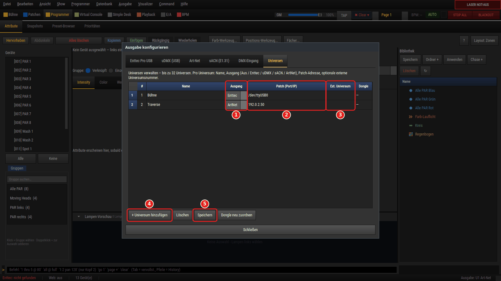

Each row is one universe: **#** (1–32), **Name** (free to choose) and:

1. **Ausgang** (output) — `Aus` (off), `Enttec`, `uDMX`, `sACN` or `ArtNet`.
2. **Patch (Port/IP)** — depending on the output: for `Enttec` the port (`COM3`,
   `/dev/ttyUSB0`), for `ArtNet` the target IP (empty = `255.255.255.255`), for `sACN` a
   unicast IP (empty = multicast), for `uDMX` the adapter key (for example
   `2008:1066@1-2`; easiest to have the **uDMX (USB)** tab enter it).
3. **Ext. Universum** (external universe) — optionally the universe number on the network. If empty, the
   default applies: Art-Net `#` minus 1, sACN `#`.
   **Dongle** (read-only) — for `Enttec` the serial number of the adapter this universe
   looks for, shortened (`Seriennr. …5123`). LightOS remembers it once the adapter has
   sent, and finds it by it even at another port after a restart — two ENTTECs do not
   swap their universes when Linux swaps the port numbers. If you **deliberately pick a
   different port** for the row (here or with **Verbinden** on the Enttec tab), the old
   number no longer applies: the universe learns the adapter at the new port. To make the
   universe use a **different** adapter: select the row, **Dongle neu zuordnen**
   (reassign dongle; or right-click the row) and **Speichern** — it then learns the
   adapter plugged into its port.
   **Check once after the update:** an older configuration remembers, at its first
   start, the adapter that is plugged into its port at that moment. If the ports were
   swapped just then, the **Dongle** column shows the other adapter's number — use
   **Dongle neu zuordnen** and **Speichern**.
4. **+ Universum hinzufügen** (add universe) — new row (32 at most). **Löschen** (delete)
   removes the selected rows from the table; this only takes effect with **Speichern**
   (save).
5. **Speichern** — writes `universes.json` (in the LightOS data folder) and applies the configuration
   **immediately**, without a restart. As confirmation LightOS shows the path of the
   file.

When saving, LightOS checks the table and speaks up if

- a **#** is outside 1–32 (*Universumsnummer angepasst* = universe number adjusted),
- a number under **Ext. Universum** does not fit the output type (*Externe Universumsnummer angepasst*
  = external universe number adjusted),
- **two rows end up at the same target** (*Zwei Universen auf demselben Ziel* = two
  universes on the same target). This leads to flickering at the receiver; it is saved
  anyway. What counts as "the same target" is explained in
  [Zwei Universen über zwei Adapter](../anleitung_zwei_universen/ANLEITUNG.md#hinweis-zwei-universen-auf-demselben-ziel)
  (German).
- **the same adapter is in several rows** (*Ein Adapter auf mehreren Universen* = one
  adapter on several universes) — that is, `Enttec` twice with the same port or `uDMX` twice with the same adapter. One adapter
  sends only one universe. It is saved anyway, but the adapter is then set up for
  **none** of them until only one row names it. The quickest fix is the **Enttec Pro
  USB** tab: choose the universe and click **Verbinden** (step 2).

## 6. Check: the Output monitor

Section **E/A** (input/output), tab **Output**. In the picture PAR 1–4 of the
documentation demo show are set to red and PAR 5–8 to blue, each with a full dimmer:

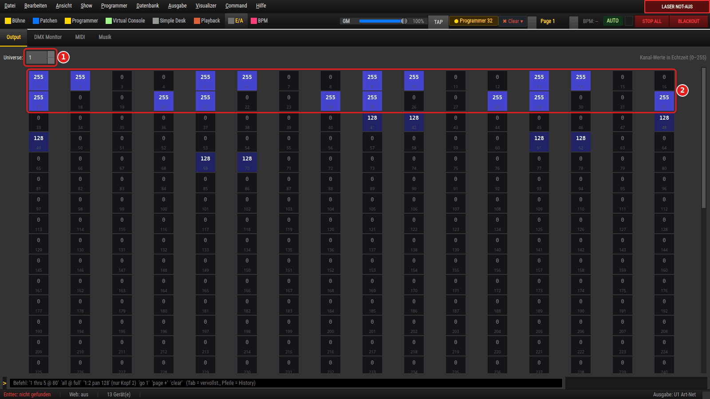

1. **Universum:** (universe) — which universe is shown (1–32).
2. One tile per channel: the value at the top (0–255), the channel number small at the
   bottom. Channels above 0 have a blue background. PAR 1 occupies channels 1–4 here
   (dimmer, red, green, blue): `255 255 0 0`.

What is shown is what is sent — that is, already including grand master and blackout.

## 7. Check: the DMX Monitor

Tab **DMX Monitor** next to it — the same values, but with fixture names:

1. **Universum:** (universe) — choice of `Universum 1` to `Universum 32`.
2. **Hervorgehobene Kanäle:** (highlighted channels) — for example `1,5,10-20`; these
   channels get a yellow frame.
3. The output display says the same as the status bar and the banner (step 8):

   | Display | Meaning |
   |---|---|
   | `Universum 1 geht raus` (is going out; green) | The universe has an output, and it is sending. |
   | `⚠ Universum <n>: <Weg> sendet NICHT` (\<route> is NOT sending; red) | The output is set up but is not sending – for example an ENTTEC whose port cannot be opened. The tooltip gives the reason. |
   | `Universum <n>: <Weg> verbindet …` (is connecting; orange) | The port is being opened right now. |
   | `⚠ Universum <n> hat keinen Ausgang — nur gerechnet` (has no output — only calculated; orange) | The values are calculated, but no adapter outputs them. |
   | `Universum <n> ist nicht angelegt — keine Werte` (does not exist — no values; grey) | Nothing is patched in this universe and no output is set up. The grid is then dimmed and empty. |

   If a universe has **several outputs** (for example ENTTEC and Art-Net), the choice
   **Ausgang:** (output) appears next to it – the monitor shows what goes to the chosen
   output. The outputs only send different data while the laser emergency stop locks
   one of them; the display then adds
   `· NOT-AUS-Sperre auf diesem Ausgang: <n> Adressen` (emergency-stop lock on this
   output: \<n> addresses).
4. The legend: blue frame = patched, yellow frame = highlighted. Each patched tile
   carries an abbreviation of fixture and channel, for example `PAR 1 R`.

**The monitor shows values, but the fixture stays dark?** Then the problem lies on the
way out, not in the patch: wrong port, wrong target IP, wrong network (below) or a
different DMX address set on the fixture.

**This is what BLACKOUT looks like in the monitor.** In the picture the PARs are set as
above, the moving heads are lit and set to pan 200 / tilt 60. Then **BLACKOUT** was
pressed in the header bar:

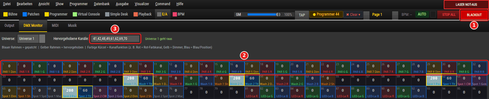

1. **BLACKOUT** is latched (red).
2. All PAR channels are at 0 — dimmer and colour.
3. Under **Hervorgehobene Kanäle:** the pan/tilt channels of the four moving heads are
   entered here. They keep their values (200 and 60), only their dimmer goes to 0. So
   the heads stay where they are and do not first drive back when you release the
   blackout.

Fixtures without a dimmer channel and fog machines go completely to 0 during a
blackout. **Lasers** get the **off value from their fixture profile** (for example the
operating mode “Laser off”), all their other channels go to 0. The off value is not
always 0 — so after a blackout the DMX monitor does not necessarily show 0 on every
laser channel. If the profile knows no off value, a laser may keep emitting (details,
including the **laser emergency stop** LASER NOT-AUS, in the
[laser manual](../anleitung_laser/ANLEITUNG_LASER.md#blackout-ziel-blackout-und-not-aus)).

## 8. Reading warnings in the status bar

The status bar reports permanently whether something is not going out. In the picture,
Universe 1 had its output removed while fixtures are patched on it:

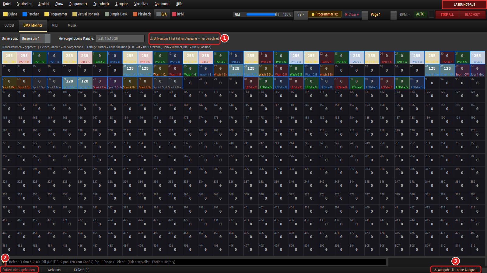

1. The DMX Monitor reports `⚠ Universum 1 hat keinen Ausgang — nur gerechnet`.
2. **Enttec indicator** at the bottom left:

   | Display | Meaning |
   |---|---|
   | `Enttec: nicht gefunden` (red) | No ENTTEC set up and none plugged in. Without an ENTTEC (pure Art-Net/sACN) this is normal. |
   | `Enttec: <Port> erkannt, kein Universum` (= detected, no universe; orange) | The adapter is plugged in, but no universe outputs through it → assign one in step 2 or 5. |
   | `FTDI-Adapter <Port> erkannt (Typ unklar), kein Universum` (= FTDI adapter detected, type unclear, no universe; orange) | An adapter with an FTDI chip that does not identify itself as an ENTTEC is plugged in, and no universe outputs through it. If it is Pro-compatible, set it up like an ENTTEC (step 2) and check with the test signal; plain "Open DMX" cables are not supported yet. |
   | `Enttec: <Port> verbindet …` (= connecting …; orange) | The port is being opened right now. If it stays like that, the adapter cannot be reached. |
   | `Enttec: <Port> aktiv (1 Universum)` (= active; green) | Set up, and the adapter is sending. |
   | `Enttec: <Port> sendet NICHT (Universum <n>)` (= is NOT sending; red) | Set up, but the port is not open — no DMX is going out. Check the USB cable and the port. |
   | `Enttec: falsch konfiguriert` (= misconfigured; orange) | The port entered cannot be right on this computer (e.g. a Windows `COM` port on Linux), or the same adapter is on several universes and is therefore set up for none of them. The tooltip gives the reason. |

3. **Output indicator** at the bottom right: normally a list such as
   `Ausgabe: U1 Art-Net` (*Ausgabe* = output; three entries at most, the rest as `+n`).
   With `⚠` and in orange: `U<n> ohne Ausgang` (U\<n> without output) — fixtures are
   patched there, but no output is set up. Red if an output that has been set up is not
   sending. `Ausgabe: —` means no universe outputs anything at all. The tooltip of the
   indicator gives the details in each case.

A click on the Enttec indicator opens the dialog from step 1 directly.

**Banner at the top of the window.** If an output that has been set up fails (ENTTEC
unplugged, network gone), a red bar `Ausgabe gestört: U<n> <Weg> — <Grund>` (output
disturbed: universe, path, reason) also appears at the top of the main window — in kiosk
mode too, where the status bar is hidden. It disappears by itself once the output has been
sending again for a few seconds; a click on the text opens the dialog from step 1 (not in
kiosk mode). If **no** output is set up at all, a subtle `Probenmodus — es wird kein DMX
gesendet` (rehearsal mode — no DMX is being sent) is shown there.

The bar lies **on top of** the upper edge of the view currently shown, directly below the
bar with STOP ALL, BLACKOUT and the grand master (in kiosk mode below the strip with
the grand master, STOP ALL, BLACKOUT and the laser emergency stop). It does not push anything down: when it appears or disappears, all
buttons of the Virtual Console and all other controls stay where they are. In return it
covers a narrow line at the top of the view. A click on the bar does not trigger anything
underneath it. The bar is always a single line high; a text that is too long is shortened
with "…", and the full text is in the tooltip. The fault message can be collapsed
(next paragraph) but not clicked away while the fault persists. The popped-out Virtual
Console window and the 3D window do not
show the bar.

**Collapsing the bar.** The bar covers the top row of the view. So that you can keep working
during a fault, it can be made smaller – the fault message cannot be removed completely
while the fault persists:

- Click `▴ einklappen` (collapse) at the right end of the bar. In kiosk mode and for the
  rehearsal hint, a click anywhere on the bar is enough. By keyboard: move to the bar with
  the Tab key and press Enter.
- Instead of the bar there is then a small chip: red `⚠ Ausgabe gestört ▾`, or a subdued
  `Probenmodus ▾` for the rehearsal hint. In the Virtual Console it sits at the right end of
  the "Aktiver Effekt" (active effect) line between the toolbar and the buttons and covers
  neither a toolbar button nor a console button there; in the other views it lies in the top
  right corner. The tooltip gives the full text of the fault.
- A click on the chip (or Enter) expands the bar again.
- On a **new** fault the bar expands by itself: when a different or an additional output
  fails, when the reason changes, or when the same fault was gone for more than 10 seconds
  and returns. A loose contact that returns within 10 seconds counts as the same fault – the
  chip then stays small so that the bar does not keep jumping over the buttons.
- When the fault ends, bar and chip disappear by themselves.
- The collapsed state is not saved: after a restart the full bar is shown again. Status bar
  and DMX monitor show the fault unchanged.

The same red bar appears if the saved configuration has **one adapter on several
universes** (`… — steht auf Universum 1 und 2, für keines eingerichtet` = is on universes 1
and 2, set up for none). LightOS does not guess which one was meant and sets the adapter
up for none of them — otherwise a rig might receive the values of another universe. To
fix it: choose the right universe in the **Enttec Pro USB** tab and click **Verbinden**.

## 9. What goes out when you quit or remove an output

Many adapters hold the last frame they received even when no program is sending
any more – an ENTTEC DMX USB Pro or a uDMX adapter as well as most Art-Net and
sACN nodes. So that
nothing keeps shining after LightOS is closed, LightOS sends **one last frame**
first:

- **On quit:** every output gets a frame like a blackout – all light channels to
  0, lasers to their **off values** (not simply 0, see the laser guide).
  Pan/tilt, gobo and optics of moving heads with a dimmer stay where they are, so
  the heads do not travel to their home position.
- **When an output is removed** (universe deleted, output set to „Aus“ (off),
  Art-Net or sACN unticked): the same frame to exactly that output.
- **When you switch to a different adapter:** if you move a universe from ENTTEC
  to Art-Net, to another port, another uDMX adapter, another target IP or
  another universe number on the network, the **previous** adapter or node gets
  the same last frame – otherwise it would hold whatever it received last.
- **Not on „Übernehmen“** (apply) **without a change:** the same output follows
  immediately there, and a dark frame would be a flash on stage.

If an adapter does not respond (unplugged, driver hanging), LightOS waits about
one second at most and then quits anyway. That one adapter gets no last frame –
all others do.

**Lasers that are taken out of the patch.** If you remove a laser from the
patch, give it another address or load a show without it, the device still
listens on its previous address. If that address dropped to 0, some lasers would
switch **on** (for many, DMX 0 means "auto run") – and LightOS could no longer
control them. So the laser's **off value** stays on its previous address, also
during a blackout and in the last frame on quit, until

- the address is patched again (then the new fixture decides), or
- LightOS is closed.

This applies only to addresses whose off value is not 0. While such a value is
held, nothing else goes out on that address – not even a value from a script or
from the Simple Desk. The DMX Monitor shows the held value.

**How to free the address again:** patch a fixture onto that address – from
then on it decides what goes out there (if you take it out of the patch again,
the address is free and at 0). Or quit LightOS and start it again: after a
restart nothing is held any more. There is deliberately no button to release
it. Switch the laser off at the device first, or give it another address
there – otherwise it keeps listening on the old one.

> **Important:** the last frame is no substitute for a main switch. If the
> computer crashes or the power fails, nobody sends anything any more, and an
> adapter holds whatever it received last. Lasers therefore belong on their own
> reachable switch at the device.

## Network pitfall with Art-Net and sACN

The computer must be **on the same network** as the node. If the node has `192.0.2.50`,
the computer's network card needs an address `192.0.2.x` (mask `255.255.255.0`).
A common mistake: a USB network adapter without DHCP only gets an address `169.254.x.x` —
then Art-Net does not reach the node, even though the dialog reports „Aktiv" (active).
The fix: give the adapter a fixed address in the node's network and check it with
`ping 192.0.2.50`. If the computer has several cards (Wi-Fi and lighting network),
choose the right **Netzwerkkarte:** in step 3.

More about Art-Net (port 6454, universe numbers): [ARTNET.md](../ARTNET.md) (German).
Basics of DMX and universes: [DMX_PROTOCOL.md](../DMX_PROTOCOL.md) (German).

## Receiving DMX: the firewall prompt

Sending needs no permission, **receiving** does. As soon as you switch on the Art-Net or
sACN input (or the **Fernsteuerung**, remote control) in the **DMX-Eingang** tab, LightOS
listens on UDP 6454 (Art-Net) or 5568 (sACN).

- **Windows** then asks once with a "Windows Security Alert" whether `LightOS.exe` may
  receive data from the network. LightOS announces this beforehand: a note sits at the top
  of the tab, and the first tick shows a short window once. For a console on the same
  network: **Allow** (private network). Without permission only what is sent on this
  computer itself arrives. Every answer creates a rule in Windows — you can change it under
  Windows Security → Firewall & network protection → "Allow an app through firewall".
- **Linux** does not ask. If a firewall is active (e.g. `ufw`), it blocks silently;
  `sudo ufw status` shows whether it is running.
- **macOS** asks on the first incoming data if its firewall is switched on.

LightOS itself changes nothing in the firewall.

**Empfangen auf:** (receive on, at the top of the **DMX-Eingang** tab) sets where LightOS
listens. The choice applies to the Art-Net and sACN input and the remote control together,
takes effect immediately and is saved on this computer:

| Choice | What arrives | Windows prompt |
|---|---|---|
| **Alle Netzwerkkarten (Vorgabe)** (all network cards, default) | everything, as before | yes |
| one network card, e.g. `eth1 — 192.0.2.10` | only what comes in through this card; sACN joins its multicast groups there | yes |
| **Nur dieser Rechner (127.0.0.1)** (this computer only) | only a second program on the same computer; sACN only as unicast to `127.0.0.1` | no |

If **nothing at all** arrives for 5 seconds after switching on, the input's status line
(and the Mitschnitt assistant) names the firewall as a possible cause and says where to
check the permission. If something arrived before, it is not the firewall.
In detail for Windows: [Netzwerk vorbereiten (Windows)](../anleitung_netzwerk_windows/ANLEITUNG.md) (German).

## Further reading

- [Supported DMX interfaces](INTERFACES.md) (German) — compatibility list, driver links
  and "Ethernet→DMX with a LAN cable straight to the PC" step by step. The button
  **Interface einrichten…** above the tabs opens an assistant that shows which DMX
  interfaces are connected and what each one needs. LightOS never installs drivers.
- [Zwei Universen über zwei Adapter](../anleitung_zwei_universen/ANLEITUNG.md) (German)
  — ENTTEC on Universe 1 and Art-Net on Universe 2 step by step, with the rules for
  duplicate targets.
- [Enttec und Art-Net gleichzeitig](../anleitung_enttec_artnet/ANLEITUNG_ENTTEC_ARTNET.md)
  (German) — the same principle with a second example.
- [Erste Schritte](../anleitung_erste_schritte/ANLEITUNG.md) (German) — create a show,
  patch a fixture, first value in the Programmer.

<!-- Bilder: venv/bin/python tools/anleitungsbilder.py ausgabe_einrichten (docs/ANLEITUNGSBILDER.md) -->
