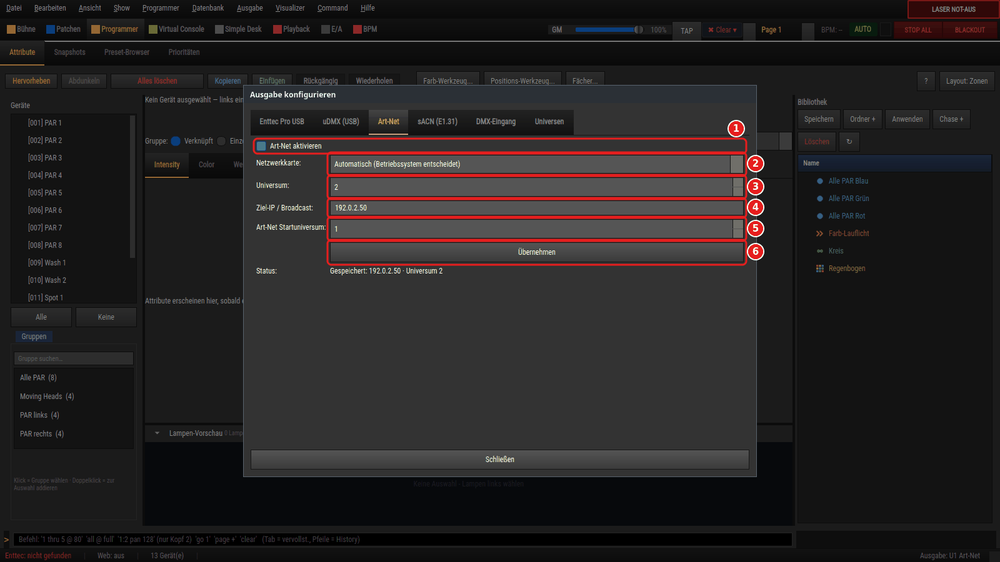
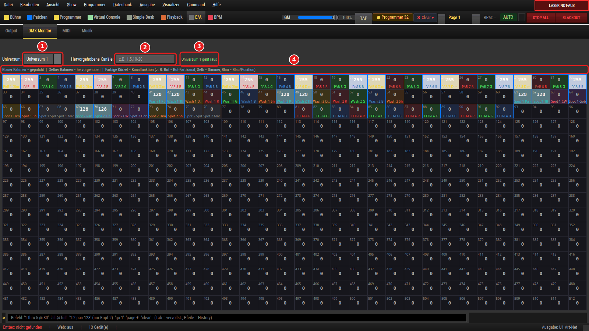

# Externe Pulte über Netzwerk und MIDI

> LightOS kann **neben** einem externen Lichtpult laufen: Es schickt DMX über das Netzwerk
> an das Pult, es nimmt DMX vom Pult an und mischt es ein, und es lässt sich vom Pult aus
> Cues auslösen. Diese Anleitung zeigt die drei Aufbauten, die Einstellungen dazu und die
> Grenzen. Sie beschreibt nur, was im Programm vorhanden ist.

Gemeint sind Lichtpulte, die **Art-Net**, **sACN (E1.31)** oder **MIDI Show Control (MSC)**
sprechen — zum Beispiel grandMA2/grandMA3, ChamSys, Hog 4, ETC Eos oder Avolites Titan; diese
Namen sind Marken ihrer Hersteller, LightOS ist mit keinem davon verbunden und von keinem
geprüft oder freigegeben. Was dein Pult davon sendet und empfängt und wie es dort
eingestellt wird, steht in dessen Handbuch — diese Anleitung beschreibt die LightOS-Seite.

**Bitte zuerst lesen:** [Was nicht geht](#2-was-nicht-geht) und
[Stand der Erprobung](#8-stand-der-erprobung).

---

## 1. Wofür das gut ist: drei Aufbauten

### Aufbau A — das Pult ist Chef, LightOS liefert zu

LightOS rechnet ein Universum und **sendet** es per Art-Net oder sACN. Das Pult empfängt
es und mischt es in seine eigene Ausgabe ein. Typisch: LightOS steuert eine Matrix oder
Effekte bei, die Geräte hängen am Pult.

```
  LightOS-Rechner                     externes Pult                  Geräte
 ┌───────────────┐  Art-Net / sACN   ┌──────────────┐     DMX      ┌────────┐
 │ rechnet U1    │ ────────────────► │ mischt ein   │ ───────────► │ Lampen │
 └───────────────┘     (Netzwerk)    └──────────────┘              └────────┘
```

### Aufbau B — LightOS ist Chef, das Pult liefert zu

Das Pult sendet Art-Net oder sACN. LightOS **empfängt** es, mischt es in ein eigenes
Universum (HTP, LTP oder REPLACE) und gibt das Ergebnis an die Geräte aus.

```
  externes Pult                      LightOS-Rechner                 Geräte
 ┌──────────────┐  Art-Net / sACN   ┌────────────────┐  ENTTEC /   ┌────────┐
 │ sendet DMX   │ ────────────────► │ DMX Input      │  Art-Net /  │ Lampen │
 └──────────────┘     (Netzwerk)    │ + eigenes Bild │ ──────────► └────────┘
                                    └────────────────┘    sACN
```

### Aufbau C — das Pult löst in LightOS Cues aus

Das Pult sendet **MIDI Show Control**: über ein MIDI-Interface (5-polig oder USB-MIDI am
LightOS-Rechner) oder, in einem bestimmten Paketformat, über das Netzwerk. LightOS führt
daraufhin GO, STOP und Fader-Befehle auf seinen Executoren aus. DMX gibt jede Seite selbst
aus.

```
  externes Pult                       LightOS-Rechner                Geräte
 ┌──────────────┐  MSC über MIDI    ┌─────────────────┐            ┌────────┐
 │ GO / STOP    │ ────────────────► │ Executor / Cue- │ ─────────► │ Lampen │
 │              │  oder UDP 6004    │ liste           │   DMX      └────────┘
 └──────────────┘                   └─────────────────┘
```

Die Aufbauten lassen sich kombinieren, zum Beispiel B und C.

## 2. Was nicht geht

- **Kein Anschluss über das USB-Kabel des Pults.** LightOS sieht nur, was sich beim
  Betriebssystem als MIDI-Port meldet, und was als Art-Net, sACN oder OSC über das
  Netzwerk kommt. Ein Pult, das per USB am Rechner hängt, ist damit nicht verbunden.
- **Tasten und Fader eines Pults sind kein MIDI-Controller für LightOS.** Das gilt auch
  für herstellereigene Erweiterungen (Wings, Faderbänke): Sie sprechen mit ihrem Pult,
  nicht mit LightOS. Ein Fader erreicht LightOS nur, wenn das Pult selbst daraus MIDI,
  MSC, OSC oder DMX macht und sendet.
- **LightOS steuert kein fremdes Pult fern.** Nach außen gehen DMX-Daten per Art-Net und
  sACN. LightOS sendet kein MSC und drückt auf dem Pult keine Tasten.
- **Herstellereigene Sitzungsprotokolle werden nicht gesprochen.** LightOS tritt keiner
  Pult-Sitzung bei, tauscht keine Showdaten aus und ist kein Backup-Pult. Es antwortet
  auch nicht auf die Art-Net-Gerätesuche (ArtPoll): In der Geräteliste des Pults taucht
  LightOS nicht von selbst auf — Adresse und Universum trägst du von Hand ein.
- **Kein Auslösen über Timecode.** LightOS zeigt eingehenden MIDI-Timecode an
  (Sektion **E/A** → Reiter **MIDI** → **MTC - MIDI Time Code Reader**: Zeit und Bildrate),
  löst damit aber nichts aus.
- **Der DMX-Eingang nimmt je Protokoll ein Universum an:** eines über Art-Net und eines
  über sACN. Stellst du ein anderes eingehendes Universum ein, ersetzt es das vorherige.
- **Der DMX-Eingang wird nicht gespeichert.** Nach jedem Programmstart schaltest du ihn
  neu ein (Schritt 4, Aufbau B). Ausgänge und MSC-Einstellungen bleiben gespeichert.

## 3. Vorbereitung: das Netzwerk

**Kabel.** Pult und LightOS-Rechner hängen am selben Switch oder direkt per Netzwerkkabel
aneinander. WLAN funktioniert, für den Live-Betrieb ist Kabel die sichere Wahl.

**Adressen.** Beide Geräte brauchen eine Adresse im **selben Bereich**. Viele Pulte und
Art-Net-Geräte arbeiten ab Werk im Bereich `2.x.x.x` oder `10.x.x.x` mit der Maske
`255.0.0.0`: Dann zählt nur die erste Zahl als Netz, alle Geräte mit derselben ersten Zahl
erreichen sich. In einem üblichen Hausnetz (`192.168.1.x`, Maske `255.255.255.0`) müssen
die ersten drei Zahlen gleich sein.

| Beispiel | Pult | LightOS-Rechner | Maske |
|---|---|---|---|
| Art-Net-Bereich | `2.0.0.10` | `2.0.0.20` | `255.0.0.0` |
| Art-Net-Bereich | `10.0.0.10` | `10.0.0.20` | `255.0.0.0` |
| Hausnetz | `192.168.1.10` | `192.168.1.20` | `255.255.255.0` |

Die Adressen sind Beispiele. Jede Adresse darf im Netz nur einmal vorkommen. Wie du dem
Rechner eine feste Adresse gibst, zeigt für Windows
[Netzwerk vorbereiten (Windows)](../anleitung_netzwerk_windows/ANLEITUNG.md#3-feste-adresse-für-das-lichtnetz).

**Netzwerkkarte in LightOS.** Hat der Rechner mehrere Karten (WLAN und Lichtnetz), wähle
im Dialog **Ausgabe konfigurieren**, Reiter **Art-Net**, unter **Netzwerkkarte:** die
Karte im Pult-Netz. Die Wahl gilt für das **Senden** von Art-Net und sACN. Der Eingang
lauscht auf allen Karten.

**Firewall.** Für das Senden (Aufbau A) braucht es in der Regel keine Freigabe. Für alles,
was LightOS **empfängt**, muss die Firewall des Rechners eingehende Pakete durchlassen:

| Funktion | Eingehend freizugeben | Aufbau |
|---|---|---|
| Art-Net-Eingang | UDP 6454 | B |
| sACN-Eingang | UDP 5568 | B |
| MSC über Netzwerk | UDP 6004 (oder der Port, den du im Feld **Port:** einträgst) | C |
| MSC über ein MIDI-Interface | nichts — das läuft nicht über das Netzwerk | C |

Gib die Ports nur für das Lichtnetz frei, nicht für öffentliche Netze. Die Schritte für
Windows stehen in
[Netzwerk vorbereiten (Windows)](../anleitung_netzwerk_windows/ANLEITUNG.md#4-firewall-freigaben-anlegen).
LightOS ändert selbst keine Firewall- oder Netzwerkeinstellungen.

## 4. Schritt für Schritt

Alle DMX-Einstellungen stehen im Dialog **Ausgabe konfigurieren**: Menü **Ausgabe** →
**Konfigurieren...**. Die MSC-Einstellungen stehen in der Sektion **E/A**, Reiter **MIDI**.

### Aufbau A — LightOS sendet an das Pult

**Mit Art-Net** (Reiter **Art-Net**):



*Das Bild stammt aus [Ausgabe einrichten](../anleitung_ausgabe_einrichten/ANLEITUNG.md#3-art-net);
die roten Zahlen gehören zum Text dort.*

1. **Art-Net aktivieren** anhaken.
2. **Netzwerkkarte:** die Karte im Pult-Netz wählen.
3. **Universe:** das LightOS-Universum, das an das Pult gehen soll.
4. **Ziel-IP / Broadcast:** die Adresse des Pults (zum Beispiel `2.0.0.10`) — dann geht
   das Universum nur an das Pult (Unicast). Mit `255.255.255.255` oder leerem Feld geht es
   als Broadcast an alle im Netz; ist eine Netzwerkkarte gewählt, an den Broadcast dieser
   Karte.
5. **Art-Net Startuniversum:** die Art-Net-Universumsnummer, auf der das Pult hört.
   Vorbelegt ist LightOS-Universum minus 1 — Universe 1 sendet auf Art-Net-Universum `0`.
6. **Übernehmen**. Der Status zeigt `Aktiv → <Adresse> · Universe <n> (gespeichert)`.

**Mit sACN** (Reiter **sACN (E1.31)**):

1. **sACN (E1.31) aktivieren** anhaken.
2. **Universe:** das LightOS-Universum. Es sendet auf die sACN-Universumsnummer mit
   derselben Zahl; eine andere Nummer trägst du im Reiter **Universen** in der Spalte
   **Ext-Universe** ein.
3. **Multicast (239.255.0.x)** angehakt lassen — oder den Haken entfernen und unter
   **Unicast Ziel-IP:** die Adresse des Pults eintragen.
4. **Übernehmen**.

LightOS sendet sACN mit der festen Priorität 100; einstellbar ist sie nicht.

**Am Pult** richtest du den passenden Eingang ein und legst fest, wie er eingemischt wird.
Das ist Sache des Pults. Alle Felder des Dialogs erklärt
[Ausgabe einrichten](../anleitung_ausgabe_einrichten/ANLEITUNG.md).

### Aufbau B — LightOS empfängt vom Pult

1. **Ziel festlegen:** Das LightOS-Universum, in das gemischt wird, braucht selbst einen
   Ausgang (ENTTEC, Art-Net, sACN …). Sonst kommt das Mischergebnis nirgends heraus.
2. Reiter **DMX Input** öffnen. Er hat zwei Kästen: **Art-Net Input** und **sACN Input**.
   Beide sind gleich aufgebaut.
3. **Art-Net Input aktivieren** bzw. **sACN Input aktivieren** anhaken.
4. **Eingehendes Universe:** die Nummer, auf der das Pult sendet. Bei Art-Net zählt LightOS
   hier ab 1: Sendet das Pult auf Art-Net-Universum `0`, trägst du `1` ein. Bei sACN gilt
   die Nummer unverändert.
5. **Merge in Universe:** das LightOS-Universum (1–32), in das gemischt wird.
6. **Merge-Modus:** wählen — siehe Tabelle.
7. **Übernehmen**. Der Status zeigt `Aktiv: U<ein> -> U<ziel> (<Modus>)`.

| Merge-Modus | Was LightOS je Kanal ausgibt |
|---|---|
| `HTP` | Den **höheren** Wert aus LightOS-Bild und Pult. Passt für Dimmer: Beide Seiten können hochziehen, keine kann die andere dunkel machen. |
| `LTP` | Den Wert **vom Pult**. Er ersetzt den LightOS-Wert auf jedem Kanal, den das Pult sendet — auch mit 0. |
| `REPLACE` | Wie `LTP`: Der Wert vom Pult ersetzt den LightOS-Wert. Beide Modi verhalten sich derzeit gleich. |

Der Modus gilt **je Ziel-Universum**. Ein Pult sendet in der Regel alle 512 Kanäle eines
Universums; mit `LTP` oder `REPLACE` bestimmt es dann das ganze Universum, solange es
sendet. Soll LightOS einzelne Kanäle behalten, nimm `HTP` oder gib dem Pult ein eigenes
Universum.

Gut zu wissen:

- Das Pult-Signal wird **nach** dem Dimmer-Master von LightOS eingemischt, ein
  Submaster in LightOS regelt es also nicht herunter. Grand Master und Blackout wirken
  erst beim Senden und damit auch auf das eingemischte Signal (siehe [Sicherheit](#6-sicherheit)).
- Der Eingang unterscheidet **keine Absender**. Senden zwei Geräte auf demselben
  eingehenden Universum, wechseln sich ihre Bilder ab — das flackert.
- Steht im Status `Aktiv, aber wirkungslos (U<n> nicht als Output gepatcht)`, gibt es das
  Ziel-Universum in LightOS nicht. Lege es im Reiter **Universen** an.
- Haken entfernen und **Übernehmen** stoppt den Empfang (Status `Gestoppt`).

### Aufbau C — das Pult löst Cues aus (MIDI Show Control)

Sektion **E/A** → Reiter **MIDI** → Kasten **MIDI Show Control (MSC)**.

| Bedienelement | Bedeutung | Vorgabe |
|---|---|---|
| **MSC an** | MSC-Befehle annehmen — über MIDI und über Netzwerk. | an |
| **Device-ID:** | Eigene MSC-Geräte-ID, 0–127. `127` nimmt alle an. Befehle, die das Pult an „alle“ (127) richtet, kommen immer an. | 127 |
| **GMA-MSC über Netzwerk** | MSC zusätzlich per UDP empfangen. | **aus** |
| **Schnittstelle:** | Netzwerkkarte, auf der gelauscht wird: `nur dieser Rechner (127.0.0.1)`, eine Karte mit ihrer Adresse oder `alle Schnittstellen (0.0.0.0)`. | nur dieser Rechner |
| **Port:** | UDP-Port für MSC über Netzwerk. | 6004 |
| **SET-Belegung:** | Wie der Befehl SET gelesen wird: `grandMA (Executor, Seite)` oder `Standard (14-Bit-Regler)`. | der erste Eintrag |
| **alle Formate annehmen** | Aus: nur Befehle für Licht (Command-Format 01–0F) und „alle“ (7F). An: auch Befehle für Ton, Maschinerie, Video usw. lösen aus. | aus |
| **Übernehmen** | Speichert die Einstellungen für diesen Rechner und startet oder stoppt den Netzwerkempfang. | |

**Weg 1 — über ein MIDI-Interface:**

1. MIDI-Ausgang des Pults mit einem MIDI-Eingang am LightOS-Rechner verbinden.
2. Im Kasten **MIDI-Geräte** unter **Eingang:** das Interface wählen und **Eingang öffnen**
   drücken. Beim Programmstart öffnet LightOS vorhandene MIDI-Eingänge von selbst.
3. **MSC an** muss angehakt sein. **Device-ID:** auf die ID stellen, an die das Pult
   sendet, oder auf `127` lassen.
4. Am Pult MSC-Ausgabe über MIDI einschalten.

**Weg 2 — über das Netzwerk:**

1. **GMA-MSC über Netzwerk** anhaken.
2. **Schnittstelle:** die Karte im Pult-Netz wählen. Mit `nur dieser Rechner (127.0.0.1)`
   erreicht kein Pult im Netz LightOS — der Kasten zeigt dazu einen Hinweis. Mit
   `alle Schnittstellen (0.0.0.0)` kann jedes Gerät in jedem angeschlossenen Netz Cues
   auslösen.
3. **Port:** auf den Port stellen, an den das Pult sendet (Vorgabe 6004).
4. **Übernehmen**. Im **MIDI Monitor** steht `GMA-MSC: lausche auf <Adresse>:<Port>` —
   oder `GMA-MSC Fehler: … nicht belegbar`, wenn der Port schon belegt ist.
5. Am Pult MSC über Netzwerk einschalten, mit der Adresse des LightOS-Rechners und
   demselben Port.

Der Netzwerkweg versteht **ein** Paketformat: UDP-Pakete, die mit der Kennung `GMA`
und `MSC` beginnen und darin die MSC-Nachricht tragen. Pulte, die MSC anders über das
Netzwerk schicken, erreichen LightOS nur über Weg 1. Der Empfang ist ungeschützt — wer
im Netz den Port erreicht, kann Cues auslösen. Deshalb ist er ab Werk aus.

**Was die Befehle in LightOS tun:**

| MSC-Befehl | Wirkung in LightOS |
|---|---|
| GO | Mit Cue-Nummer: springt in der Cueliste des Executors zu dieser Cue. Ohne Cue-Nummer: wie die GO-Taste des Executors. |
| TIMED_GO | Wie GO. Die mitgesendete Zeit wird nicht ausgewertet; es gelten die Zeiten der Cue in LightOS. |
| RESUME | Wie GO. |
| STOP, GO_OFF | Mit Cue-Liste: Stop des zugehörigen Executors. Ohne Cue-Liste: stoppt alle laufenden Executoren. |
| ALL_OFF | Stoppt alle laufenden Executoren. |
| SET | Setzt den Fader eines Executors (siehe **SET-Belegung:**). |
| FIRE | Makro-Nummer *n* startet die LightOS-Funktion mit der Nummer (ID) *n*. |
| LOAD, RESTORE, RESET | Werden erkannt, lösen aber nichts aus. |

**Welcher Executor gemeint ist**, bestimmt das Feld „Cue-Liste“ des MSC-Befehls:

- eine **Zahl** → der Executor mit dieser Nummer auf der aktuellen Executor-Seite,
- ein **Name** → der Executor mit dieser Beschriftung oder der Executor, dessen Cueliste
  so heißt (Groß-/Kleinschreibung egal),
- **leer** → Executor 1.

Der Executor braucht eine Cueliste, sonst geschieht nichts. Eine Cue-Nummer, die es in der
Liste nicht gibt, bewirkt ebenfalls nichts. Wie du eine Cueliste auf einen Executor legst,
zeigt [Szenen, Snaps & Cue-Listen](../anleitung_szenen_cues/ANLEITUNG.md).

**SET-Belegung:** In der Vorgabe liest LightOS die vier Datenbytes als Executor (ab 0),
Seite (ab 1) und Wert in Prozent und setzt den Fader auf der genannten Executor-Seite.
`Standard (14-Bit-Regler)` liest Reglernummer *n* und setzt den Fader von Executor *n*+1
der aktuellen Seite, Wert 0–16383. Gibt es den Executor oder die Seite nicht, schreibt
LightOS einen Hinweis ins Diagnose-Protokoll.

### Nebenweg: OSC

Kann dein Pult OSC senden, erreicht es LightOS auch darüber: Menü **Ausgabe** →
**OSC-Server (Port 7770)**. LightOS versteht diese Adressen:

| OSC-Adresse | Wirkung |
|---|---|
| `/lightos/go`, `/lightos/back` | GO bzw. BACK auf der Cueliste, die auch die Leertaste bedient. |
| `/lightos/exec/<n>/go`, `…/back`, `…/stop` | Taste von Executor *n*. |
| `/lightos/exec/<n>/fader` | Fader von Executor *n*, Wert 0.0–1.0. |
| `/lightos/blackout` | Blackout an (1) oder aus (0). |
| `/lightos/programmer/clear` | Programmer leeren. |
| `/lightos/ch/<Universum>/<Kanal>` | Einzelnen DMX-Kanal setzen, Wert 0–255. |

**Einschränkung:** Der OSC-Server lauscht ab Werk nur auf dem eigenen Rechner
(`127.0.0.1`). Ein Pult im Netz erreicht ihn erst, wenn „OSC über Netzwerk“ eingeschaltet
ist — dafür gibt es derzeit keinen Schalter in der Oberfläche, nur den Eintrag
`osc_network_enabled` in der Einstellungsdatei (siehe
[Web-Remote](../anleitung_web_remote/ANLEITUNG.md)). Dann ist zusätzlich UDP 7770
freizugeben.

## 5. Prüfen, ob es ankommt

| Aufbau | Wo nachsehen | Was du sehen solltest |
|---|---|---|
| A | Statusleiste unten rechts | `Ausgabe: U<n> Art-Net` bzw. `sACN`. Orange oder rot mit `⚠` heißt: Dieses Universum geht nicht hinaus; der Tooltip nennt den Grund. |
| A | Sektion **E/A** → **DMX Monitor** | `Universe <n> geht raus` und die Werte, die LightOS sendet. Ob sie beim Pult ankommen, zeigt nur das Pult. |
| B | Dialog **Ausgabe konfigurieren** → **DMX Input** → **Status:** | `Aktiv: U<ein> -> U<ziel> (<Modus>)`. Das heißt: LightOS lauscht — nicht, dass schon etwas ankommt. |
| B | Sektion **E/A** → **Output** oder **DMX Monitor**, Ziel-Universum wählen | Einen Fader am Pult bewegen: Der Kanal muss sich im Monitor mitbewegen. |
| C | Sektion **E/A** → **MIDI** → **MIDI Monitor (Eingehende Nachrichten)**, **Monitor aktiv** angehakt | Je Befehl eine Zeile wie `MSC   [<Quelle>] GO Cue=1 Liste=2`. Die Quelle ist der MIDI-Port oder `MSC/UDP` für den Netzwerkweg. |



*Der DMX Monitor, Bild aus [Ausgabe einrichten](../anleitung_ausgabe_einrichten/ANLEITUNG.md#7-kontrolle-der-dmx-monitor).
Er zeigt, was LightOS sendet — eingemischte Werte vom Pult eingeschlossen.*

Bleibt der Monitor bei Aufbau B leer, obwohl der Status `Aktiv` zeigt, kommt nichts an:
weiter bei [Fehlersuche](#7-fehlersuche).

## 6. Sicherheit

**Zwei Quellen, ein Kanal.** Lege vor der Show fest, wer welche Kanäle führt. Bei `HTP`
kann jede Seite hochziehen, aber keine kann abdunkeln, solange die andere hell ist — ein
Blackout am Pult macht LightOS-Kanäle nicht dunkel und umgekehrt. Bei `LTP`/`REPLACE`
führt das Pult das ganze Universum.

**Wenn die Verbindung abreißt (Aufbau B).** Sendet das Pult länger als 2,5 Sekunden
nichts mehr, verwirft LightOS dessen Werte. Es bleibt das eigene LightOS-Bild: Kanäle,
die nur vom Pult kamen, gehen auf den LightOS-Wert zurück — in der Regel dunkel. Die
letzten Pult-Werte bleiben nicht stehen. Kommt das Signal wieder, wird es wieder
eingemischt.

**Aufbau A und C.** Was das Pult tut, wenn das Signal von LightOS ausbleibt, bestimmt das
Pult. MSC kennt keine Verbindungsüberwachung: Kommt kein Befehl an, geschieht in LightOS
nichts, und es gibt keine Meldung.

**Blackout.** Der Blackout in LightOS wirkt beim Senden, also auf das fertige Bild samt
eingemischtem Pult-Signal. Bei gepatchten Lampen mit Dimmer bleiben Pan, Tilt und ähnliche
Kanäle stehen; alles andere geht auf 0. Ein Blackout am Pult wirkt nur auf das, was das
Pult sendet. Über OSC lässt sich der LightOS-Blackout von außen ein- **und ausschalten**
(`/lightos/blackout`), wenn der OSC-Server läuft.

**Laser und NOT-AUS.** Der Laser-NOT-AUS in LightOS gilt weiter und liegt über allem:
Er setzt die Laser-Kanäle nach dem Einmischen auf 0, ein Pult-Signal kann sie also nicht
wieder öffnen. Weder der DMX-Eingang noch MSC noch die oben genannten OSC-Adressen können
den NOT-AUS lösen. Er wirkt aber nur auf das, was **LightOS** ausgibt, und nur solange
Rechner und Leitung arbeiten. Hängt der Laser am Pult (Aufbau A), sichert der NOT-AUS von
LightOS ihn nicht. Schlüsselschalter, Interlock und NOT-AUS am Laser selbst bleiben die
eigentliche Sicherung.

**Offene Eingänge.** Art-Net, sACN, MSC über Netzwerk und OSC kennen kein Passwort.
Betreibe sie nur in einem eigenen Lichtnetz, nicht im Gäste-WLAN.

## 7. Fehlersuche

| Was du siehst | Wahrscheinliche Ursache | Was hilft |
|---|---|---|
| **Es kommt nichts an** (B): Status `Aktiv`, Monitor bleibt leer. | Geräte in verschiedenen Adressbereichen, Firewall, oder das Pult sendet nicht bzw. an eine andere Adresse. | Adressen und Maske vergleichen (Schritt 3). Eingehend UDP 6454 (Art-Net) bzw. 5568 (sACN) freigeben. Am Pult prüfen, ob die Ausgabe eingeschaltet ist; versuchsweise per Unicast an die Adresse des LightOS-Rechners senden. |
| **Es kommt nichts an** (B, sACN, Rechner mit mehreren Netzwerkkarten). | LightOS meldet sich für Multicast über die Standardkarte des Betriebssystems an — das ist womöglich nicht die im Pult-Netz. | Das Pult per Unicast an die Adresse des LightOS-Rechners senden lassen. |
| **Es kommt nichts an** (A): LightOS zeigt `Aktiv`, das Pult sieht nichts. | Falsche **Netzwerkkarte:**, falsche Ziel-IP oder das Pult hört auf einem anderen Universum. | Reiter **Art-Net**: Karte und **Ziel-IP / Broadcast:** prüfen. Statusleiste und DMX Monitor müssen „geht raus“ zeigen. |
| **Falsches Universum:** Werte kommen an, aber um eins verschoben oder gar nicht. | Art-Net zählt auf der Leitung ab 0, LightOS ab 1. | Eingang: Pult-Universum plus 1 bei **Eingehendes Universe:** eintragen. Ausgang: **Art-Net Startuniversum:** auf die Nummer des Pults stellen. Bei sACN sind die Nummern gleich. |
| Status `Aktiv, aber wirkungslos (… nicht als Output gepatcht)`. | Das Ziel-Universum gibt es in LightOS nicht. | Reiter **Universen**: Universum anlegen, Ausgang wählen, **Speichern**. |
| **Flackern bei zwei Quellen.** | Zwei Absender auf demselben eingehenden Universum, Art-Net **und** sACN in dasselbe Ziel-Universum, oder LightOS empfängt per Broadcast sein eigenes Art-Net wieder. | Je eingehendem Universum nur ein Absender. Art-Net und sACN in verschiedene Ziel-Universen mischen. Für Ein- und Ausgang verschiedene Art-Net-Universen nehmen oder per Unicast senden. |
| Werte bleiben nach dem Abziehen des Pults kurz stehen. | Gewollt: LightOS wartet 2,5 Sekunden, bevor es die Quelle verwirft. | Nichts — siehe [Sicherheit](#6-sicherheit). |
| Der Eingang ist nach dem Neustart weg. | Der DMX-Eingang wird nicht gespeichert. | Reiter **DMX Input**: neu anhaken und **Übernehmen**. |
| **MSC reagiert nicht**, im MIDI Monitor erscheint keine Zeile. | Über MIDI: Eingang nicht offen, **MSC an** aus, Device-ID passt nicht, oder das Pult sendet ein anderes Command-Format als Licht. Über Netzwerk: **GMA-MSC über Netzwerk** aus, **Schnittstelle:** steht auf `nur dieser Rechner`, falscher Port, Firewall, oder das Pult sendet ein anderes Paketformat. | **Eingang öffnen**; **Device-ID:** auf `127`; versuchsweise **alle Formate annehmen**; Schnittstelle und Port prüfen, **Übernehmen**; UDP 6004 eingehend freigeben. |
| **MSC reagiert nicht**, aber die Zeile steht im MIDI Monitor. | Der Befehl kommt an, trifft aber nichts: Executor ohne Cueliste, falsche Nummer im Feld „Cue-Liste“, falsche Executor-Seite, Cue-Nummer gibt es nicht — oder es ist LOAD, RESTORE oder RESET. | `Liste=` und `Cue=` in der Monitorzeile mit Executor und Cueliste in LightOS vergleichen. |
| SET bewegt den falschen oder keinen Fader. | **SET-Belegung:** passt nicht zum Pult. | Die andere Belegung wählen, **Übernehmen**. |
| MSC löst bei jedem GO des Pults aus, auch bei fremden Listen. | LightOS nimmt jedes GO, das Device-ID und Format passieren lässt; die Liste bestimmt nur den Executor. | Dem Pult eine eigene Device-ID für LightOS geben und sie unter **Device-ID:** eintragen. |

## 8. Stand der Erprobung

- **Im Programm und durch Tests abgedeckt:** Art-Net- und sACN-Ausgang, Art-Net- und
  sACN-Eingang mit HTP/LTP/REPLACE und Quell-Timeout, MIDI Show Control über MIDI und über
  Netzwerk, OSC. Die Tests arbeiten mit nachgebildeten Paketen.
- **Noch nicht erprobt:** ein Aufbau mit einem echten großen Lichtpult. Das Projekt hat
  keinen der drei Aufbauten an einem solchen Pult getestet. Ob ein bestimmtes Pult die
  hier beschriebenen Signale so sendet, wie LightOS sie erwartet, ist offen.
- **Rückmeldungen sind willkommen:** Wenn du einen Aufbau ausprobierst, schreib bitte ein
  Issue im Repository — mit Pult, Softwarestand, Aufbau (A, B oder C) und dem, was
  funktioniert hat oder nicht. Das Diagnosepaket aus dem Hilfe-Menü hilft dabei.

## Weiterlesen

- [Ausgabe einrichten: ENTTEC, Art-Net, sACN](../anleitung_ausgabe_einrichten/ANLEITUNG.md)
  — alle Reiter des Dialogs, Monitore und Statusleiste mit Bildern.
- [Netzwerk vorbereiten (Windows)](../anleitung_netzwerk_windows/ANLEITUNG.md) — feste
  Adresse, Netzwerkprofil und Firewall-Freigaben.
- [Zwei Universen über zwei Adapter](../anleitung_zwei_universen/ANLEITUNG.md) — mehrere
  Ausgänge nebeneinander.
- [Szenen, Snaps & Cue-Listen](../anleitung_szenen_cues/ANLEITUNG.md) — Cuelisten und
  Executoren, die MSC auslöst.
- [ARTNET.md](../ARTNET.md) — Art-Net-Grundlagen, Universumsnummern.
