# Gruppen — Schritt für Schritt

> Nach diesen vier kurzen Anleitungen kannst du eine Gruppe aus der Auswahl auf der Bühne
> anlegen, ein Mehrkopf-Gerät im Raster-Editor als Block aufteilen, Gruppen ineinander
> setzen und verstehen, was LightOS mit der automatischen Kopf-Gruppe einer Matrix macht.
> Jede Anleitung beginnt mit einem GIF vom ganzen Ablauf, danach kommt ein Bild je Schritt.
> Rote Rahmen zeigen dir, wohin du klickst.

Die Bilder stammen aus einer Übungs-Show im Probelauf (es geht kein DMX hinaus). Hintergrund
zu Rastern und Matrizen: [Gruppen und Matrizen anlegen](../anleitung_gruppen_matrizen/ANLEITUNG_GRUPPEN_MATRIZEN.md).
Alle Anleitungen: [Übersicht](../ANLEITUNGEN.md).

---

## 1. Gruppe aus der Auswahl auf der Bühne erstellen

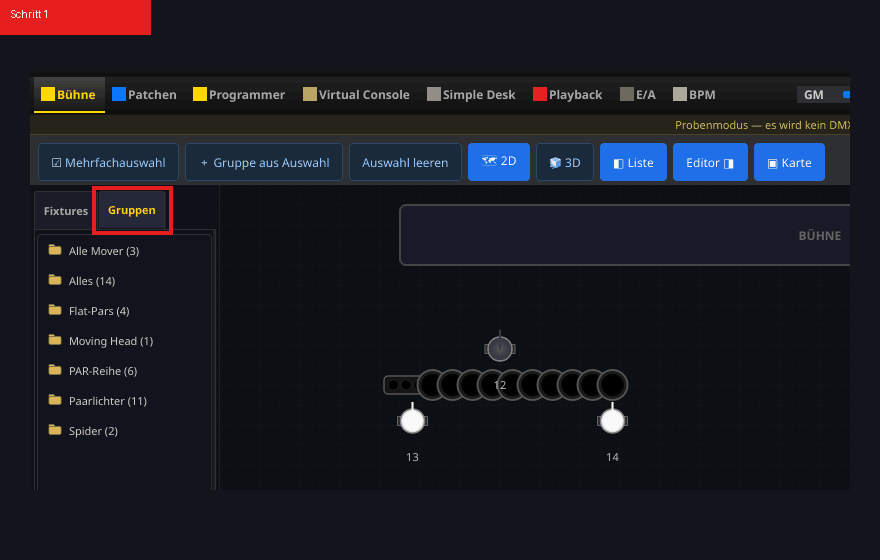

1. Öffne den Bereich **Bühne**. Links siehst du die Reiter **Fixtures** und **Gruppen**.
   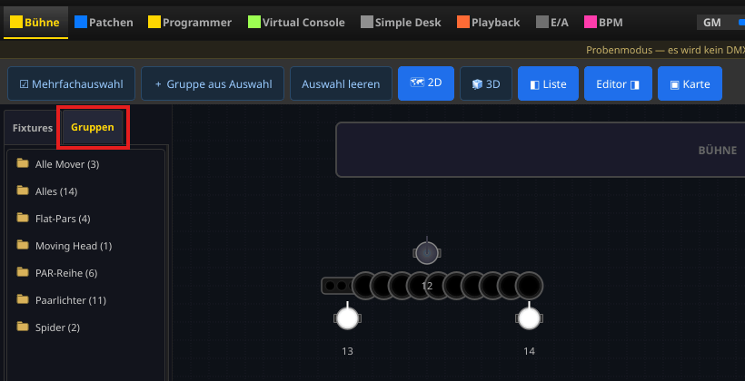
2. Klick auf **Mehrfachauswahl**. Wechsle in den Reiter **Fixtures** und klick die Geräte an,
   die in die Gruppe sollen. Sie werden blau markiert und auf der Bühne gelb umrandet.
   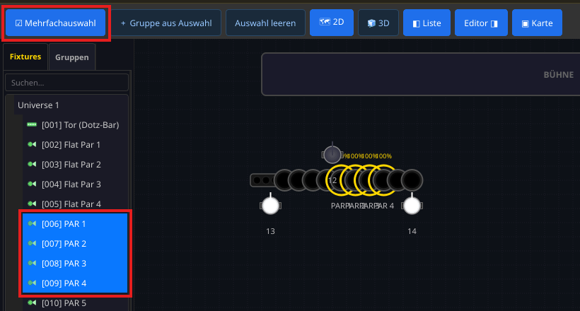
3. Klick oben auf **+ Gruppe aus Auswahl**.
   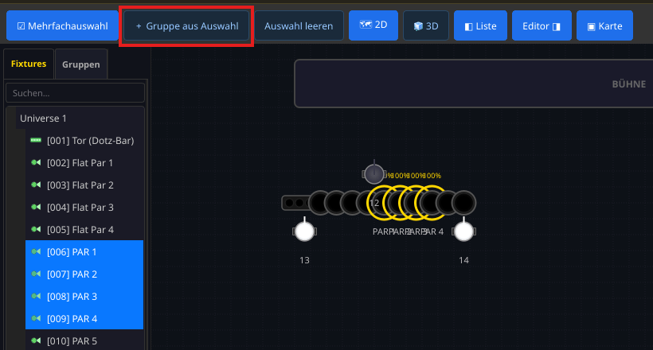
4. Gib einen Namen ein, zum Beispiel „PAR Mitte“. Bestätige mit **OK**.
   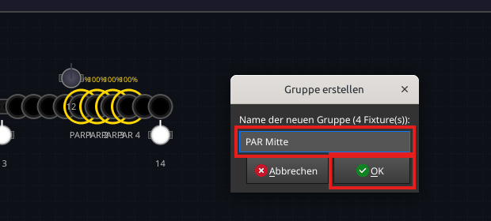
5. Fertig. Die neue Gruppe steht im Reiter **Gruppen** (mit Anzahl der Geräte). Unten in der
   Statuszeile steht „Gruppe … erstellt“.
   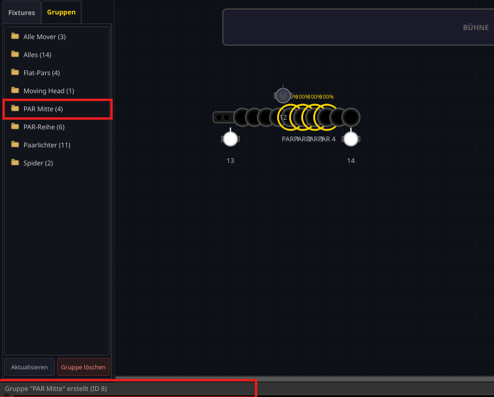

**Gut zu wissen:** Eine Gruppe braucht einen Namen. Ohne Namen legt LightOS keine Gruppe an.

---

## 2. Ein Mehrkopf-Gerät im Raster-Editor als Block aufteilen

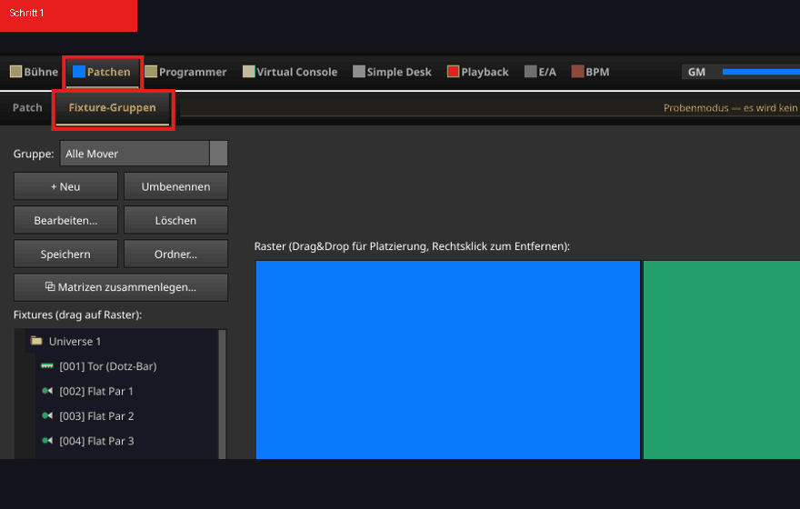

1. Öffne **Patchen** und dann den Reiter **Fixture-Gruppen**. Das ist der Raster-Editor.
   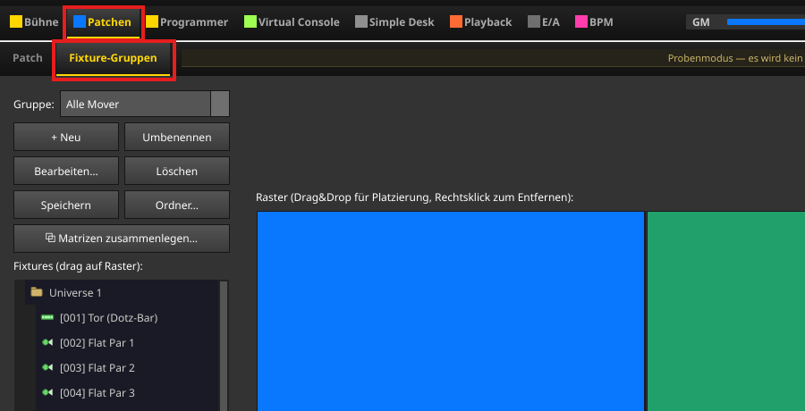
2. Klick auf **+ Neu** und gib der Gruppe einen Namen.
   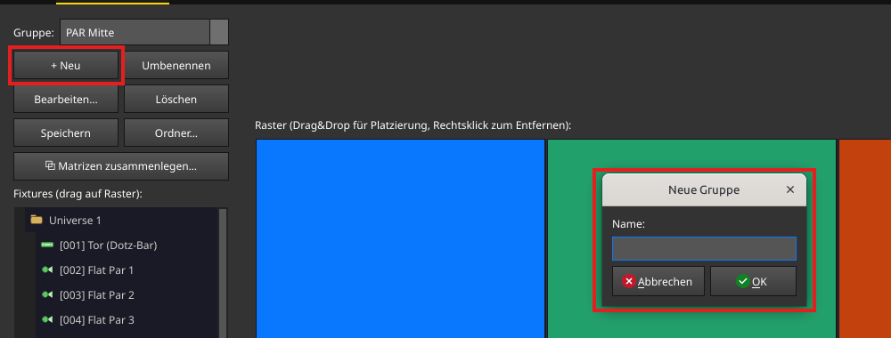
3. Zieh das Gerät (hier eine LED-Bar mit vier Zellen) aus der Liste links auf eine Rasterzelle.
   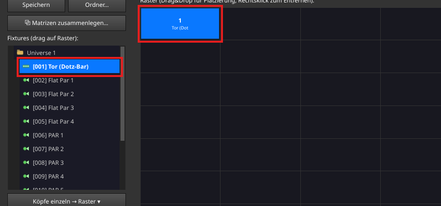
4. Rechtsklick auf die Zelle. Wähle **„… aufteilen (4 Elemente)“** und dann **als Block…**.
   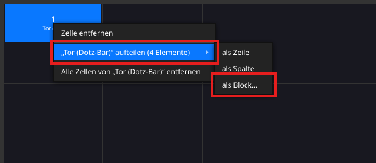
5. Gib an, wie viele Spalten der Block haben soll (hier 2). Bestätige mit **OK**.
   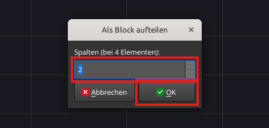
6. Jetzt liegt jeder Kopf in seiner eigenen Zelle: K1 bis K4 als 2 × 2-Block.
   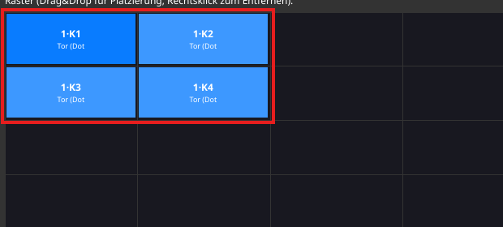
7. Stell rechts oben bei **Rastergröße** Spalten und Zeilen passend ein (hier 2 × 2).
   Klick auf **Speichern**.
   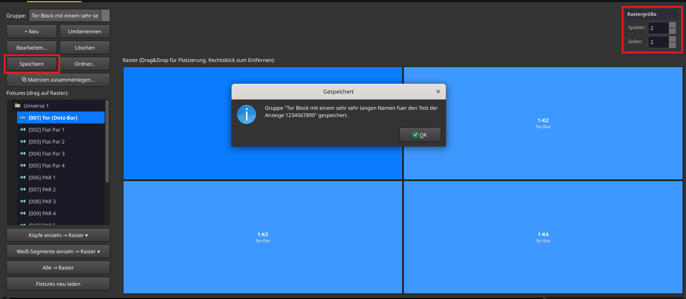

**Gut zu wissen:** Klick **Speichern**, bevor du eine andere Gruppe wählst.

---

## 3. Gruppe in Gruppe: Blöcke einsetzen, drehen, aufteilen

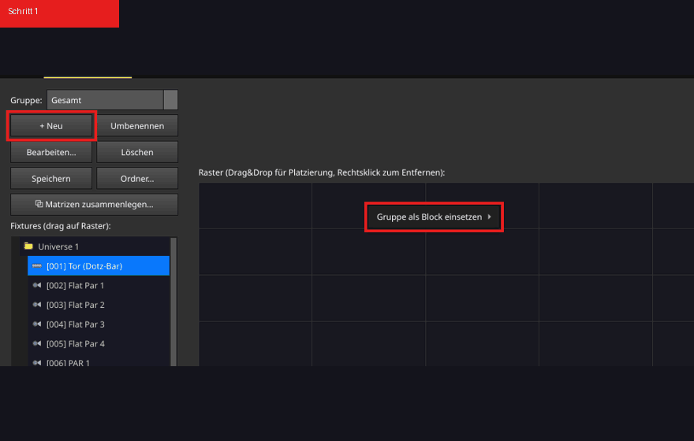

1. Leg mit **+ Neu** eine große Gruppe an (hier „Gesamt“). Rechtsklick auf eine leere Zelle
   zeigt **Gruppe als Block einsetzen**.
   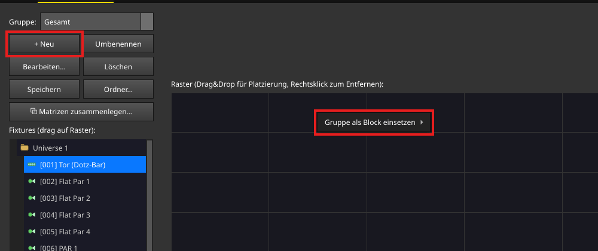
2. Fahr auf den Eintrag. Wähle die Gruppe, die du einsetzen willst.
   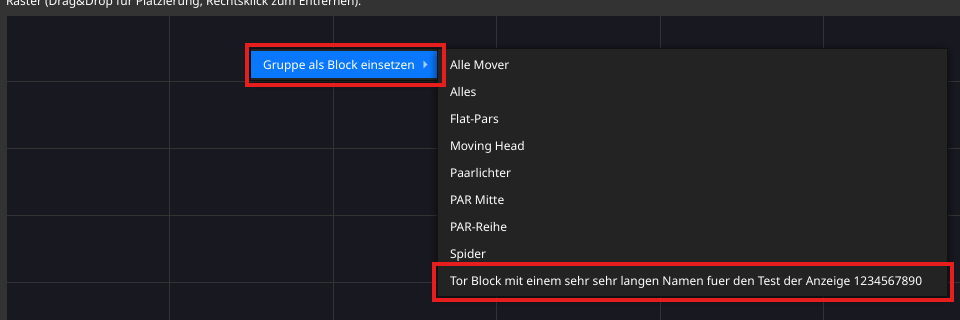
3. Die Gruppe erscheint als gestrichelter Block in ihrer eigenen Größe. Das Raster wächst bei
   Bedarf mit.
   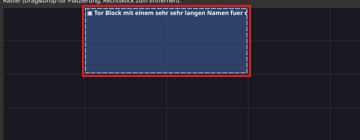
4. Rechtsklick auf einen Block bietet **Block entfernen**, **Block drehen** und **Block in
   Einzelzellen aufteilen**. Klick auf **Block drehen**.
   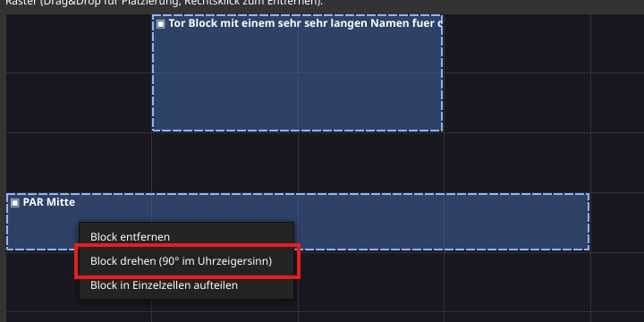
5. Der Block steht jetzt hochkant. Der Name zeigt den Winkel, z. B. „(90°)“. Nach viermal
   Drehen ist er wieder wie am Anfang.
   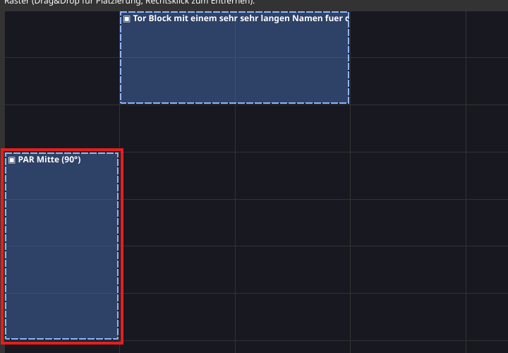
6. Willst du die Geräte einzeln haben: Rechtsklick und **Block in Einzelzellen aufteilen**.
   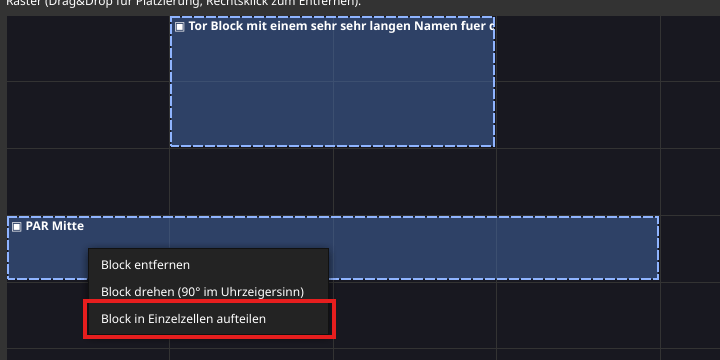
7. Aus dem Block werden normale Zellen. Unten erscheint die Farb-Legende.
   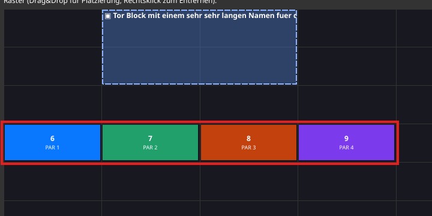
8. Schutz gegen Schleifen: In einer Untergruppe kannst du die Obergruppe nicht als Block
   einsetzen. Sie fehlt einfach in der Liste (hier fehlt „Gesamt“).
   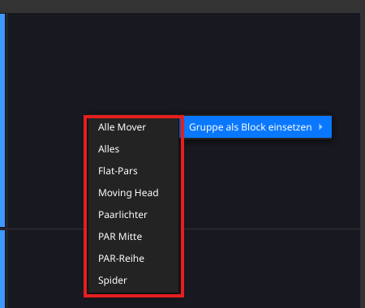
9. Löschst du eine Untergruppe, verschwindet der Block nicht. Seine Zellen bleiben in der
   Obergruppe als Einzelzellen erhalten.
   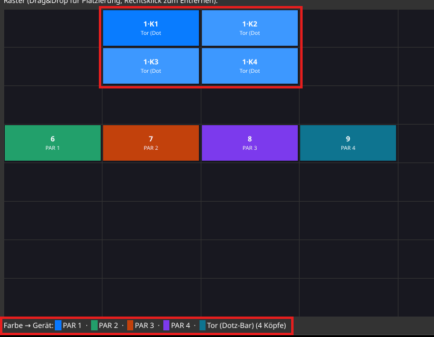

**Gut zu wissen:** Mit **Speichern** bleibt alles erhalten — auch nach einem Neustart.

---

## 4. Auto-Kopf-Gruppe: Rückfrage nach einer Montage-Änderung

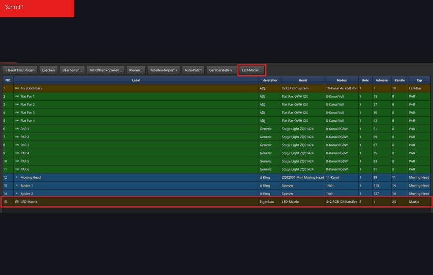

1. Patche ein Mehrkopf-Gerät, hier mit **LED-Matrix…** eine 4 × 2-Matrix. LightOS legt dabei
   automatisch eine Gruppe „… · Köpfe“ an.
   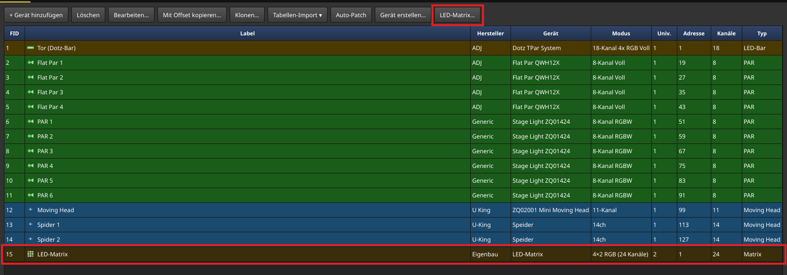
2. Im Reiter **Fixture-Gruppen** findest du sie unter „… · Köpfe“: K1 bis K8 im Raster.
   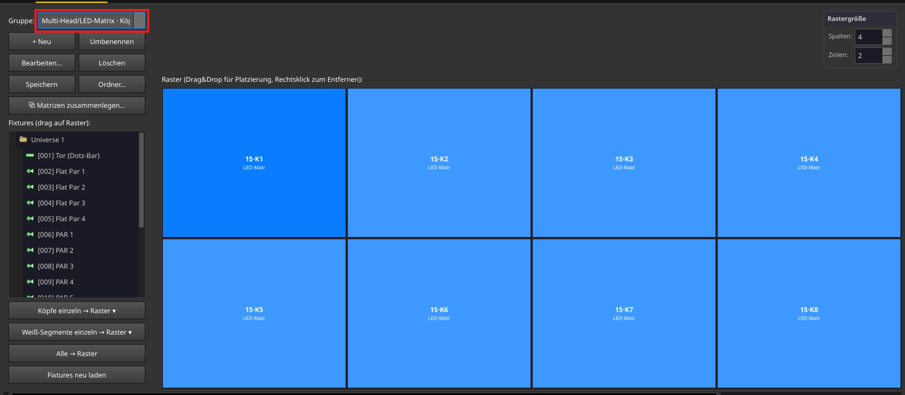
3. Zurück in **Patchen**: Zeile markieren, **Bearbeiten…** klicken. Unten steht
   **Montage-Drehung**.
   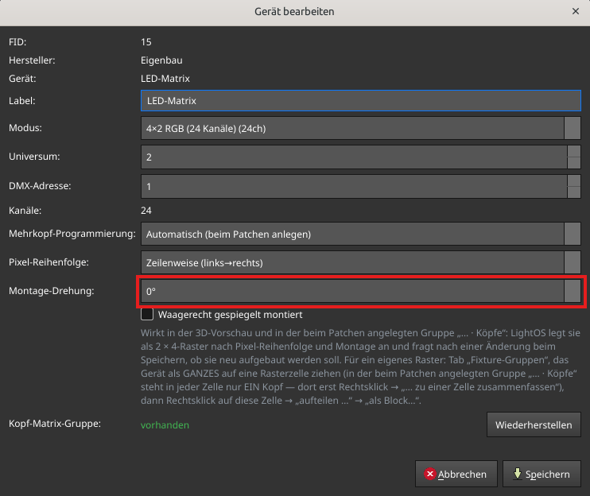
4. Wähle einen anderen Winkel, z. B. 180°. Klick auf **Speichern**.
   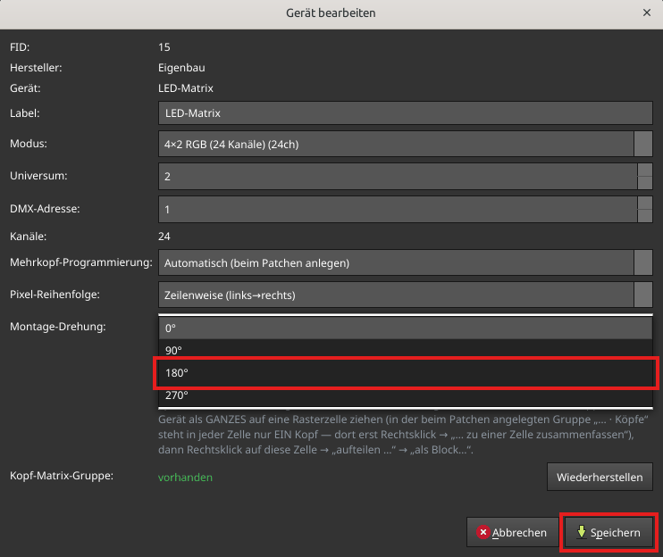
5. LightOS fragt: **Automatische Gruppe neu aufbauen?** „Nein“ ist vorgewählt.
   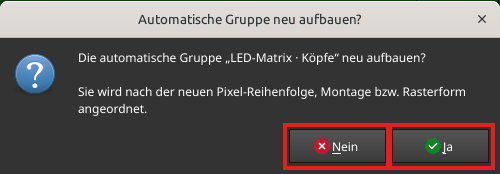
6. Bei **Nein** bleibt die Gruppe genau so, wie sie war.
   
7. Änderst du später erneut (hier 90°), kommt die Frage wieder — jetzt mit dem Hinweis, dass
   eigene Änderungen verloren gehen. Klick auf **Ja**.
   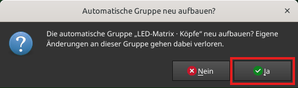
8. Die Gruppe ist neu aufgebaut: hochkant, 2 Spalten × 4 Zeilen, Köpfe passend zur Drehung.
   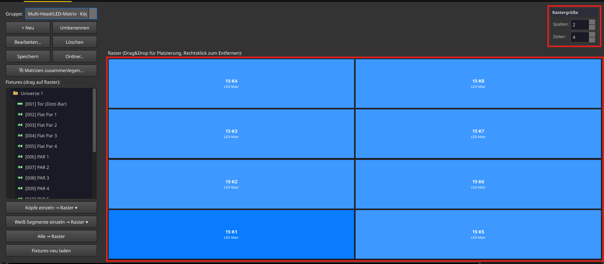
9. Doch falsch? Menü **Bearbeiten → Rückgängig**.
   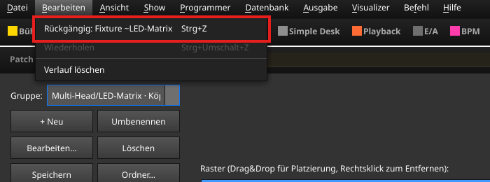
10. Gerät und Gruppe sind in einem Schritt zurück. **Wiederholen** baut sie wieder neu auf.
    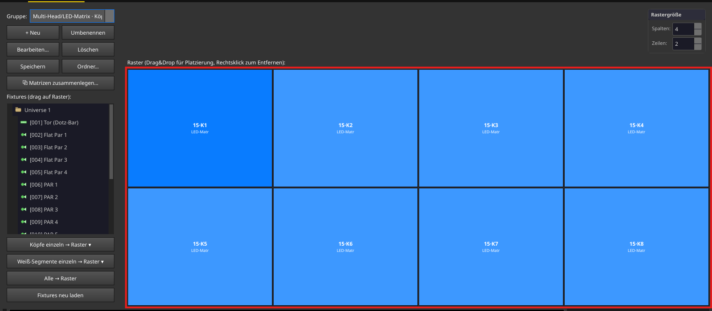
