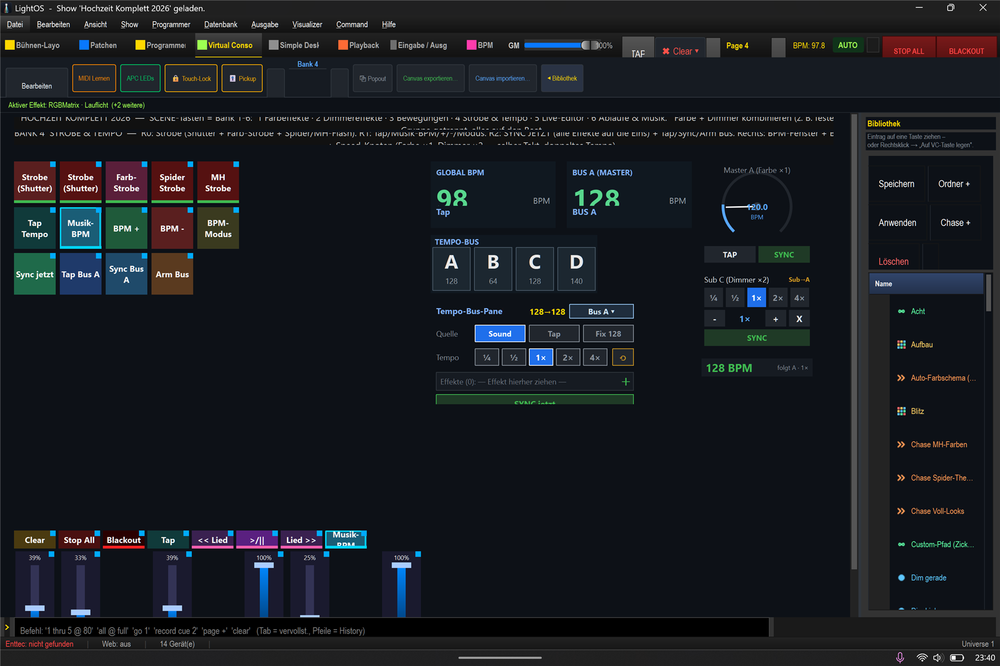

# Mini-Anleitung: Strobe & Tempo/BPM ⚡🥁

> **Lernziel:** Stroboskop auslösen **und** alle Effekte **auf den Beat** bringen — sogar mit
> verschiedenen Tempi (Farbe ×1, Dimmer ×2), die trotzdem **auf demselben Taktschlag** beginnen.
> Show: `Hochzeit_Komplett_2026.lshow`, **Bank 4 (Strobe & Tempo)** (`Strg+4` → `Strg+Bild↓` bis Bank 4).

---

### Strobe (Reihe 1)
- **Strobe (Shutter)** — echtes Stroboskop über den Shutter-Kanal (an/aus toggeln).
- **„Strobe (Shutter)“** (die zweite Kachel, daneben) — **gehalten = an**, loslassen = aus (für kurze Bursts).
- **Farb-Strobe** — Blitzen über die Farbkanäle.
- **„Spider Strobe“ / „MH Strobe“** — Stroboskop nur für Spider bzw. Moving Head (gehalten).

### BPM einstellen (Reihe 2)
- **Tap Tempo** — mehrfach im Takt tippen → BPM wird gemessen.
- **Musik-BPM** — übernimmt die BPM aus der laufenden Musik (PC-Audio).
- **BPM +/-** — fein nachregeln. **BPM-Modus** — Auto/Manuell umschalten.

Alles das stellt die **Haupt-BPM**. **Bus A folgt ihr** (Sub ×1 — im Tempo-Bus-Panel A steht die
Quelle auf **Sound**); an Bus A hängen alle Farb-, Dimmer- und Bewegungs-Effekte. Ein Tap oder
Musik-BPM erreicht damit die ganze Show.

### Auf den Beat bringen (Reihe 3)
- **„Sync jetzt“** — setzt Bus A auf die Eins: alle laufenden Farb-, Dimmer- und Bewegungs-Effekte
  beginnen ihren Zyklus gemeinsam auf diesem Schlag. **„Sync Bus A“** daneben tut dasselbe.
- **„Auto-Sync an/aus“** — schaltet um, ob **neu gestartete** Effekte von selbst phasengleich am
  gemeinsamen Beat-Raster einsteigen (Vorgabe: an).
- **Arm Bus** — schaltet Bus A „scharf“ (wie ein Klick auf A in der Bus-Auswahl rechts).

### Rechts: die Tempo-Fenster
- **GLOBAL BPM** + **BUS A (= Haupt-BPM)** — die aktuelle BPM groß ablesen (Beat-Blink).
- **Tempo-Bus** (Auswahl A/B/C/D) + **Tempo-Bus-Panel A** — der Bus, an dem die Effekte hängen.
  Im Panel auf **Tap** oder **Fix** umschalten koppelt Bus A bewusst von der Haupt-BPM ab
  (eigenes Tempo); **Sound** hängt ihn wieder an.
- **Farb-Tempo ×** — Faktor-Rad (¼ ½ 1 2 4) für alle Farb-Effekte, Vorgabe ×1.
- **Dimmer-Tempo ×** — Faktor-Rad für alle Dimmer-Effekte, Vorgabe ×2 (doppelt so schnell wie die
  Farbe, trotzdem **phasengleich**).
- Fader **„Tempo Bus D“** stellt den eigenen Bus D; **„BPM global“** schiebt die Haupt-BPM (30–300).

---

### Warum „verschiedene Tempi, gleicher Takt"?
Alle Farb- und Dimmer-Effekte hängen an **Bus A** und teilen eine **sync_group**. Der Bus gibt den
Beat vor; jeder Effekt hat einen **Multiplikator** (Farbe ×1, Dimmer ×2, Bewegung ×¼). Dadurch starten
sie zusammen auf der Eins und bleiben gekoppelt — der Dimmer macht nur doppelt so viele Schritte pro Takt.
Alle Tempo-Regler der Show (Faktor-Räder, „Dimmer-Tempo“, „Effekt-Tempo“, „Mover-Speed“, Encoder
„Tempo“/„EFX-Tempo“) stellen genau diesen Multiplikator.

> Solange noch **keine BPM** läuft (weder Tap noch Musik-BPM), laufen die Effekte frei in ihrer
> Grundgeschwindigkeit; die Fader und Encoder wirken erst mit Takt. Die Faktor-Räder rechts wirken
> in beiden Fällen.

### Sofort weiterprobieren
1. **Musik-BPM** tippen (oder **Tap Tempo** im Takt) → die BPM oben rechts springt auf den Wert.
2. Ein paar Effekte starten (Bank 1 Farbwechsel + Bank 2 Lauflicht).
3. **„Sync jetzt“** → die laufenden Effekte schnappen auf die Eins. Der Dimmer läuft sichtbar doppelt so schnell wie der Farbwechsel.
4. **Fader „BPM global"** schieben → das ganze Set wird schneller/langsamer, bleibt aber synchron.
