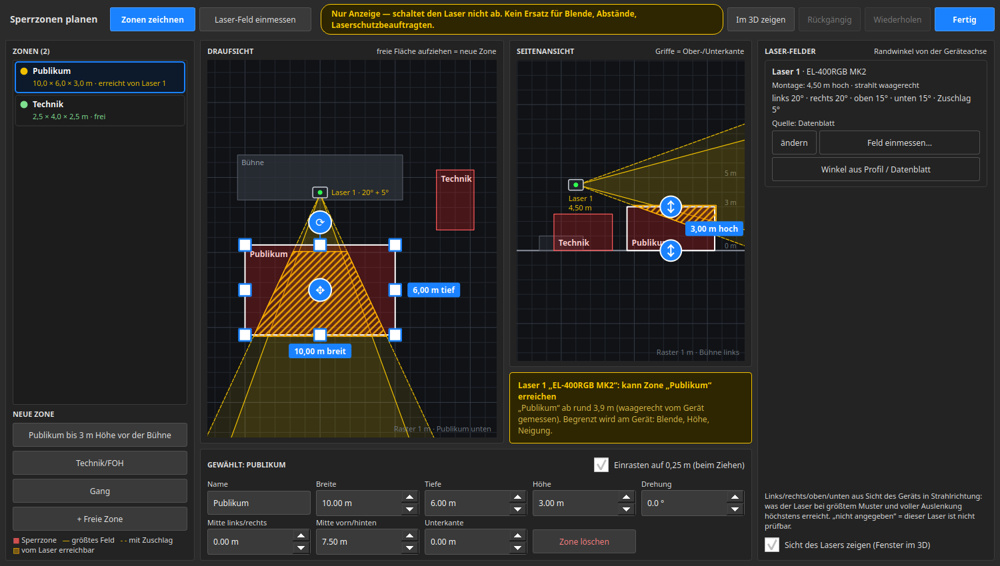
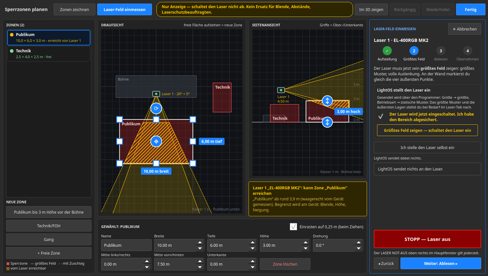
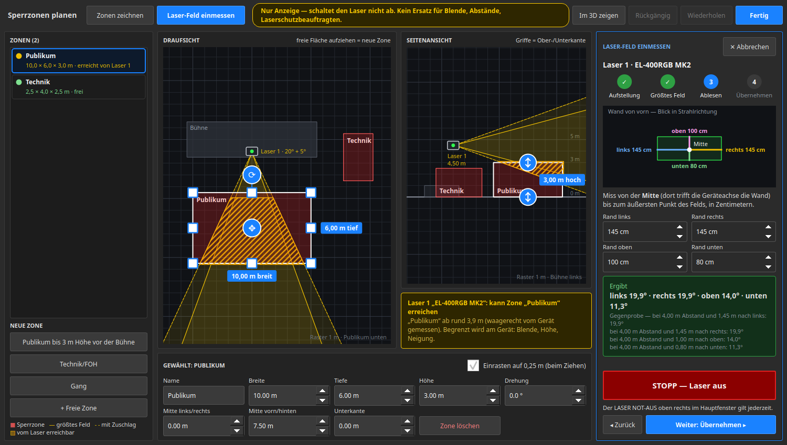

# LightOS – Laser bedienen

So steuerst du einen Laser in LightOS: Muster wählen, als abrufbares Muster
speichern und auf der Virtuellen Konsole auf einen Knopf legen. Grundlagen
(Patchen, Gruppen, Programmer) stehen in [ANLEITUNG.md](../ANLEITUNG.md).

> Stand 2026‑07. Die Oberfläche ist deutsch; der Laser-Tab erscheint im
> **Programmer**, sobald ein Laser-Gerät ausgewählt ist.

---

## 0. Zwei Arten von Lasern — was deiner kann

LightOS unterscheidet ehrlich, was ein Laser wirklich ausgeben kann. Woran du den
Typ erkennst: Nur beim **Netzwerk-Laser** erscheinen im Laser-Tab der Bereich
**„Laser-Ausgabe (Netzwerk)"** (Scharf/Unscharf + NOT-AUS) und der Knopf
**„✏️ Zeichnen…"**. Öffnest du damit das **Zeichen-Studio**, zeigt dir dort ein
ehrliches **Fähigkeits-Banner**, ob deine Zeichnung 1:1 ausgegeben wird (grün) oder
auf diesem Gerät nur als Vorlage/Näherung dient (bernstein):

- **DMX-Muster-Laser** (z. B. **Ehaho L2600 „3D Partylight"**): gibt nur seine
  **eingebauten Werksmuster** aus. Du wählst Muster über DMX-Werte an — eine
  frei gemalte Figur kann er **nicht** darstellen. Für dieses Gerät ist der
  ganze Abschnitt **1–5** gedacht.
- **Netzwerk-Laser** (Ether Dream / IDN / ILDA): gibt **exakt gemalte Figuren**
  aus. Für dieses Gerät gibt es zusätzlich das **Zeichen-Studio** (Abschnitt 7).

> Der L2600 hat **nur DMX** (kein ILDA/SD/USB). Deshalb dreht sich seine
> Bedienung um die Werksmuster, nicht um eigene Zeichnungen.

---

## 1. Patchen

**Patch → „+ Gerät hinzufügen"** → Hersteller **Ehaho**, Gerät
**L2600 3D Animation RGB Laser**, Modus **34-Kanal (Professional DMX)**. Die
Adresse schlägt LightOS automatisch vor. (Es gibt auch einen 6-Kanal-Modus für
einfache Bedienung.)

---

## 2. Laser-Tab öffnen

Wechsle in den **Programmer** und **wähle den Laser** in der Geräteliste. Es
erscheint der Tab **„Laser"**. Er ist nach Bedeutung gegliedert statt roher
DMX-Kanäle:

- **Betriebsart** (Kacheln)
- **Mustergruppe** und **Muster** (Bank + Musterauswahl)
- **Farbe**, **Bewegung & Geschwindigkeit**, **Zeichnen**
- einklappbare **„Weitere Kanäle"** für den Rest

Neben jedem Regler steht der **Klartext des Wertebereichs** — z. B. zeigt das
Muster-Farbfeld bei Wert 40 automatisch „40–47 Blau", die Musterbank
„0–223 Animations-Bänke 1–14". So musst du keine DMX-Tabelle neben der Konsole
liegen haben.

---

## 3. Betriebsart wählen

Die Kacheln unter **„Betriebsart"** entsprechen den Grund-Betriebsarten des
Geräts (**Aus · Auto-Programm · Sound-Modus · Muster-Modus**). Für die manuelle
Steuerung die Kachel **„Muster-Modus (DMX-Steuerung)"** wählen — nur dann wirken
Bank/Muster/Farbe-Regler.

---

## 4. Ein Muster einstellen

1. **Mustergruppe** (Bank) wählen — grobe Vorauswahl der Animations-Bank.
2. **Muster** (Musterauswahl) — das konkrete Werksmuster in der Bank
   (1 Wert = 1 Muster).
3. **Farbe** und **Bewegung & Geschwindigkeit** nach Geschmack.

> Der **Geschwindigkeits-/Rotations-Regler** hält den Laser im Dreh-Modus; über
> die Virtuelle Konsole lässt sich genau darauf ein Tempo-Fader legen
> (Abschnitt 6).

---

## 5. Muster als abrufbares Muster speichern

Damit du ein schönes Muster später mit **einem Klick** wiederbekommst:

- **„💾 Muster speichern…"** (Box **„Muster-Paletten"**) legt die aktuellen
  Laser-Werte der Auswahl als **benanntes Muster** ab. Es erscheint als Kachel
  in „Muster-Paletten" und lässt sich per Klick wieder auf den Laser anwenden.

### 5b. Werksmuster-Bibliothek mit eigenen Fotos (nur DMX-Muster-Laser)

Die Werksmuster des L2600 sind herstellerseitig **unbenannt und ohne
Vorschau**. Deshalb baust du dir in der Box **„Werksmuster (Gerät)"** deine
eigene Vorschau-Bibliothek:

1. Am Gerät (oder über die Regler) Bank + Muster einstellen.
2. **„➕ Muster merken…"** → **Name** vergeben.
3. Der Foto-Dialog fragt nach einem **Foto vom echten Laser-Output** (optional —
   „Abbrechen" merkt das Muster ohne Bild). Mach einfach ein Handyfoto vom
   Muster an der Wand und wähle es aus.
4. Es erscheint eine **Kachel**: mit Foto als Vorschau, sonst mit der
   Bank/Muster-Nummer („B32/M7").

**Kachel anklicken** ruft das Muster ab (schreibt Bank + Muster in den
Programmer). **Rechtsklick** auf eine Kachel löscht den Slot. Die Bibliothek
wird mit der Show gespeichert.

---

## 6. Auf die Virtuelle Konsole legen (Knopf + Tempo)

So bedienst du den Laser im Live-Betrieb ohne den Programmer:

1. **Virtual Console → Bearbeiten-Modus.** Element per **Rechtsklick auf die
   Fläche → „Hinzufügen"** (oder Toolbar) anlegen.
2. **Muster-Knopf:** einen **Button** anlegen, in seinen Einstellungen die
   Aktion **„Laser-Muster abrufen"** wählen und die zuvor gespeicherte
   **Muster-Palette** (Abschnitt 5) zuordnen. Ein Druck ruft das Muster ab.
3. **Tempo-Fader:** einen **Fader** anlegen, Modus **„Programmer-Attribut"**,
   **Attribut** `gobo_rotation`, und das Wert-Teilband **„Wert bei 0 %" = 192**,
   **„Wert bei 100 %" = 223** setzen. Der Fader hält den Laser dann im
   Dreh-Modus und regelt nur das **Tempo**.
4. **Sicherheit auf Tasten:** die Aktionen **„Laser scharf/unscharf"** und
   **„Laser NOT-AUS"** lassen sich ebenfalls auf VC-Buttons legen (auch per
   MIDI-Pad auslösbar).

> Muster lassen sich außerdem in **Snaps/Szenen** aufnehmen (Programmer →
> „Speichern" bzw. Assistent-Tab „Programmer → Szene") und so über Chaser abspielen.

---

## 7. Netzwerk-Laser: Zeichnen-Studio (nur exakte Laser)

Hat dein Laser eine Netzwerk-Ausgabe (Ether Dream / IDN), erscheint zusätzlich:

- **„✏️ Zeichnen…"** öffnet das Vollbild-**Zeichen-Studio**: Formen (Kreis /
  Rechteck / Linie / Polygon / Stern) aufziehen, Freihand mit Glätten,
  Undo/Redo (Strg+Z/Y), Raster-Einrasten, Figuren-Bibliothek. Über
  **„🖼️ Bild importieren…"** wird ein Bild automatisch in eine Figur vektorisiert.
- Die gemalten Figuren sind Show-persistent und erscheinen mit ★ in der
  Ausgabe-Auswahl.

---

## 8. Sicherheit (wichtig)

- Netzwerk-Laser starten **unscharf** — solange nicht bewusst **scharf
  geschaltet**, wird jeder Frame geblockt (Vorschau ohne Lichtaustritt).
- Der Bereich **„Laser-Ausgabe (Netzwerk)"** hat einen großen
  **Scharf/Unscharf-Umschalter** und einen **NOT-AUS**. Beim Scharfschalten
  tritt **echtes Laserlicht** aus — Publikum/Augen schützen, Not-Aus
  bereithalten.
- Ein Show-Load schaltet automatisch auf **unscharf** zurück.

### Grand Master und Laser

- Ein Laser **mit** Dimmer- oder Farbkanal wird vom **Grand Master** ganz
  normal mitgedimmt.
- Ein Laser **ohne** Dimmer (z. B. SH-LASER3W, ZQB370 — nur ein Kanal
  „Betriebsart“ bzw. „Laser An/Aus“) lässt sich **nicht stufenlos dimmen**.
  Der Grand Master **schaltet ihn bei 0 % aus**: die Betriebsart geht auf den
  Wert „Laser aus“ aus dem Geräteprofil. Zwischen 1 % und 100 % läuft der Laser
  unverändert weiter.
- Hat der Shutter-Kanal gar keine Bereichsangaben, wird er auf 0 gezogen; ein
  Programmwahl-Kanal ohne „Aus“-Bereich bleibt unangetastet. Ein bloßes „Off“
  zählt nur am Shutter oder an einem Betriebsart-Kanal (Name „Mode“/„Modus“) —
  „Macros: Off“ heißt nur „kein Makro“.
- Ein Laser **mit** Dimmerkanal bekommt bei 0 % zusätzlich die eindeutig
  benannten Aus-Werte („Laser off“, „Blackout“) — der Dimmer gilt nicht immer
  für den Laser (z. B. DJ Lase BlueStar: Dimmer nur für die LED).
- **Viele Profile kennen keinen Aus-Wert** (z. B. Boom Box Fx2 3-Kanal, Galaxian
  Sky, Wookie): solche Laser **strahlen bei Grand Master 0 % weiter**.
  Verlässlich aus ist ein Laser nur mit dem **NOT-AUS**.

### Blackout, Ziel-Blackout und NOT-AUS

Dieselben **Aus-Werte aus dem Geräteprofil** wie beim Grand Master gelten auch
hier — ein Laser bekommt also nicht einfach überall 0:

- **BLACKOUT** (global): alle Laser bekommen ihre Aus-Werte (z. B. Betriebsart
  „Laser aus“, Shutter zu). Der Aus-Wert ist **nicht immer 0** — bei manchen
  Lasern bedeutet DMX 0 an der Betriebsart „Auto“; eine reine Null würde
  sie einschalten.
- **Blackout-Taste mit Ziel:** nur die Laser im Ziel bekommen ihre Aus-Werte,
  alle anderen laufen weiter.
- **Laser-NOT-AUS:** schreibt an jede Laser-Adresse mit bekanntem Aus-Wert
  diesen Wert, an alle übrigen Laser-Adressen 0 — und gewinnt immer (auch
  gegen Kanal-Modifier, Grand Master und Blackout).
- Kennt das Profil **keinen** Aus-Wert (siehe oben), gibt es nichts zu
  schreiben: Blackout und Ziel-Blackout setzen dann die Lichtkanäle auf 0,
  ein Laser ohne Dimmer kann trotzdem weiterstrahlen. Im DMX-Monitor sieht man
  bei Lasern deshalb nach einem Blackout nicht unbedingt überall 0.

### Laser-EFX (Bewegung)

- Ein EFX bewegt bei Lasern die Achsen **„X-Bewegung“/„Y-Bewegung“**
  (`laser_x`/`laser_y`) statt Pan/Tilt. Diese Zuordnung wird in der Show-Datei
  mitgespeichert; der Show-Check (`tools/lint_show.py`) warnt, wenn ein EFX auf
  ein Gerät zeigt, das keine der beiden Achsen hat.

## 9. Sperrzonen (Vorschau)

> **Grenzen — zuerst lesen.**
> - **Nur Anzeige.** Die Sperrzonen schalten den Laser **nicht** ab und ändern
>   nichts an dem, was LightOS sendet. Am Gerät ist die Funktion noch nicht
>   abgenommen.
> - **Kein Ersatz** für Blende/Abschattung am Gerät, für Abstände und
>   Mindesthöhen und für den Laserschutzbeauftragten samt
>   Gefährdungsbeurteilung.
> - Die Rechnung kennt **nur, was im 3D eingetragen ist**. Hängt der Laser real
>   anders, ist er anders gekippt oder sind die Randwinkel falsch, stimmt die
>   Meldung nicht.
> - **Spiegelungen** (Spiegelkugel, Glas, Chrom, nasse Flächen) und
>   **Abschattungen** (Wand, Traverse) werden nicht gerechnet.
> - Der **Einmess-Assistent** (unten) ist die einzige Stelle hier, die einen
>   Laser **einschalten** kann — nur nach deinem Haken bei der Bestätigung und
>   deinem Druck auf den Knopf. Vorher: niemand im Strahl, Raum abgesperrt.
>   Der **LASER NOT-AUS** oben rechts gilt jederzeit.
> - Geräte, die LightOS **nicht als Laser kennt** (falsches Profil, rohe
>   Kanäle, zweiter Laser auf derselben Adresse), und **Netzwerk-Laser**
>   (Ether Dream/IDN) tauchen in der Meldung nicht auf.

Wozu es trotzdem gut ist: Schon beim Aufbau siehst du, **welcher Laser
überhaupt in welchen Bereich strahlen könnte** — und kannst ihn so hängen und
per Blende begrenzen, dass sein Feld den Publikumsbereich gar nicht erreicht.

**Der Planer** — im 3D-Fenster, Werkzeugleiste **„Sperrzonen…“**, oder über
den Knopf **„Sperrzonen planen…“** in der gelben Meldung im Laser-Tab. Es
öffnet sich das Fenster **„Sperrzonen planen“**. Oben steht dauernd die eine
Zeile *„Nur Anzeige — schaltet den Laser nicht ab. Kein Ersatz für Blende,
Abstände, Laserschutzbeauftragten.“*

- **Draufsicht** (Bühne von oben, Publikum unten): die Bühnenelemente der
  3D-Bühne als Umrisse, jeder Laser als Kästchen mit seinem Feld als gelbem
  Fächer (durchgezogen = deine Randwinkel, gestrichelt = mit Zuschlag), die
  Zonen als rote Rechtecke.
- **Seitenansicht**: Höhe der Zonen von–bis, Höhe des Lasers, das Feld nach
  oben und unten.
- **Orange schraffiert** ist in beiden Ansichten der Teil einer Zone, den ein
  Laser erreicht. Die Schraffur kommt aus derselben Rechnung wie die Meldung;
  streift das Feld eine Zone nur, ist die ganze Zone schraffiert. Die
  Schraffur rechnet den festen Rand von 10 cm um jede Zone mit und kann
  deshalb knapp über das rote Rechteck hinausragen.

**Zonen anlegen und ziehen:**

1. **Neue Zone:** in der Draufsicht auf freier Fläche **aufziehen** — oder
   links eine **Vorlage** antippen: *„Publikum bis 3 m Höhe vor der Bühne“*,
   *„Technik/FOH“*, *„Gang“* (bzw. *„+ Freie Zone“*). Eine Vorlage legt eine
   Zone an einer üblichen Stelle an; danach ziehst du sie zurecht.
2. **Verschieben:** die Zone oder den runden Griff in ihrer Mitte ziehen.
   **Größe:** an den eckigen Griffen (Ecken und Kanten) ziehen — die
   gegenüberliegende Seite bleibt stehen. **Drehen:** am runden Griff außen.
   **Höhe:** in der Seitenansicht die Griffe an Ober- und Unterkante.
   Die Griffe sind für den Finger gemacht.
3. **Einrasten auf 0,25 m** (beim Drehen 5°) ist an; der Haken über der
   Maßleiste schaltet es ab.
4. **Maßleiste** unten: Name, Breite, Tiefe, Höhe, Mitte links/rechts, Mitte
   vorn/hinten, Unterkante und Drehung der gewählten Zone als Zahlen — für die
   Feineingabe. **„Zone löschen“** entfernt sie.
5. **Liste links:** jede Zone mit Ampel — *„erreicht von Laser 1“*, *„frei“*
   oder *„nicht prüfbar (Laser 2)“*. *„frei“* steht dort nur, wenn **jeder**
   Laser prüfbar war und keiner die Zone erreicht.
6. **„Rückgängig“ / „Wiederholen“** (auch Strg+Z / Strg+Y) gelten für alles,
   was du im Planer an Zonen und Laser-Feldern änderst. Jede Änderung steht
   sofort in der Show und im 3D; **„Fertig“** schließt nur das Fenster.

**Maximalfeld je Laser** — rechts im Planer, je Laser eine Karte: Name,
Montage (Höhe, Neigung), die vier **Randwinkel** samt **Zuschlag** und ihre
**Quelle** (*„Geräteprofil“*, *„Datenblatt“*, *„eingemessen am 11.10.2026“*,
*„von Hand eingetragen“* oder *„nicht angegeben“*). Die Randwinkel sind in Grad
von der Geräteachse gemessen, **links/rechts/oben/unten aus Sicht des Geräts
in Strahlrichtung**: was der Laser bei größtem Muster und voller Auslenkung
höchstens erreicht. Sie dürfen verschieden sein (z. B. hinter einer Blende).
**„ändern“** klappt die Zahlenfelder auf. Steht ein Wert auf
*„nicht angegeben“*, ist der Laser **nicht prüfbar**. Dazu der **Zuschlag**
rundum: Vorgabe 5°, mindestens 2°. Gerechnet wird mit dem Feld samt Zuschlag
— einer nach vorn offenen Pyramide ohne Längengrenze, deren Spitze im
**Austrittsfenster** des Lasers sitzt (im Modell knapp 9 cm vor der
Gerätemitte), nicht in der Gerätemitte.

**Feld einmessen — „Wand und Zollstock“** (Knopf **„Feld einmessen…“** auf der
Karte oder **„Laser-Feld einmessen“** oben): vier Schritte, die Rechnung macht
LightOS.

1. **Aufstellung.** Laser gerade auf eine freie Wand richten, den **Abstand
   Austrittsfenster → Wand** in Metern eintragen. Niemand im Strahl, Raum
   abgesperrt.
2. **Größtes Feld.** Der Laser muss sein größtes Muster bei voller Auslenkung
   zeigen. Zwei Wege:
   - **„Ich stelle den Laser selbst ein“** — LightOS sendet nichts; du stellst
     Muster und Größe im Laser-Tab oder am Gerät ein.
   - **„Größtes Feld zeigen — schaltet den Laser ein“** — nur wählbar, wenn das
     Geräteprofil sagt, welche Werte das größte Feld ergeben, und erst nachdem
     du den Haken bei der Bestätigung gesetzt hast (der Haken gilt für ein
     Einschalten). LightOS sendet dann über den Programmer, also auf dem
     normalen Bedienweg: NOT-AUS, Blackout und Grand Master wirken wie immer.
     Ist der LASER NOT-AUS gedrückt, schaltet der Assistent nicht ein und löst
     ihn auch nicht.

   Der rote Knopf **„STOPP — Laser aus“** setzt die Betriebsart dieses Lasers
   auf „Aus“.

   
3. **Ablesen.** An der Wand von der **Mitte** (dort trifft die Geräteachse die
   Wand) bis zum äußersten Punkt des Felds messen — getrennt nach **links,
   rechts, oben, unten**, in Zentimetern. Die Skizze zeigt, was gemeint ist.
   LightOS rechnet daraus die vier Randwinkel und zeigt den Rechenweg als
   Gegenprobe, z. B. *„bei 4,00 m Abstand und 1,45 m nach links: 19,9°“*.
   Gerechnet wird **mit dem, was du abliest** — nicht mit DMX-Werten;
   Umkehr-Haken oder eine am Gerät umgestellte Spiegelung ändern daran nichts.
   Bei mehr als 60°, bei einer fehlenden Richtung oder sehr kurzem Abstand
   fragt der Assistent nach; Abstand 0 nimmt er nicht an.

   
4. **Übernehmen.** Die Winkel und der Zuschlag (Vorgabe 5°, mindestens 2°)
   werden eingetragen, als Quelle steht *„eingemessen am <Datum>“*. Hat der
   Assistent den Laser eingeschaltet, schaltet er ihn dabei wieder aus —
   ebenso bei **„Abbrechen“** in jedem Schritt und beim Schließen des Planers.
   Hast du selbst eingeschaltet, schaltest du selbst aus.

Die eingemessenen Winkel gelten für das **Gerät**. Die Meldung stimmt nur,
wenn es im 3D so steht und geneigt ist wie in echt. Nach jedem Umbau, nach
einer geänderten Blende und vor jeder Veranstaltung: kurze Gegenprobe am
Gerät.

**Was das 3D davon zeigt** — keine Pyramide quer durchs Bild, sondern das,
worauf es ankommt:

- **Ansatz am Gerät:** ein kurzes gelbes Stück (1,5 m) zeigt Öffnung und
  Richtung des Feldes.
- **Fußabdruck:** ein gelber Umriss mit zarter Füllung dort, wo das Feld auf
  den Boden oder eine Plattform fällt. Er reicht 12 m weit (hängt der Laser so
  hoch, dass das Feld erst dahinter aufsetzt, noch 5 m ab dort) und blendet zum
  Ende hin aus — das Feld hört dort nicht auf, nur das Bild.
- **Rote Schraffur:** der Teil einer Sperrzone, den das Feld erreicht. Das
  Schild über der Zone bekommt eine zweite Zeile *„⚠ Laser 1 erreicht diese
  Zone“* (bei mehreren: *„Laser 1, 3 erreichen diese Zone“*). Zonen, die kein
  Laser erreicht, sind etwas blasser — aber nur, solange **alle** Laser
  prüfbar sind. Fehlen einem Laser Randwinkel oder der Platz im 3D, bleibt
  jede Zone kräftig: für ihn weiß LightOS es nicht.
- **Kein Treffer:** die vier Feldkanten laufen ein Stück ausblendend weiter,
  und am Ansatz steht *„Laser 1: erreicht keine Zone — nur Anzeige“*. Das
  ist **keine Freigabe** (siehe Grenzen oben).
- **Fenster „Sicht des Lasers“** unten links: das Bild aus dem Austrittsfenster
  heraus. Das Feld ist ein gelbes Rechteck (durchgezogen = mit Zuschlag,
  gestrichelt = deine Randwinkel, an den Seiten die Gradzahlen), die Zonen
  liegen als rote Flächen darin, der Teil im Feld schraffiert — so, wie du eine
  Blende einstellen würdest. Oben links steht, welche Zonen im Feld liegen.
  Bei mehreren Lasern wählst du im Fenster (*„Laser 1 | Laser 2“*); es folgt
  auch dem Laser, den du im 3D anklickst. Das **✕** blendet das Fenster aus,
  der Knopf **„Sicht des Lasers ▸“** an derselben Stelle oder der Haken
  **„Sicht des Lasers zeigen“** im Planer (rechts unten) holt es zurück; LightOS
  merkt sich die Wahl. Das Fenster erscheint nur, wenn es mindestens einen
  Laser mit Randwinkeln und mindestens eine Zone gibt.

Der Fußabdruck ist eine Orientierungshilfe mit Lücken: er fällt nur auf den
Boden und auf **quaderförmige** Bühnenteile (nicht auf Traversen, runde oder
schräge Körper) und kennt **keine Verdeckung** — auch was im Schatten einer
Plattform läge, wird umrandet. Ob ein Laser eine Zone erreicht, hängt davon
nicht ab; das sagen Schraffur, Schild und die Meldung.

**Schnellweg „Winkel aus Profil / Datenblatt“** (Knopf auf der Laser-Karte):
Nennt das Geräteprofil einen Abstrahlwinkel, trägt LightOS ihn ein (Quelle
*„Geräteprofil“*). Sonst fragt es nach dem **Gesamtwinkel waagerecht/senkrecht**
aus dem Datenblatt und verteilt ihn je zur Hälfte auf links/rechts bzw.
oben/unten (Quelle *„Datenblatt“*). Das ist ein Datenblatt-Wert, keine Messung
— die Ränder am Gerät nachprüfen, am einfachsten mit **„Feld einmessen…“**.
Für den Laserworld EL-400RGB MK2 ist im Profil kein Winkel hinterlegt, weil
die ausgewerteten Handbuch-Abschnitte keinen nennen.

**Feld und grüne Strahlen liegen nicht auf einer Achse.** Das gelbe Feld
(Ansatz, Fußabdruck) folgt der Geräteachse — von ihr aus trägst du die
Randwinkel ein, mit ihm wird gerechnet. Die grünen Strahlen im 3D sind ein Schema und fest um
rund 3,4° nach unten geneigt, damit sie im Bild über die Köpfe laufen. Der
Unterschied ist kleiner als der Zuschlag von 5°; bei kleinerem Zuschlag und
kleinem Randwinkel „unten“ können die Strahlen im Bild knapp außerhalb des
Feldes liegen. Maßgeblich ist das gelbe Feld.

**Randwinkel gehören zum Gerät.** Löschst du einen Laser, gehen seine
Randwinkel mit (Rückgängig holt beides zurück). Sitzt später ein anderes
Lasermodell auf derselben Gerätenummer, gilt es als *nicht prüfbar*, bis du
seine eigenen Winkel einträgst.

**Meldung je Laser** — im Laser-Tab gelb überschrieben mit *„Nur Anzeige —
schaltet den Laser NICHT ab (am Gerät noch nicht abgenommen)“*, daneben der
Knopf **„Sperrzonen planen…“**. Im Planer steht dieselbe Meldung unter der
Seitenansicht, bei einem Treffer mit dem Ort (*„Publikum“ ab rund 3,9 m,
waagerecht vom Gerät gemessen*):

| Meldung | Bedeutung |
|---|---|
| *kann Zone „Publikum“ erreichen* | Das eingetragene Feld (plus Zuschlag) berührt die Zone. Der Teil einer Zone **hinter** dem Gerät zählt nicht. |
| *erreicht keine Zone* | Nach den eingetragenen Werten berührt das Feld keine Zone. **Keine Freigabe** — siehe Grenzen. |
| *Randwinkel fehlen — nicht prüfbar* | Für diesen Laser sind nicht alle vier Randwinkel eingetragen. |
| *im 3D nicht platziert — nicht prüfbar* | Der Laser hat im 3D keinen Platz. |
| *Laser gepatcht, keine Sperrzonen angelegt* | In dieser Show gibt es keine Zone. |

**Hauptfenster:** Hast du auf diesem Rechner schon einmal eine Zone angelegt
oder eine Show mit Zonen geladen, steht oben rechts neben dem Laser-NOT-AUS
klein und gelb *„Laser gepatcht — keine Sperrzonen angelegt“*, solange ein
DMX-Laser gepatcht ist und die Show keine Zone hat. Wer nie mit Sperrzonen
gearbeitet hat oder keinen Laser patcht, sieht die Zeile nicht. Lädst du nach
einer Show mit Zonen eine ohne, meldet die Statuszeile das einmal.

**Speichern:** Zonen (mit Drehung) und Randwinkel samt Quelle und Datum
gehören zur **Show**. Eine Show ohne Zonen
sieht aus wie bisher. Öffnest und speicherst du die Show mit einem **älteren
LightOS**, gehen die Zonen verloren — danach meldet LightOS wieder *„keine
Sperrzonen angelegt“*.

---

### Siehe auch
- [ANLEITUNG.md](../ANLEITUNG.md) – Oberfläche, Patchen, Gruppen, Programmer
- [EFFEKTE.md](../EFFEKTE.md) – Effekte, Snaps/Szenen, Virtuelle Konsole
- [Übersicht bebilderte Anleitungen](../ANLEITUNGEN.md)
