# Matrix-Effekte — Schritt für Schritt

> Nach diesen drei kurzen Anleitungen kannst du für eine Gruppe einen Matrix-Effekt anlegen,
> ein eigenes Bild oder animiertes GIF über deine Lampen laufen lassen und die Meldungen unter
> „Medium“ richtig lesen. Jede Anleitung beginnt mit einem GIF vom ganzen Ablauf, danach kommt
> ein Bild je Schritt. Die roten Ziffern im Bild passen zu den Schritten.

**Show:** Die Bilder zeigen die Show „Hochzeit Komplett 2026“ (Generator
`build_hochzeit_komplett.py`, siehe [Übersicht](../ANLEITUNGEN.md)), Gruppe „Flat-Pars“ mit
vier RGB-Scheinwerfern nebeneinander. Aufgenommen im Probelauf (es geht kein DMX hinaus).
Mehr Effekte: [Matrix-Effekte](../anleitung_matrix_effekte/ANLEITUNG_MATRIX_EFFEKTE.md) ·
[Farb-Matrix](../anleitung_farbmatrix/ANLEITUNG_FARBMATRIX.md).

---

## Anleitung 1 – Einen Matrix-Effekt für eine Gruppe anlegen

**Ziel:** Deine Gruppe spielt ein Lauflicht, einen Regenbogen oder ein anderes Muster.

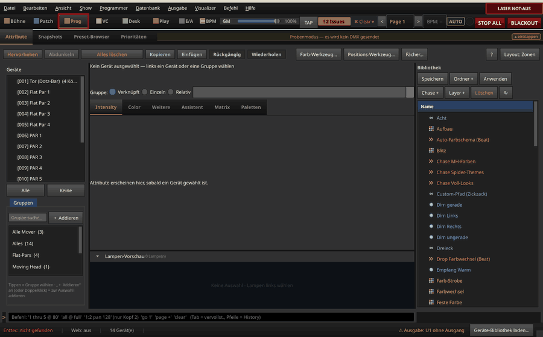

1. Öffne oben den Reiter **Prog**.
   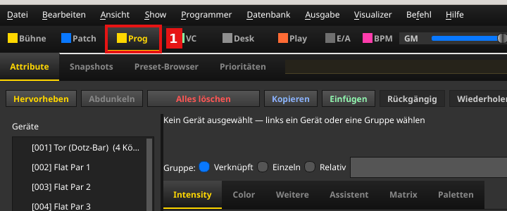
2. Wähle links unten unter **Gruppen** deine Gruppe, hier **Flat-Pars (4)**. Die Geräte werden
   oben blau markiert.
   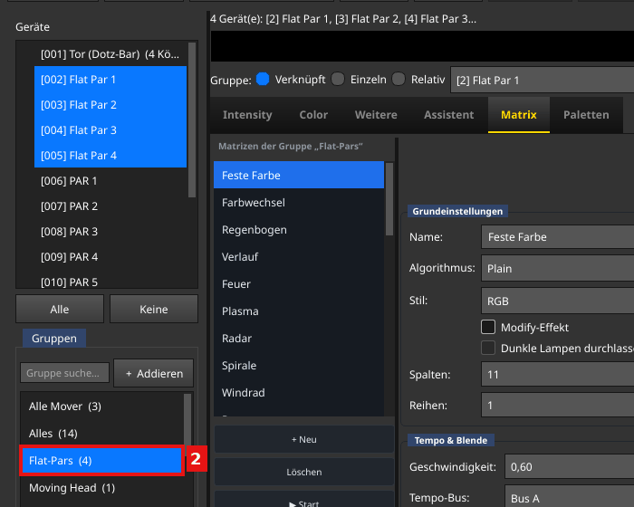
3. Klicke in der Mitte auf den Reiter **Matrix**. Links siehst du die Liste der Matrix-Effekte.
   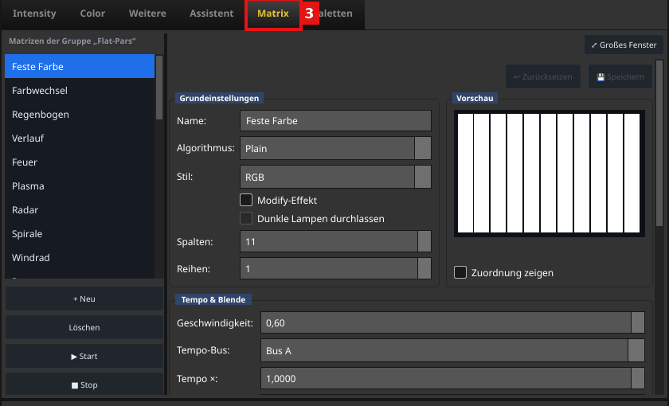
4. Klicke auf **+ Neu**. Unten in der Liste erscheint ein neuer Effekt, zum Beispiel
   „Matrix 32“. Spalten und Reihen passen schon zu deiner Gruppe.
   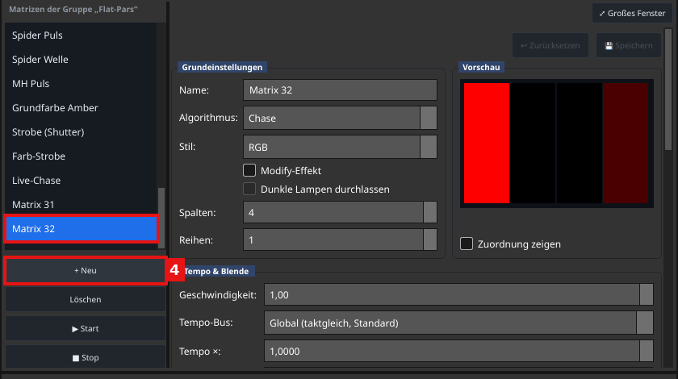
5. Mehr Platz bekommst du mit **Großes Fenster** (oben rechts). Dort stehen alle Einstellungen
   untereinander.
   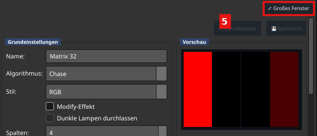
6. Klappe **Algorithmus** auf und wähle eine Art, zum Beispiel Chase, Feuer, Regen oder
   Bild/Video. Die **Vorschau** rechts zeigt sofort, wie es aussieht.
   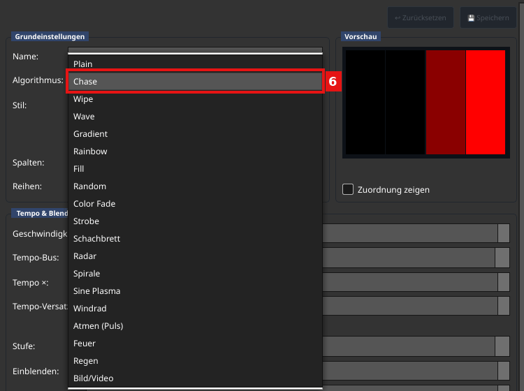
   So sehen die Arten nacheinander aus:
   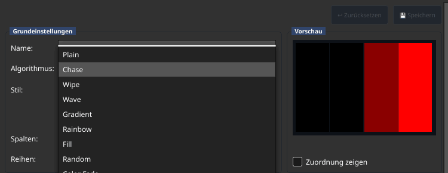
7. Unter **Farben** klickst du auf das Farbfeld **C1**. Wähle eine Farbe und klicke
   **Auswählen**. Mit **Abbrechen** bleibt die alte Farbe.
   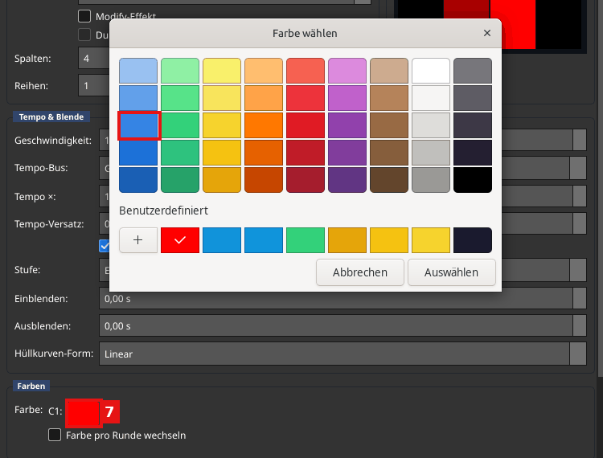
8. Stelle bei **Geschwindigkeit** das Tempo ein. Klicke zum Schluss oben rechts auf
   **Speichern**. Mit **Zurücksetzen** holst du den letzten gespeicherten Stand zurück.
   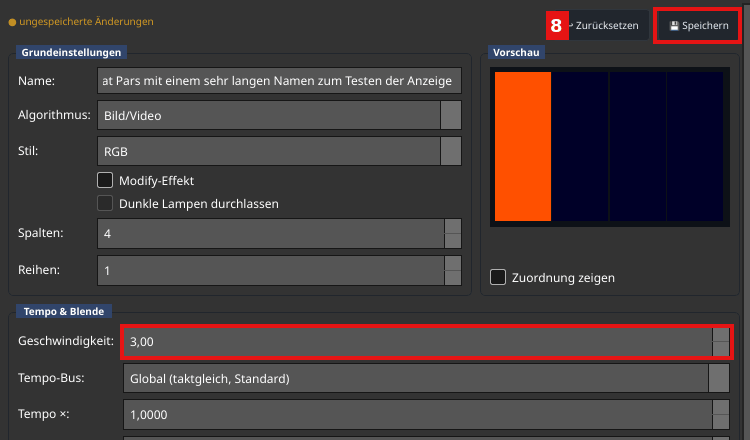

**Wichtig:**
- Erst **Speichern**, dann einen anderen Effekt in der Liste anklicken.
- Farbe und Dimmer sind getrennt. Bleiben die Lampen dunkel, zieh im Reiter **Intensity** den
  **Master Dimmer** hoch.
- Die kleine **Lampen-Vorschau** unten im Prog zeigt die Programmer-Werte. Den laufenden Effekt
  siehst du in der **Vorschau** des Editors und auf der **Bühne**.

---

## Anleitung 2 – Ein Bild oder GIF auf die Matrix legen

**Ziel:** Ein eigenes Bild (PNG/JPG) oder ein animiertes GIF läuft über deine Lampen.

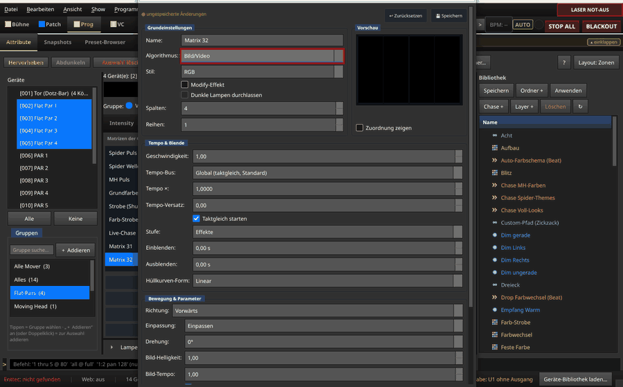

1. Lege wie in Anleitung 1 einen Matrix-Effekt an. Wähle bei **Algorithmus** die Art
   **Bild/Video** (ganz unten).
   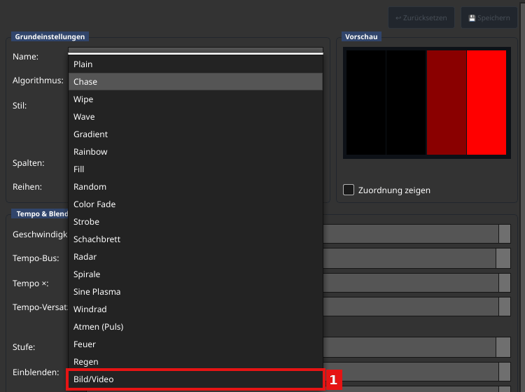
2. Scrolle im Editor nach unten bis **Medium**. Klicke auf **Medium wählen …**. Darunter steht
   noch „Kein Medium gewählt.“
   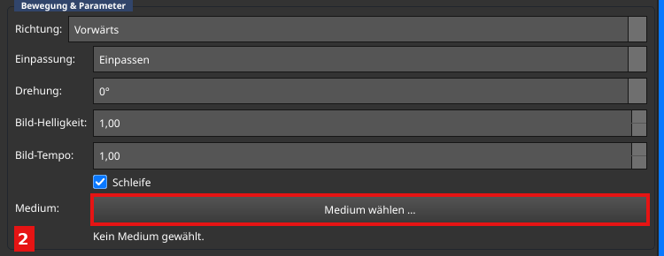
3. Wähle im Dateifenster dein Bild aus und klicke **Öffnen**. Tipp: Mit Strg+L kannst du den
   Pfad direkt eintippen.
   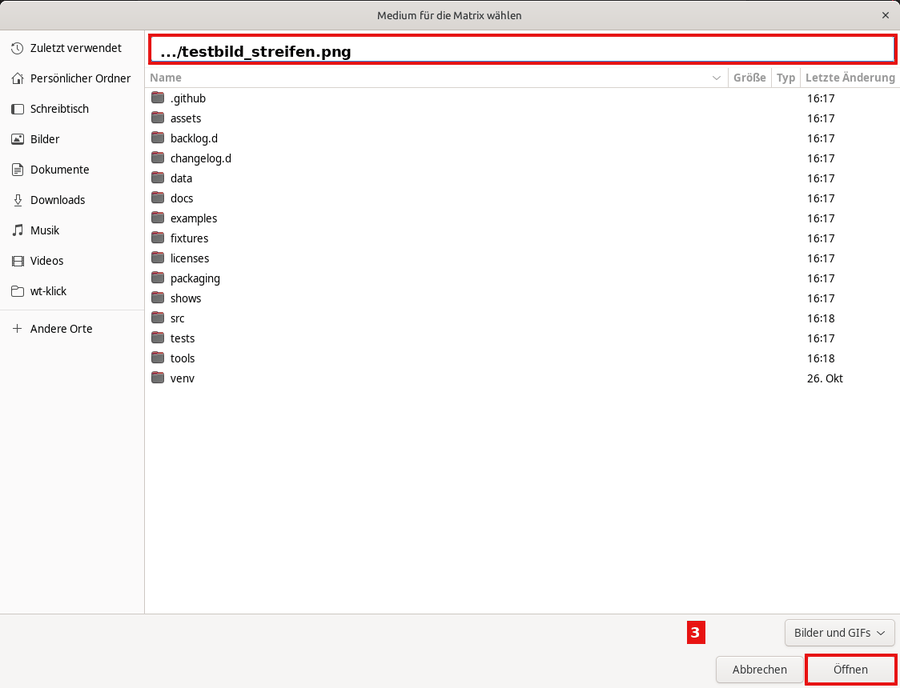
4. Unter dem Knopf steht jetzt der Dateiname, zum Beispiel „testbild_streifen.png — 1 Bild“.
   LightOS kopiert die Datei in seinen Medien-Ordner.
   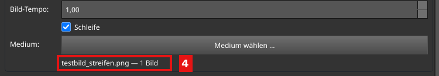
5. Bei **Einpassung** legst du fest, wie das Bild auf das Raster kommt:
   - **Einpassen:** ganzes Bild sichtbar, Ränder bleiben dunkel.
   - **Füllen:** Raster ganz gefüllt, überstehende Teile werden abgeschnitten.
   - **Strecken:** Bild wird auf das Raster gezogen, auch wenn es verzerrt.
   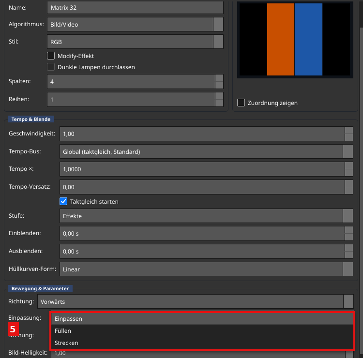
   So sieht dasselbe Bild auf vier Lampen aus:
   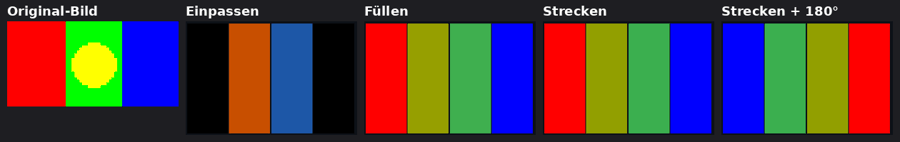
6. Mit **Drehung** drehst du das Bild um 90°, 180° oder 270°. Bei 180° läuft das Bild genau
   spiegelverkehrt über die Lampen.
   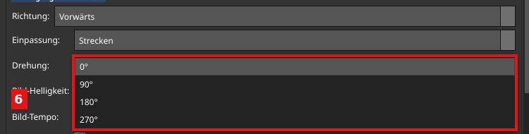
7. Ein animiertes GIF wählst du genauso. Der Status zeigt dann die Zahl der Bilder, zum
   Beispiel „8 Bilder“.
   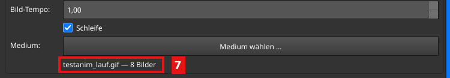
   Das GIF läuft in der Vorschau:
   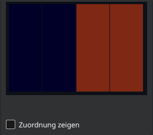
8. **Bild-Helligkeit** dimmt nur das Bild (0 bis 1). **Bild-Tempo** macht das GIF schneller
   oder langsamer (0,1 bis 8). Ohne Haken bei **Schleife** bleibt das GIF am Ende auf dem
   letzten Bild stehen. Zum Schluss **Speichern**.
   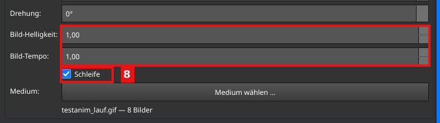

---

## Anleitung 3 – Speichern, Laden und Meldungen verstehen

**Ziel:** Du weißt, was die Hinweise unter „Medium“ bedeuten und wie dein Effekt sicher in der
Show landet.

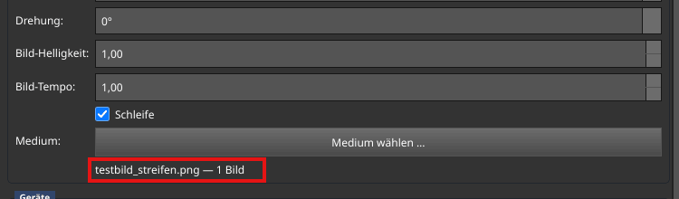

1. Orange **„ungespeicherte Änderungen“** heißt: Der Effekt ist noch nicht übernommen. Klicke
   **Speichern** — am besten, bevor du einen anderen Effekt in der Liste anklickst.
   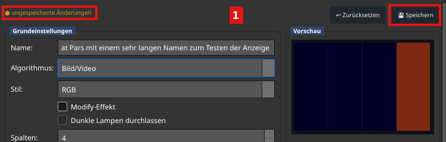
2. Speichere danach die ganze Show: **Datei → Speichern** (Strg+S). In der Show steht nur der
   Dateiname des Bildes. Das Bild selbst liegt im Medien-Ordner neben den Show-Daten.
   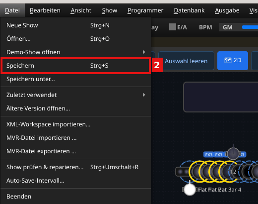
3. **Video:** „Video wird noch nicht unterstützt — bitte Bild oder animiertes GIF verwenden.“
   Wandle das Video vorher in ein GIF um.
   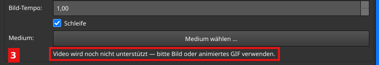
4. **Kaputte Datei:** „Medium nicht lesbar: …“. Die Datei ist kein lesbares Bild. Nimm eine
   andere.
   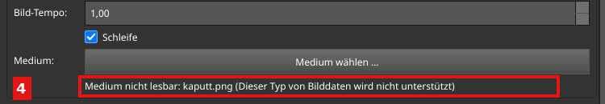
5. **Datei fehlt:** „Medium fehlt: … (erwartet im Medien-Ordner neben den Show-Daten)“. Das
   passiert, wenn du die Show ohne das Bild auf einen anderen Rechner mitnimmst. Die Matrix
   bleibt dann dunkel; die Show läuft weiter.
   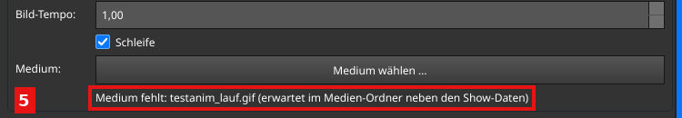
6. Wähle das Bild einfach neu mit **Medium wählen …** oder lege es zurück in den Medien-Ordner.
   Danach steht wieder „— 8 Bilder“ da.
   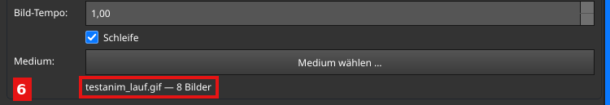
