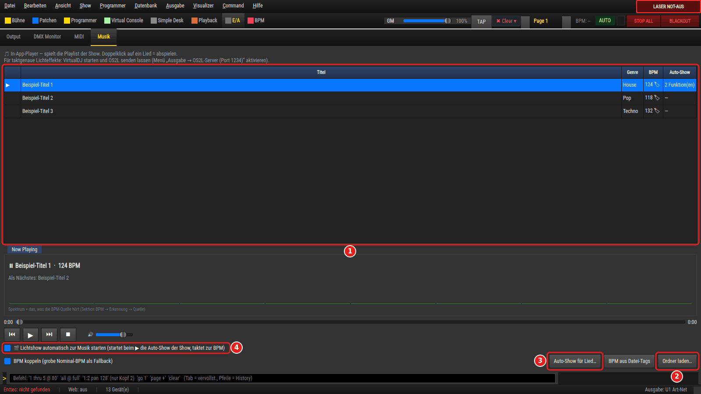
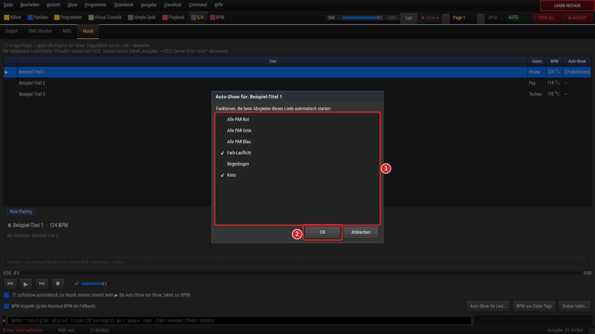
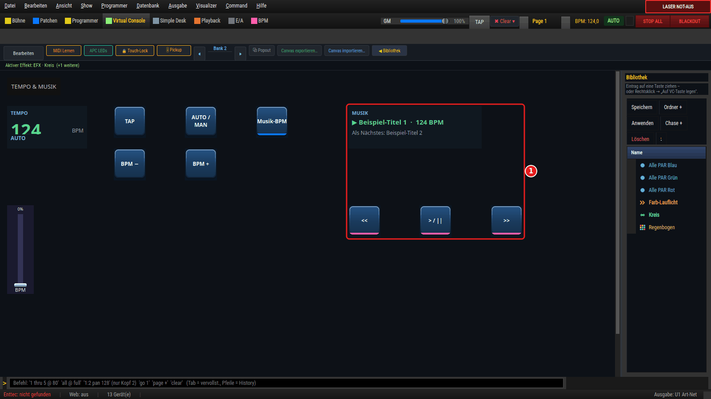
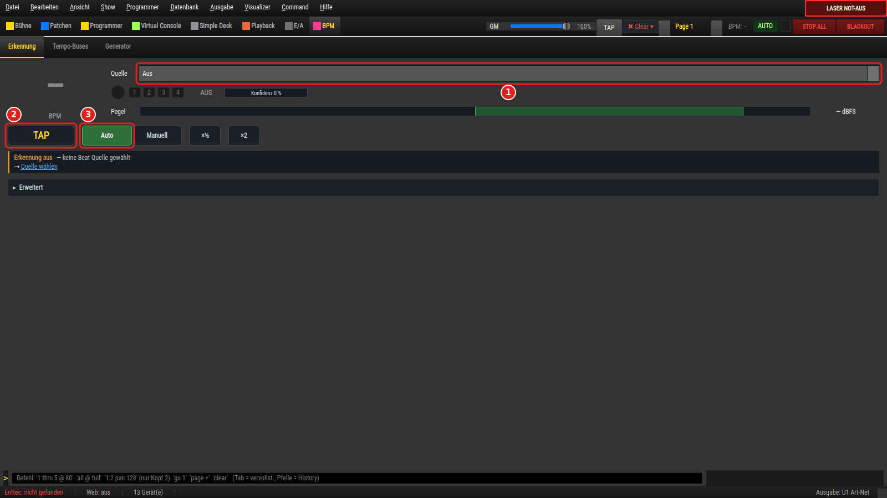

# Anleitung: Musik-Sync & automatische Live-Show

> Ziel: Die Lichtshow läuft **automatisch zur Musik** — beim **Play** startet die hinterlegte
> Auto-Show, das Tempo folgt der Musik (BPM-Erkennung), und in der Virtuellen Konsole zeigen
> Widgets **Now-Playing** und **BPM** an. Genutzt wird der interne Player + `music_autoshow`
> (alles vorhanden, kein Code).

---

> Navigation: Sektion **E/A** (Eingabe / Ausgabe, Strg+7) → Tab **„Musik"**. Den BPM-Takt stellst du in
> der eigenen Sektion **BPM** (Strg+8) ein.

## 1. Playlist laden

Im **Musik-Tab** (Sektion *E/A* → Tab „Musik", bzw. das eigene Fenster *Musik-Fenster
(Now Playing)*) über **„Ordner laden…"** deine Titel hinzufügen — die Pfade werden **mit
der Show** gespeichert. Genre und BPM liest LightOS aus dem Dateinamen bzw. mit
**„BPM aus Datei-Tags"** aus dem eingebetteten Tag (🏷 hinter der Zahl).

1. Die **Playlist** (Titel, Genre, BPM, zugewiesene Auto-Show). Doppelklick = abspielen.
2. **„Ordner laden…"** — alle Musikdateien eines Ordners übernehmen.
3. **„Auto-Show für Lied…"** — Funktionen für das markierte Lied (Abschnitt 2).
4. Der globale Schalter **„Lichtshow automatisch zur Musik starten"**.

*(Die Titel im Bild sind Platzhalter; die Bilder zeigen die Doku-Demo-Show, siehe
[Virtual Console bauen](../anleitung_vc/ANLEITUNG_VC.md).)*

> Wichtig: Es werden **absolute Dateipfade** gespeichert. Verschiebt man die mp3s, müssen die Pfade
> neu verknüpft werden.

## 2. Auto-Show zuweisen (`music_autoshow`)

Lege fest, **welche Funktionen** beim Abspielen automatisch starten. Im Musik-Tab gibt es dafür zwei
Bedienelemente:

- **Globaler Schalter** (Checkbox unten): **🎬 Lichtshow automatisch zur Musik starten** — startet
  beim ▶ die Auto-Show der Show und taktet sie zur BPM. Eine *globale* Funktions-IDs-Liste hat
  **keine** eigene Bedienoberfläche; ob die globale Auto-Show überhaupt läuft, steuert nur diese
  Checkbox.
- **Pro-Lied-Zuweisung** über den Button **„Auto-Show für Lied…"**: markiere zuerst einen Track in
  der Playlist, dann wählst du im Dialog die **Funktionen** an, die beim Abspielen *dieses* Lieds
  automatisch starten (in dieser Show z. B. *MH-Bewegung* + *Farb-Chase* + *Dimmer 2×* = der
  komplette Look). Der Button setzt die Funktions-IDs des markierten Tracks; in der Spalte
  **„Auto-Show"** der Tabelle steht dann z. B. *„3 Funktion(en)"*.
- Beides wird in der `.lshow` gespeichert und beim Laden übernommen.

  

  1. Die Funktionen der Show — angehakt ist, was beim Abspielen dieses Lieds startet.
  2. **OK** übernimmt die Zuweisung.

## 3. Play → die Show startet von selbst

Drückst du **Play** (im Player **oder** über die **Media-Taste `> / ||`** in der VC — im Beispiel
auf Bank 2 „Tempo & Musik" aus der [VC-Anleitung](../anleitung_vc/ANLEITUNG_VC.md); Bank-Namen
sind show-spezifisch), passiert automatisch:
1. Die Musik beginnt — die **Musik-Anzeige** in der VC wird grün (▶ Titel · BPM), darunter
   „Als Nächstes":

   

   1. Musik-Anzeige mit den Media-Tasten **`<<` / `> / ||` / `>>`**.

2. Die **Auto-Show startet** die zugewiesenen Funktionen — die Geräte laufen los, die
   Statuszeile der VC nennt den laufenden Effekt.
3. Beim **Trackwechsel** läuft die Playlist selbsttätig weiter; die Auto-Show bleibt aktiv und
   tauscht den Lied-Look aus.

> **Bekannte Grenze (Stand Oktober 2026):** Ist nur ein Lied-Look zugewiesen (über
> „Auto-Show für Lied…") und keine globale Auto-Show-Funktion, startet beim **ersten** Play
> aus dem Stillstand noch nichts — der Lied-Look kommt erst beim nächsten Trackwechsel
> (oder per Doppelklick auf ein Lied, während die Musik schon läuft). Gemeldet im Backlog
> unter DOC-16 (Nebenbefund).

## 4. Tempo / BPM folgt der Musik

- In der **BPM**-Sektion (Strg+8), Unter-Tab **Erkennung**, oben in der Liste **Quelle**
  einen **PC-Audio**-Eintrag wählen (z. B. „PC-Audio (Systemstandard)") — dann erkennt LightOS das
  Tempo aus der laufenden Musik. Die große **BPM-Zahl** springt mit (z. B. ~150 BPM bei Hardstyle),
  das Zustandswort daneben zeigt **EINGERASTET**, sobald das Tempo steht.

  

  1. **Quelle** — im Bild noch „Aus" (der Bildrechner hat keine Audio-Geräte); hier
     PC-Audio, Eingang, OS2L oder Lied-Analyse wählen.
  2. **TAP** — Tempo von Hand tippen.
  3. **Auto** — zurück zur Erkennung.
- Am **taktgenausten** läuft es über **OS2L**: als Quelle **OS2L (DJ-Software)** wählen
  (das startet den Server auf Port 1234 gleich mit — der Menüpunkt *Ausgabe → OS2L-Server (Port 1234)*
  tut genau dasselbe und stellt die Quelle ebenfalls um) und in VirtualDJ den OS2L-Versand aktivieren —
  dann liefert der DJ-Player den exakten Takt statt der Audio-Schätzung.
- Alternativ von Hand: **TAP** im Takt tippen (ab dem 4. Tipp schaltet LightOS auf **Manuell**),
  mit **Nudge** (−5/−1/+1/+5, im Bereich **Erweitert**) nachziehen oder den **BPM-Fader** in der VC
  benutzen. Zurück zur Erkennung: **Auto** klicken.
- Alle Bedienelemente der BPM-Sektion erklärt die
  [BPM-Manager-Anleitung](../anleitung_bpm_manager/ANLEITUNG_BPM_MANAGER.md).
- Alle **Beat-Effekte** (Farb-Chase, Dimmer …) folgen taktgenau. Über einen **Tempo-Bus** laufen
  gekoppelte Effekte relativ zueinander (z. B. der **Dimmer doppelt so schnell** wie der Farb-Chase,
  phasen-gekoppelt) — siehe Anleitung *Virtuelle Konsole* (Dimmer 2×).

## 5. Bedienen aus der Virtuellen Konsole

Im Beispiel der [VC-Anleitung](../anleitung_vc/ANLEITUNG_VC.md) liegt alles auf Bank 2
**„Tempo & Musik"**: die **MUSIK**-Anzeige mit den Media-Tasten **`<<` / `> / ||` / `>>`**, die
**BPM-Anzeige** (live) plus **TAP / AUTO-MAN / Musik-BPM / BPM ±** und der Fader **BPM**.
*(Die Bank-Namen sind show-spezifisch — in deiner eigenen Show können diese Widgets anders
verteilt oder benannt sein.)*
So steuerst du Wiedergabe und Tempo komplett aus der VC (und per APC mini, s. *APC-Anleitung*).

---

**Kurz:** Playlist laden → globalen Schalter „Lichtshow automatisch zur Musik starten" setzen
(und/oder pro Lied über „Auto-Show für Lied…" Funktionen zuweisen) → **Play** startet Musik **und**
Show automatisch → BPM-Sektion: **Quelle** auf einen **PC-Audio**-Eintrag (oder **OS2L (DJ-Software)** für
exakten Takt) → die Effekte folgen taktgenau der Musik. Bedienung über die
VC-Bank *Tempo & Musik* (optional APC mini).
