# Patch und Gerätebibliothek — Schritt für Schritt

> Nach diesen drei kurzen Anleitungen kannst du ein Gerät aus der Bibliothek patchen,
> Adresskonflikte finden und lösen und eine LED-Matrix mit dem Assistenten anlegen.
> Jede Anleitung beginnt mit einem GIF vom ganzen Ablauf, danach kommt ein Bild je Schritt.
> Rot umrandet ist immer das, worauf du klickst oder schaust.

Die Bilder stammen aus einer Übungs-Show im Probelauf (es geht kein DMX hinaus). Die Schritte
gelten für jede Show. Mehr zum Patchen: [Patchen & Gruppen](../anleitung_patch_gruppen/ANLEITUNG_PATCH_GRUPPEN.md)
und [Geräte-Bibliothek & eigene Profile](../anleitung_geraete_bibliothek/ANLEITUNG.md).
Alle Anleitungen: [Übersicht](../ANLEITUNGEN.md).

---

## Anleitung 1: Ein Gerät suchen und patchen

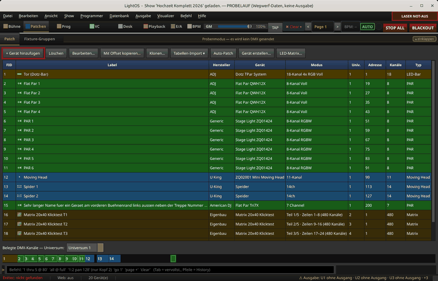

1. **Öffne den Patch.** Klick oben auf **Patchen**. Dann klick auf **+ Gerät hinzufügen**.
   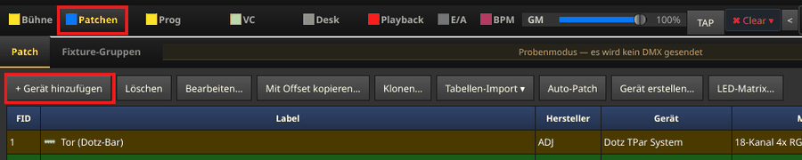
2. **Das Fenster „Gerät hinzufügen“ geht auf.** Links steht die ganze Bibliothek, sortiert nach Hersteller.
   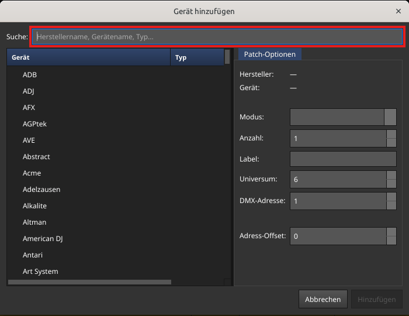
3. **Such dein Gerät.** Tipp oben ins Suchfeld einen Teil vom Namen, zum Beispiel `QWH12`.
   Die Liste wird sofort kürzer. Klick dein Gerät an.
   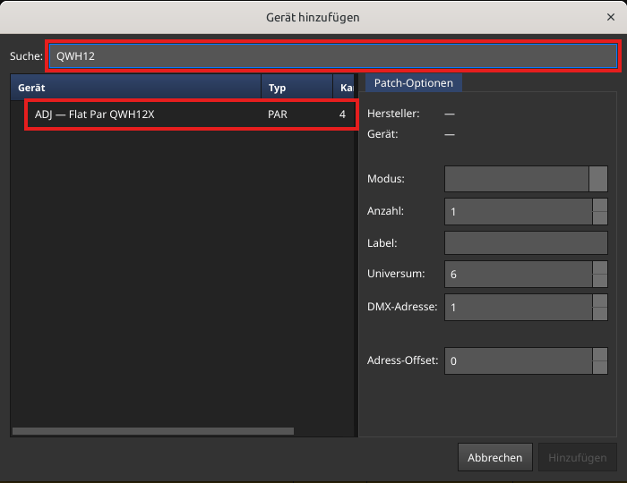
4. **Schau dir die Vorschläge an.** LightOS wählt einen Modus und schlägt die nächste freie
   DMX-Adresse vor. Der graue Text unter der Adresse sagt dir, warum.
   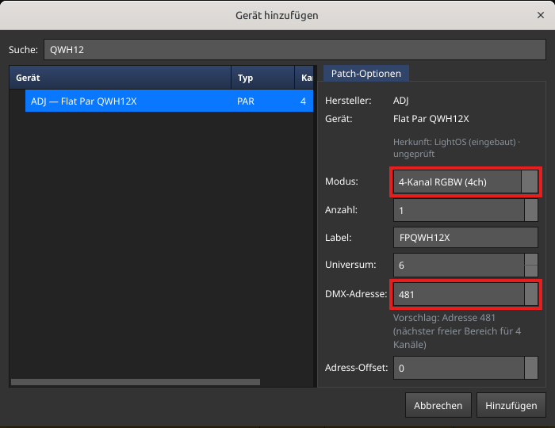
5. **Wähl den richtigen Modus.** Er muss zu dem Modus passen, der am Gerät eingestellt ist.
   Die Kanalzahl steht in Klammern.
   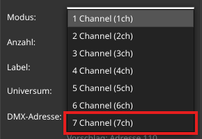
6. **Trag Anzahl, Name und Universum ein.** Bei Anzahl 2 legt LightOS zwei Geräte direkt
   hintereinander an. Aus „Front“ werden „Front 1“ und „Front 2“. Klick auf **Hinzufügen**.
   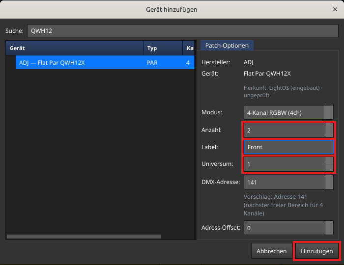
7. **Fertig.** Die neuen Geräte stehen unten in der Liste. Die Leiste darunter zeigt, welche
   Kanäle im Universum belegt sind.
   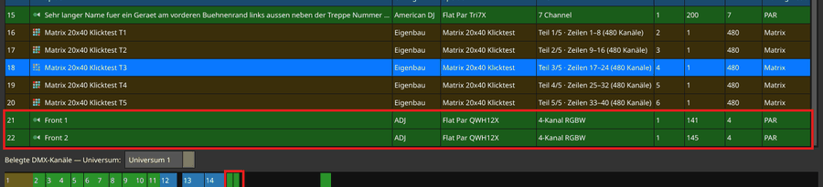

**Tipp:** Schau vor **Hinzufügen** kurz auf das Universum. Es steht am Anfang auf dem
Universum, das du zuletzt benutzt hast.

---

## Anleitung 2: Adresskonflikte finden und lösen

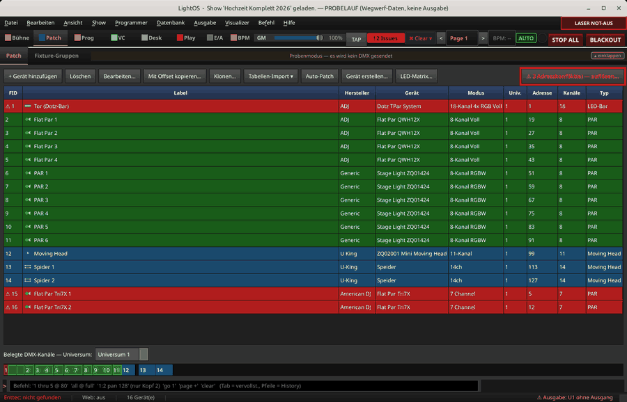

1. **Erkenne den Konflikt.** Wenn sich zwei Geräte Kanäle teilen, werden beide Zeilen rot und
   bekommen ein ⚠. Oben rechts erscheint der rote Knopf **„… Adresskonflikt(e) — auflösen…“**.
   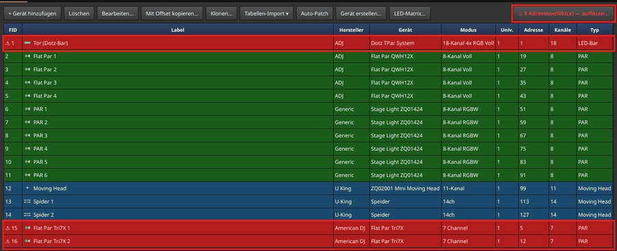
2. **Öffne die Übersicht.** Klick auf den roten Knopf. Du siehst jedes betroffene Gerät, welche
   Kanäle es belegt, mit wem es sich überlappt und einen Vorschlag für eine freie Adresse.
   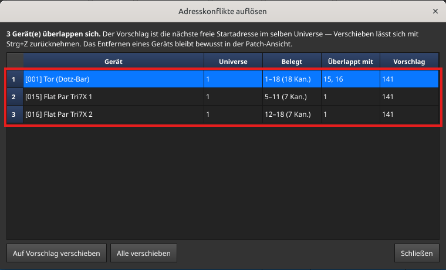
3. **Verschieb das richtige Gerät.** Klick die Zeile des Geräts an, das wandern soll — meist
   das neue. Dann klick auf **Auf Vorschlag verschieben**. Prüf vor jedem Klick, welche Zeile
   gewählt ist.
   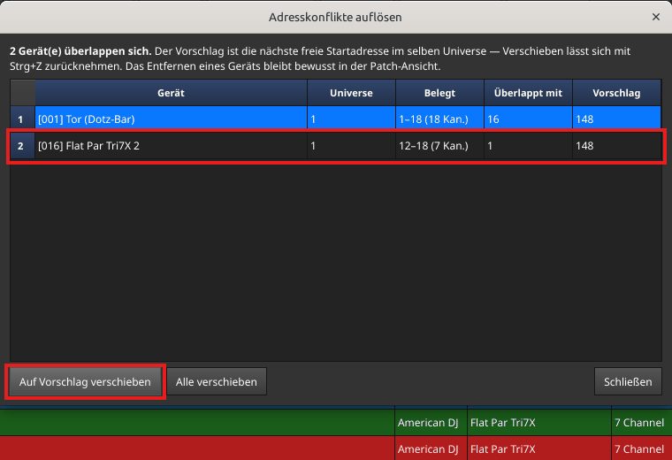
4. **Oder ändere die Adresse von Hand.** Doppelklick auf die Zeile öffnet **Gerät bearbeiten**.
   Trag eine neue DMX-Adresse ein.
   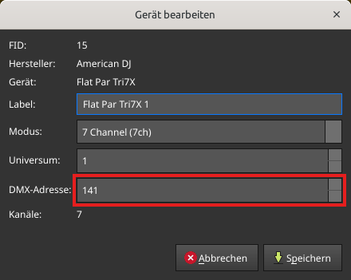
5. **Achte auf die rote Zeile im Fenster.** Steht dort „Adresskonflikt mit FID …“, ist die
   Adresse belegt. Schau auf die Zahl im Feld, bevor du speicherst.
   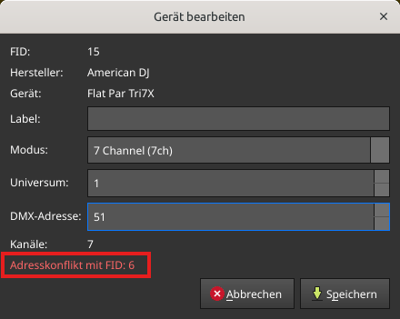
6. **Speichern trotz Konflikt?** LightOS fragt nach. Mit **Nein** kommst du zurück und kannst
   die Adresse ändern.
   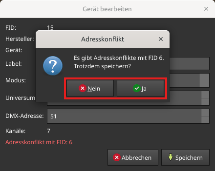

Hast du etwas falsch verschoben, nimmst du es mit **Strg+Z** zurück.

---

## Anleitung 3: Eine LED-Matrix mit dem Assistenten anlegen

Beispiel: 20 × 40 Pixel, RGB, Fläche 30 × 50 cm.

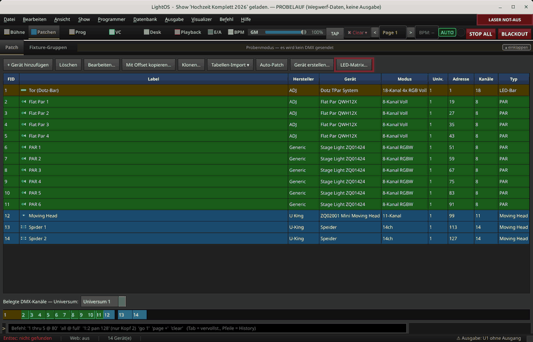

1. **Starte den Assistenten.** Im Patch klickst du auf **LED-Matrix…**. Ohne Patchen geht es
   auch über das Menü **Datenbank → LED-Matrix-Assistent…**.
   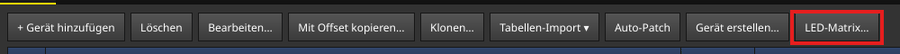
2. **Gib die Größe ein.** Breite **20 Pixel**, Höhe **40 Pixel**, Fläche **30 cm** breit und
   **50 cm** hoch. Kanalformat **RGB**. Den Pixelabstand (15 × 12,5 mm) rechnet LightOS selbst
   aus. Rechts siehst du sofort die Vorschau: Jede Farbe ist ein Universum, die Zahl ist die
   Reihenfolge am Controller.
   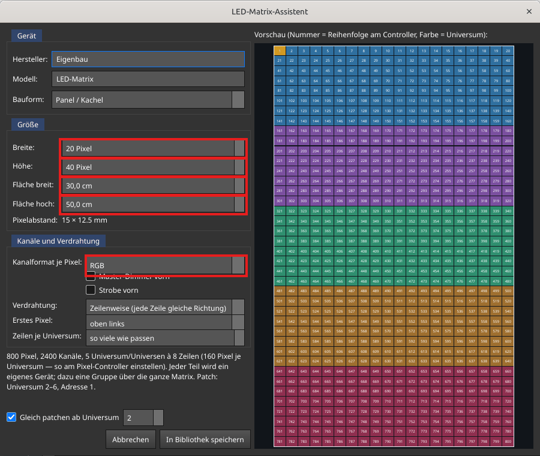
3. **Stell die Verdrahtung ein.** Wähl, wo das erste Pixel sitzt (zum Beispiel **unten links**)
   und ob jede Zeile gleich läuft oder als **Schlangenlinie**. Das orange Feld in der Vorschau
   ist Pixel 1.
   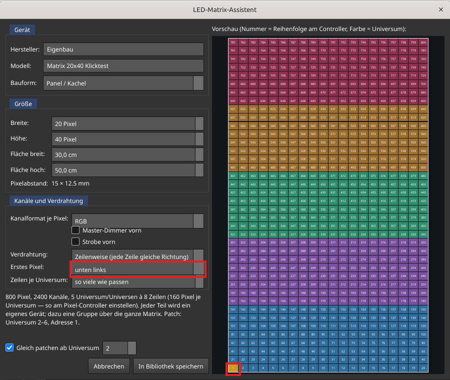
4. **Grenzfall: zu breite Zeile.** Eine Zeile darf nicht mehr als 512 Kanäle brauchen. Bei RGB
   sind das höchstens 170 Pixel. Ist es mehr, zeigt LightOS eine rote Meldung, und der
   Speichern-Knopf bleibt grau.
   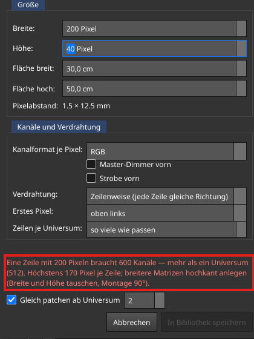
5. **Grenzfall: zu viele Universen.** Die Matrix braucht hier 5 Universen. Ab Universum 32
   passt das nicht mehr. LightOS sagt dir, ab welchem Universum es höchstens geht (hier 28).
   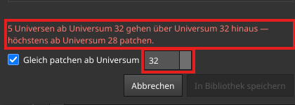
6. **Gleich patchen.** Lass **Gleich patchen ab Universum** angehakt und trag das erste
   Universum ein (hier 2). Klick auf **In Bibliothek speichern**.
   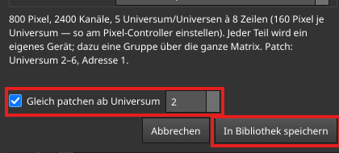
7. **Ergebnis.** Jeder Universums-Teil ist ein eigenes Gerät (T1 bis T5), jeweils ab Adresse 1.
   Unten steht eine Bestätigung.
   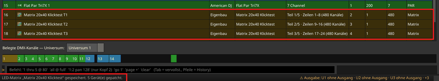
8. **Die ganze Matrix als Gruppe.** Unter **Patchen → Fixture-Gruppen** gibt es eine Gruppe
   „… · Matrix“ mit allen 800 Pixeln. Darauf kannst du später einen Effekt über die ganze
   Fläche laufen lassen.
   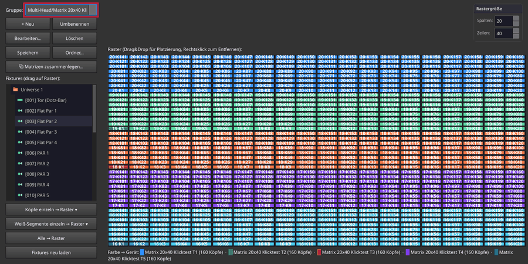

### Die Matrix nachträglich ändern

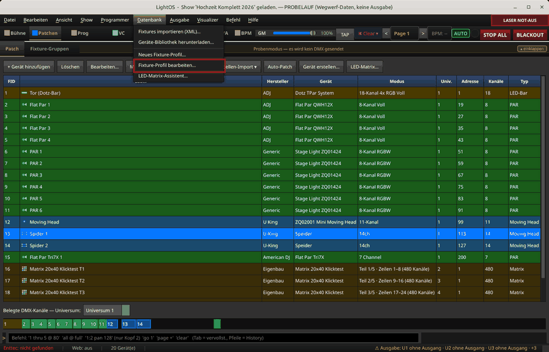

9. Öffne **Datenbank → Fixture-Profil bearbeiten…**. Such deine Matrix und klick auf
   **Im Matrix-Assistenten…**.
   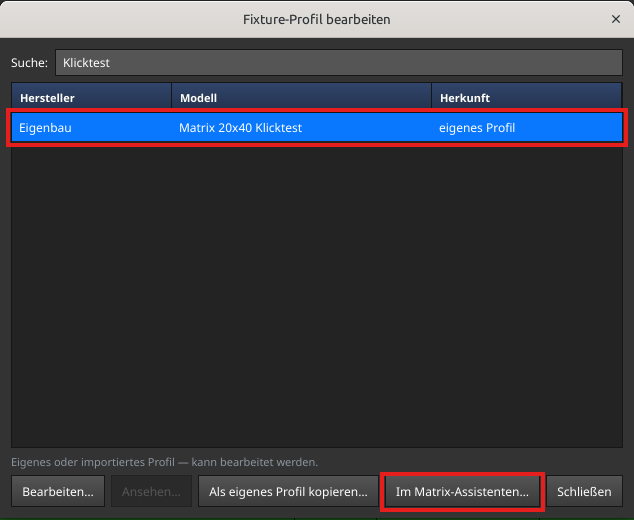
10. Ändere zum Beispiel die Verdrahtung. Klick auf **Profil aktualisieren** und bestätige mit
    **Ja**.
    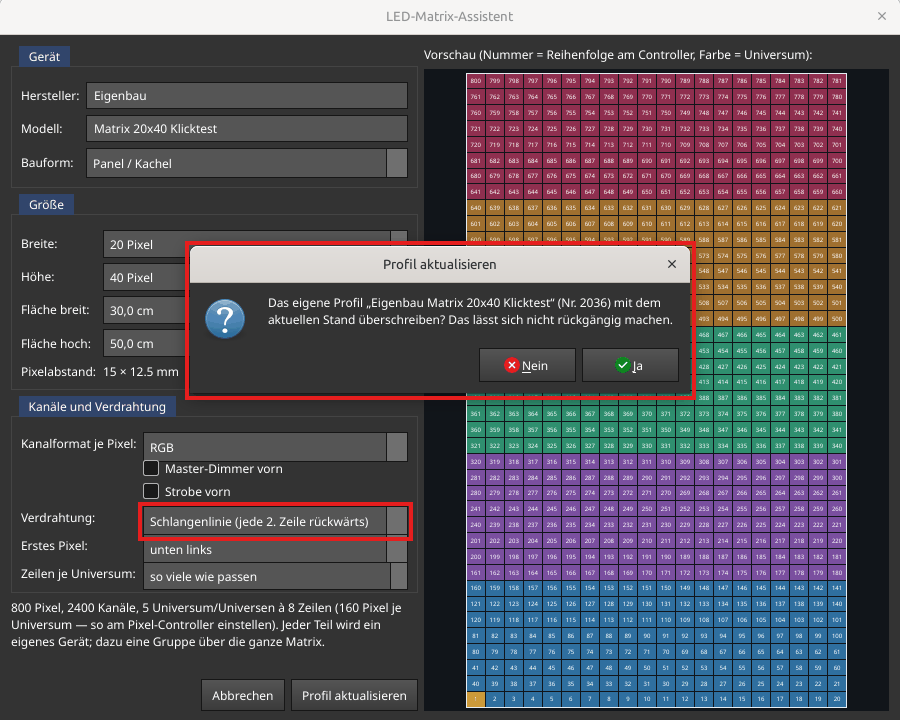

**Gut zu wissen:** Bei sehr großen Matrizen (mehrere hundert Pixel) dauert das Aktualisieren
eine Weile. Warte, bis LightOS wieder reagiert. Hast du Verdrahtung oder Startecke geändert,
prüfe danach die schon gepatchten Teile; im Zweifel löschst du sie und patchst die Matrix neu.
