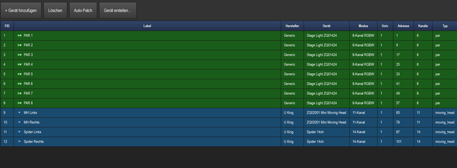
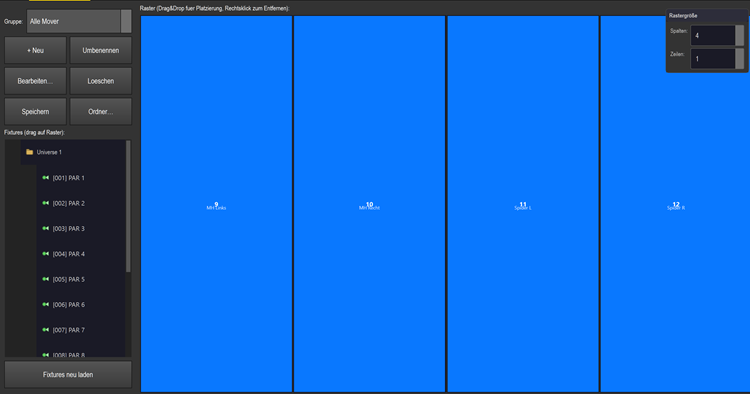

# Anleitung: Patchen & Fixture-Gruppen

> **Patchen** = jedes Gerät auf seine **DMX-Adresse** legen (damit LightOS weiß, welche Kanäle
> welches Gerät steuern). **Gruppen** fassen Geräte zusammen und legen über ein **Raster** ihre
> Reihenfolge fest — die Basis für Matrix-/EFX-Effekte (neue Effekte nehmen die Gruppen-Auswahl).

---

## 1. Geräte patchen

Sektion **Patchen** → Tab **Patch**. Mit **+ Gerät hinzufügen** öffnet sich der Dialog
*Gerät hinzufügen*: links das Profil im Baum wählen, rechts unter *Patch-Optionen* den
**Modus** (= Kanal-Layout), **Universum:** und die **DMX-Adresse:** setzen (unter dem Feld
schlägt LightOS automatisch den nächsten freien Bereich vor), dann **Hinzufügen**.

Mehrere gleiche Geräte auf einmal: Feld **Anzahl:** hochzählen und mit **Adress-Offset:**
den Abstand von Startadresse zu Startadresse festlegen (0 = Kanalzahl des Modus, also dicht
hintereinander). Ein Wert **kleiner** als die Kanalzahl lässt die Geräte überlappen — der
Dialog warnt nicht, die Zeilen werden danach rot. Reicht das Universum nicht aus, rollt
LightOS automatisch ins nächste.



Das Rig dieser Show (Universum 1):
- **PAR 1–8** — `Stage Light ZQ01424`, **8-Kanal RGBW**, Adressen **1 · 9 · 17 · 25 · 33 · 41 · 49 · 57**
- **MH Links / Rechts** — `ZQ02001 Mini Moving Head`, **11-Kanal**, Adressen **65 / 76**
- **Spider Links / Rechts** — `Spider 14ch`, **14-Kanal**, Adressen **87 / 101**

Hilfen:
- **Auto-Patch** legt **alle** Geräte neu ab Universum 1, Adresse 1 lückenlos in FID-Reihenfolge
  an (ins nächste Universum erst, wenn 512 überschritten würden). Universum und Adresse **aller**
  Geräte werden überschrieben — eine gewollte Aufteilung auf mehrere Universen geht dabei
  verloren. Es fragt vorher nach; **Strg+Z** macht es rückgängig.
- **Mit Offset kopieren…** patcht die markierten Geräte mehrfach mit festem Abstand
  (**Anzahl Kopien:** und **Adress-Abstand:**).
- **Gerät erstellen…** baut ein eigenes Profil (Kanäle/Attribute), falls dein Gerät nicht in der
  Datenbank ist.
- **Löschen** entfernt die markierten Zeilen (mit Rückfrage). Doppelklick auf eine Zeile öffnet
  *Gerät bearbeiten* (Label, Modus, Universum, DMX-Adresse, bei Movern auch Pan/Tilt invertieren/tauschen,
  bei Lasern die Laser-Ausrichtung — siehe unten).
- Die Leiste **„Belegte DMX-Kanäle — Universum:"** unten (mit der Universum-Auswahl direkt daneben)
  zeigt pro Universum als farbige Blöcke, welche Kanäle belegt sind. **Adresskonflikte** erkennst du
  direkt in der **Tabelle**: betroffene Zeilen werden rot eingefärbt und die FID mit **⚠** markiert.
  Oben rechts erscheint dann der Knopf **„⚠ N Adresskonflikt(e) — auflösen…"**: ein Klick öffnet
  *Adresskonflikte auflösen*, dort legst du die betroffenen Geräte mit **Auf Vorschlag
  verschieben** bzw. **Alle verschieben** auf freie Adressen.

### Geräteliste aus einer Tabelle übernehmen

Wer von einem anderen Lichtprogramm umsteigt, muss seine Geräte nicht einzeln neu patchen:
Geräteliste als Tabelle aufschreiben (oder aus dem alten Programm exportieren), als **CSV**
speichern, einlesen.

1. Im Tab **Patch** auf **Tabellen-Import ▾** → **Vorlage speichern …**. Das schreibt eine
   Beispiel-Tabelle mit Kopfzeile und zwei Zeilen.
2. Die Vorlage im Tabellenprogramm öffnen, die Beispielzeilen durch die eigenen Geräte ersetzen
   und wieder als CSV speichern (in Excel: *Speichern unter…* → *CSV (Trennzeichen-getrennt)*;
   eine `.xlsx`-Arbeitsmappe liest LightOS nicht).
3. **Tabellen-Import ▾** → **Aus Tabelle importieren …**, Datei wählen. Es öffnet sich die Vorschau
   *Patch aus Tabelle importieren* — noch ist nichts angelegt.
4. Vorschau prüfen, bei offenen Zeilen das Profil wählen, dann **Anwenden**.

So sieht eine Tabelle aus:

```
Name;Hersteller;Profil;Modus;Universum;Adresse;Anzahl
PAR vorne;Generic;Stage Light ZQ01424;8-Kanal RGBW;1;1;4
Moving Head links;U King;ZQ02001 Mini Moving Head;11-Kanal;1;101;1
```

| Spalte | Pflicht | Bedeutung | Heißt auch |
|---|---|---|---|
| **Profil** | ja | Modellname, wie er in der Geräte-Bibliothek steht | Modell, Gerät, Fixture, Typ, Model |
| **Adresse** | ja | DMX-Startadresse 1 bis 512; mit Universum davor geht auch `2.101` oder `2/101` | DMX, DMX-Adresse, Address |
| **Name** | nein | Bezeichnung im Patch; ohne Angabe der Profilname | Label, Bezeichnung |
| **Hersteller** | nein | hilft, wenn zwei Hersteller ein gleichnamiges Modell haben | Manufacturer, Marke |
| **Modus** | nein | Kanalmodus, entweder mit Namen (`11-Kanal`) oder als Kanalzahl (`11ch`) | Mode |
| **Universum** | nein | 1 bis 32; ohne Angabe Universum 1 | Universe, Univ. |
| **Anzahl** | nein | so viele gleiche Geräte dicht hintereinander ab der Adresse; sie heißen dann *Name 1*, *Name 2* … | Count, Menge |
| **Kanäle** | nein | Kanalzahl — damit findet LightOS den Modus, wenn die Spalte Modus leer ist | Channels |

Die Reihenfolge der Spalten ist egal, Groß- und Kleinschreibung der Überschriften auch. Als
Trennzeichen gehen Semikolon, Komma und Tabulator; Umlaute werden aus UTF-8 und aus der
Windows-Kodierung richtig gelesen. Leere Zeilen und Zeilen, die mit `#` beginnen, werden
übersprungen. Ohne Kopfzeile versteht LightOS nur genau drei Spalten (Name; Profil; Adresse) oder
vier (Name; Profil; Universum; Adresse).

**Die Vorschau** zeigt je Tabellenzeile, was passieren wird — in der Spalte **Status** steht der
Grund im Klartext, darunter eine Zählerzeile (zum Beispiel „12 Geräte werden angelegt, 2 offen,
1 Zeile mit Überschneidungen“):

- **wird angelegt** — Profil und Modus sind sicher erkannt, die Adresse ist frei.
- **offen** — LightOS ist sich beim Profil oder beim Modus nicht sicher und **rät nicht**. In der
  Spalte **Profil / Modus** stehen die ähnlichsten Profile der Bibliothek zur Wahl; nach der Wahl
  wird die Zeile angelegt. Sicher erkannt heißt: der Name stimmt genau, oder er stimmt bis auf
  Groß-/Kleinschreibung und Leerzeichen und es gibt nur ein solches Profil. Hat ein Profil mehrere
  Modi und die Tabelle nennt keinen, bleibt die Zeile ebenfalls offen. Steht bei einer Zeile
  „— kein passendes Profil —“, fehlt das Gerät in der Bibliothek: Namen in der Tabelle berichtigen
  oder das Profil zuerst mit **Gerät erstellen…** anlegen.
- **wird nicht angelegt** — die Adresse liegt nicht in 1 bis 512, das Gerät reicht über Kanal 512
  hinaus, das Universum gibt es nicht, oder die Zeile **überschneidet** sich mit einem vorhandenen
  Gerät oder mit einer anderen Zeile der Tabelle. Überschneiden sich zwei Zeilen der Tabelle,
  bleiben beide weg — welche stimmt, steht nur in der Tabelle. Trifft eine Zeile mehrere Geräte,
  fasst der Status sie in einem Satz zusammen („Überschneidet sich mit 8 vorhandenen Geräten:
  „PAR 1“ … „PAR 8“ (Universum 1, Kanal 1 bis 32).“); der Tooltip der Zelle nennt jedes einzeln.

**Doppelte Namen** sind kein Hindernis: jedes Gerät bekommt beim Import einen eigenen Namen. Steht
ein Name mehrfach in der Tabelle oder gibt es ihn im Patch schon, hängt LightOS die nächste freie
Nummer an — aus „PAR links“ wird „PAR links 2“, dann „PAR links 3“. Die Spalte **Name** zeigt den
neuen Namen fett und farbig, im **Status** steht „wird angelegt — Name gab es schon, heißt jetzt
„PAR links 2“.“, und die Zählerzeile nennt, wie viele Geräte umbenannt werden. Endet der Name schon
auf eine abgesetzte Zahl, wird weitergezählt („PAR 3“ → „PAR 4“); klebt die Zahl am Wort
(„PAR64“), gehört sie zur Typbezeichnung und es wird „PAR64 2“. Ein Name, der in der Tabelle nur
einmal steht und im Patch frei ist, bleibt immer, wie er ist. Groß- und Kleinschreibung und
zusätzliche Leerzeichen unterscheiden zwei Namen nicht. Eine Zeile mit **Anzahl** zählt
aufsteigend weiter: gibt es „PAR 1“ und „PAR 2“ schon, heißen drei neue „PAR 3“, „PAR 4“ und
„PAR 5“.

In der Vorschau erklärt jeder Spaltenkopf im Tooltip, was in der Spalte steht; die Spalte
**Tabelle** zeigt Hersteller, Profil und Modus so, wie sie in der Datei geschrieben sind.

**Anwenden** legt alle Zeilen an, bei denen „wird angelegt“ steht; der Rest bleibt weg. Der Knopf
ist grau, solange keine Zeile angelegt werden kann. **Vorhandene Geräte werden nie verändert oder
überschrieben** — wer dieselbe Tabelle zweimal einliest, bekommt beim zweiten Mal nur
Überschneidungen. Die Geräte entstehen genau wie von Hand gepatcht (Mehrkopf-Geräte bekommen
ihre Kopf-Gruppe). **Rückgängig** (Strg+Z) nimmt den ganzen Import in einem Schritt zurück.
Der Patch und alle Ansichten bauen sich dabei **einmal** neu auf, nicht je Gerät — auch eine lange
Liste ist in einem Augenblick da; ein importierter Laser ist sofort in NOT-AUS und Blackout erfasst.
Bis der Import fertig ist, gibt keines der neuen Geräte etwas aus.

Mit der Tastatur: liegt der Fokus auf **Tabellen-Import ▾**, öffnet die **Eingabetaste** das Menü,
die Pfeiltasten wählen den Eintrag. Die Leertaste öffnet es nicht — sie löst im Hauptfenster GO aus.

Nicht übernommen werden Szenen, Abläufe, Gruppen und die Position auf der Bühne — nur der Patch.

### Laser-Ausrichtung (hängend/stehend)

Ein Laser, der **hängend** statt stehend montiert ist (oder um 90° gedreht), fährt dieselbe
Programmierung spiegelverkehrt. Statt jede Szene umzubauen, stellst du das einmal je Gerät ein:
Doppelklick auf die Laser-Zeile → *Gerät bearbeiten* → Zeile **Laser-Ausrichtung:** (erscheint
nur bei Lasern):

- **X-Achse umkehren** — links/rechts spiegeln.
- **Y-Achse umkehren** — oben/unten spiegeln.
- **X/Y tauschen** — für einen um 90° gedreht montierten Laser.

Die Haken wirken auf Programmer, Cues, EFX und Netzwerk-Laser; sie stehen in der Show-Datei.
Das 3D-Bild zeigt den Laser weiter in der programmierten Richtung. Abschalt-Werte (Shutter),
**NOT-AUS** und Blackout sind nicht betroffen.

**Was „umkehren" bedeutet, hängt vom Profil ab** — die Zeile unter den Haken sagt, welcher
Fall gilt:

- Hat die Achse einen **Mitte-Bereich** und zwei Richtungen (z. B. 0–10 Mitte, 11–127 eine
  Richtung, 128–255 die andere), bleibt die Mitte, wo sie ist; nur die Richtung wechselt bei
  gleicher Auslenkung. Es wird also **nicht** einfach `255 − Wert` gerechnet.
- Hat der Kanal einen festen Positionsbereich und darüber eine Eigenbewegung, wird nur der
  Positionsbereich gespiegelt.
- Beschreibt das Profil die Achse nicht, rechnet LightOS linear (`255 − Wert`).

Nach dem Umstellen **am Gerät prüfen**: Laser mit kleiner Leistung auf eine sichere Fläche
richten, eine Position links und eine rechts (bzw. oben/unten) anfahren und ansehen, ob die
Richtung stimmt — vor allem bei „linear", denn dort kennt LightOS die Achse nicht.

## 2. Fixture-Gruppen anlegen

Tab **Fixture-Gruppen** → **+ Neu** → benennen (z. B. *Alle PAR*, *Farb-Matrix*, *Moving Heads*,
*Spider*, *Alle Mover*). Dann links unter *Fixtures (drag auf Raster):* die **Geräte auf das Raster
ziehen** (Drag&Drop); ein platziertes Gerät lässt sich per Drag auf eine andere Zelle
verschieben oder tauschen. **Rechtsklick** auf eine Zelle öffnet ein Menü: **Zelle entfernen**
leert sie; außerdem lassen sich dort alle Zellen eines Geräts entfernen und Mehrkopf-Geräte
aufteilen bzw. zu einer Zelle zusammenfassen. (Die Überschrift über dem Raster sagt noch
„Rechtsklick zum Entfernen" — gemeint ist dieses Menü.) Über das schwebende Panel **Rastergröße**
oben rechts (Felder **Spalten:** und **Zeilen:**) bestimmst du die Anordnung.

**Wichtig — Speichern:** Geänderte Platzierungen und Rastergröße werden **nicht** automatisch
persistiert. Klick zum Sichern auf **Speichern** (LightOS bestätigt mit *„Gruppe … gespeichert."*).
Ungespeicherte Änderungen gehen **ohne Rückfrage** verloren, sobald du die Gruppe wechselst,
**Umbenennen**, **Ordner…**, **+ Neu**, **⧉ Matrizen zusammenlegen…** oder **Bearbeiten…** benutzt
oder sich der Patch ändert —
also vorher **Speichern**. (**Bearbeiten…** speichert seine eigenen Änderungen sofort.)



Die weiteren Buttons über der Geräteliste:
- **+ Neu** — neue (leere) Gruppe anlegen · **Umbenennen** — Name der gewählten Gruppe ändern.
- **Bearbeiten…** — Mitglieder, Name und Reihenfolge über einen **touch-tauglichen Dialog ohne
  Drag&Drop** anpassen (gut am Touchscreen). · **Löschen** — Gruppe entfernen (mit Rückfrage).
- **Speichern** — aktuelles Raster sichern (siehe oben). · **Ordner…** — Gruppe einem
  (verschachtelten) Ordner zuordnen, z. B. *Front/Wash*.
- **⧉ Matrizen zusammenlegen…** — mehrere (Kopf-)Matrix-Gruppen zu einer größeren Matrix stapeln.

Unter der Geräteliste: **Köpfe einzeln → Raster ▾** und **Weiß-Segmente einzeln → Raster ▾**
legen die Köpfe bzw. Weiß-Segmente eines Mehrkopf-Geräts einzeln aufs Raster, **Alle → Raster**
legt alle gepatchten Geräte auf freie Zellen (danach **Speichern**), **Fixtures neu laden**
liest die Geräteliste neu ein.

Die Gruppen dieser Show:
- **Alle PAR (8)** · **PAR Links (1–4)** · **PAR Rechts (5–8)**
- **Moving Heads (2)** · **Spider (2)** · **Alle Mover (4)** (MH + Spider, für EFX)
- **Farb-Matrix (10)** — alle RGB(W)-Geräte (PAR + Spider), für den Farb-Chase.

## 3. Warum das Raster wichtig ist

Neue Matrix- und EFX-Effekte **nehmen die Gruppen-Auswahl**, und das **Raster bestimmt die
Reihenfolge/Position**: Ein Chase läuft genau in der Raster-Reihenfolge über die Geräte, eine
2D-Matrix nutzt Spalten×Zeilen als Fläche. Deshalb lohnt es sich, die Gruppen sauber anzulegen
(z. B. PAR-Reihe als 8×1, alle Mover als 4×1).

→ Weiter mit: [Farb-Matrix](../anleitung_farbmatrix/ANLEITUNG_FARBMATRIX.md) ·
[Dimmer-Matrix](../anleitung_dimmermatrix/ANLEITUNG_DIMMERMATRIX.md) ·
[EFX](../anleitung_efx/ANLEITUNG_EFX.md).

---

**Kurz:** Patchen → **+ Gerät hinzufügen** (Profil + Universum + DMX-Adresse) bzw. **Auto-Patch** →
Tab **Fixture-Gruppen** → **+ Neu** → Geräte aufs **Raster** ziehen (Spalten×Zeilen = Reihenfolge)
→ **Speichern**. Matrix/EFX folgen dann dieser Gruppe.
