# Cuelisten, Playback und Executoren — Schritt für Schritt

> Nach diesen drei kurzen Anleitungen kannst du eine Cueliste anlegen und Cues aufnehmen,
> Fade-Zeiten einstellen und mit GO, BACK und STOP abspielen und die Liste über die
> Executor-Leiste und die Virtual Console bedienen. Jede Anleitung beginnt mit einem GIF vom
> ganzen Ablauf, danach kommt ein Bild je Schritt. Der rote Rahmen zeigt, wo du klickst oder
> hinschaust.

**Show:** Die Bilder zeigen die Show „Hochzeit Komplett 2026“ (Generator
`build_hochzeit_komplett.py`, siehe [Übersicht](../ANLEITUNGEN.md)), aufgenommen im Probelauf
(es geht kein DMX hinaus). Mehr dazu: [Szenen, Snaps & Cue-Listen](../anleitung_szenen_cues/ANLEITUNG.md).

---

## Anleitung 1 – Eine Cueliste anlegen und Cues aufnehmen

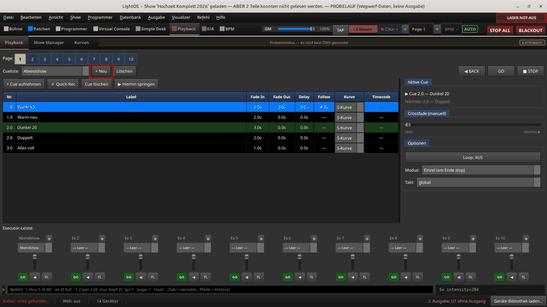

1. Öffne oben den Reiter **Playback**. Klick neben „Cueliste“ auf **+ Neu**.
   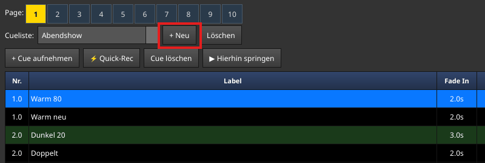
2. Gib einen Namen ein, z. B. „Hochzeit Abend“. Bestätige mit **OK** oder Enter. Ohne Namen
   wird keine Liste angelegt.
   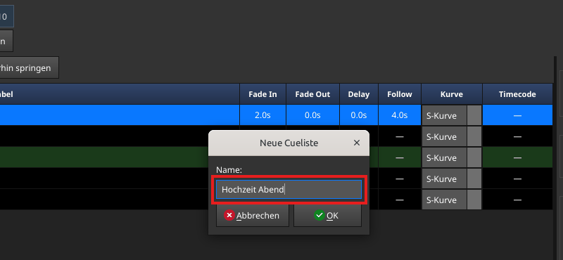
3. Die neue, leere Liste ist jetzt oben ausgewählt.
   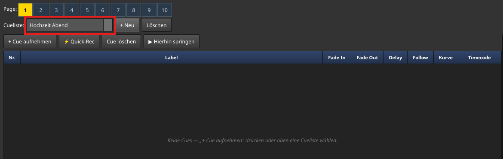
4. Stell das Licht ein. Am schnellsten geht das über die Befehlszeile unten. Tippe z. B.
   `1 thru 5 @ 80` (Gerät 1 bis 5 auf 80 %) oder wie im Bild `1 thru 5 dim 204` (Rohwert
   0–255) und drück Enter.
   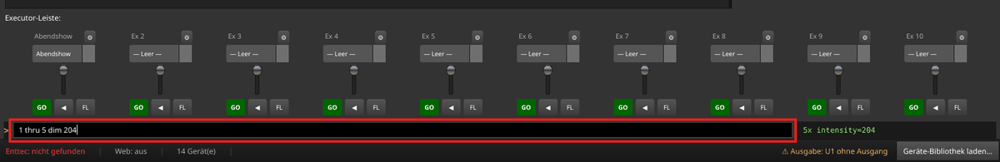
5. Oben erscheint **Programmer 5**. So siehst du, dass Werte gesetzt sind.
   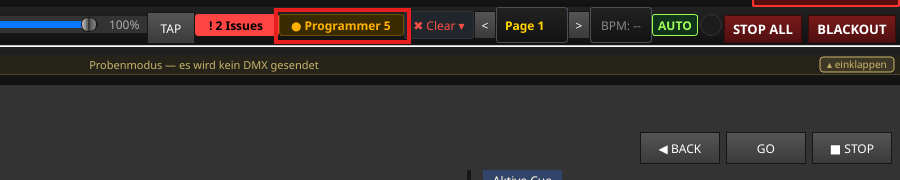
6. Klick auf **+ Cue aufnehmen**. Die nächste freie Nummer ist schon eingetragen. Drück Enter.
   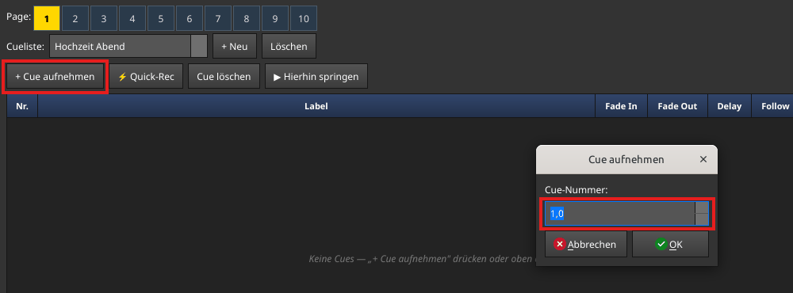
7. Gib einen Namen ein, z. B. „Warm“. Bestätige mit Enter.
   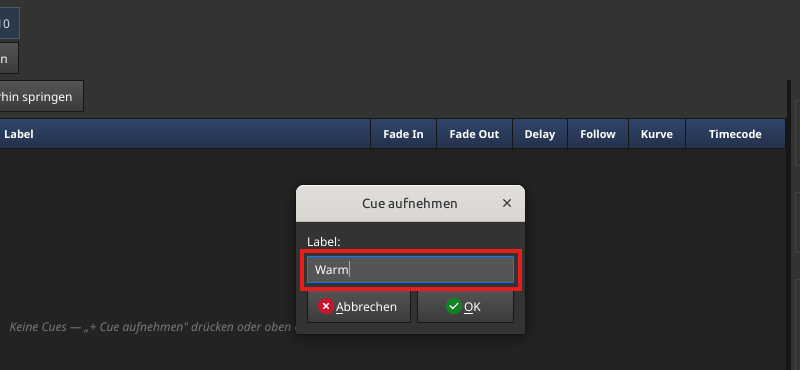
8. Wiederhol Schritt 4 bis 7 für jede Stimmung, jedes Mal mit der vorgeschlagenen freien
   Nummer. Hier: „Warm“, „Gedimmt“ und „Voll“.
   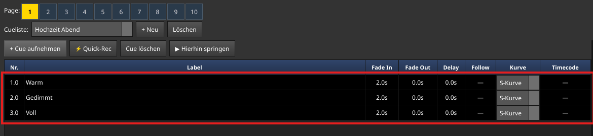

---

## Anleitung 2 – Fade-Zeiten einstellen und mit GO, BACK und STOP abspielen

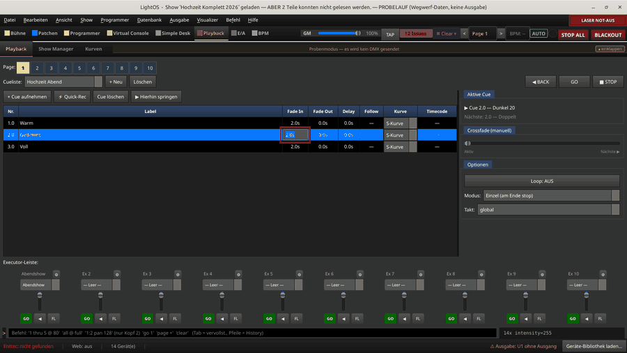

1. Klick doppelt auf das Feld **Fade In** einer Cue.
   
2. Tippe die Zeit in Sekunden, z. B. `3`, und drück Enter. Schreib Dezimalzahlen mit Punkt,
   z. B. `1.5`.
   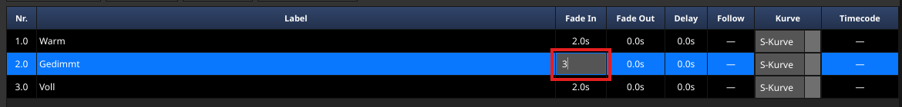
3. Stell so auch **Fade Out** und **Delay** ein. **Follow** heißt: nach so vielen Sekunden läuft
   die nächste Cue von selbst.
   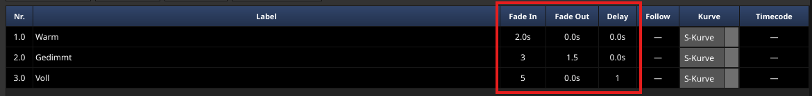
4. Drück rechts oben **GO**. Cue 1 startet. Rechts unter „Aktive Cue“ siehst du, welche Cue
   läuft und welche als nächste kommt. Die Liste wird dabei automatisch auf einen freien
   Executor gelegt (hier Ex 2).
   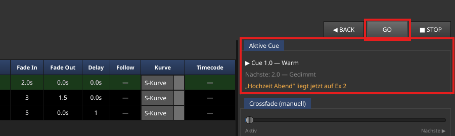
5. Drück wieder **GO**. Die laufende Cue ist in der Tabelle grün markiert.
   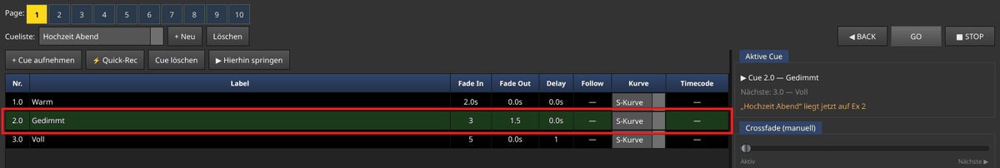
6. Bei der letzten Cue steht „Nächste: Ende“.
   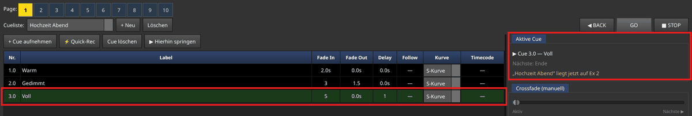
7. Mit **BACK** springst du eine Cue zurück.
   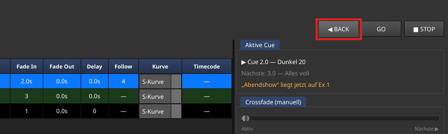
8. Mit **STOP** hältst du die Liste an. Unter „Aktive Cue“ steht dann ein Strich.
   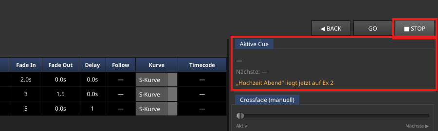

---

## Anleitung 3 – Executor-Leiste, Seiten und Cueliste in der Virtual Console

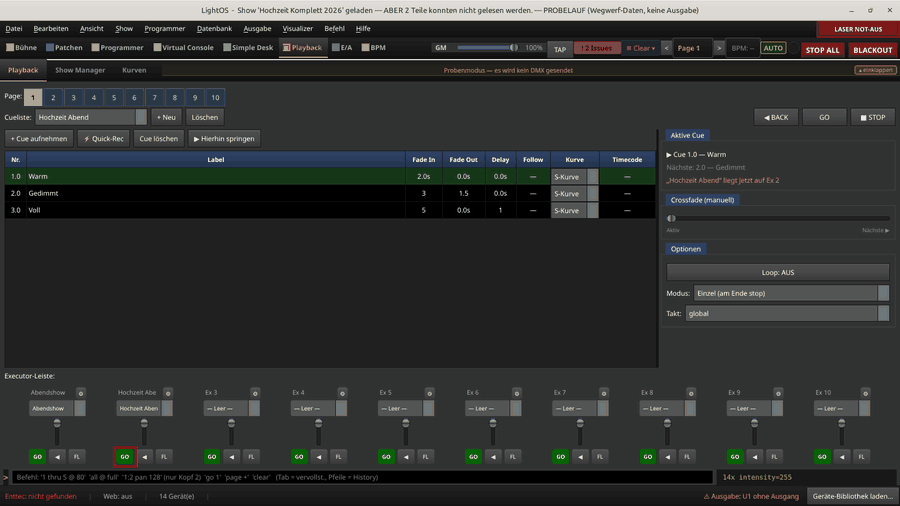

1. Unten in der **Executor-Leiste** liegt deine Liste auf einem Executor. Mit dessen grünem
   **GO** startest du sie direkt.
   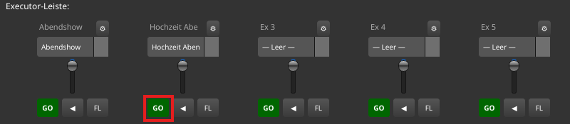
2. Zieh den kleinen **Fader** nach unten. So wird die ganze Liste dunkler.
   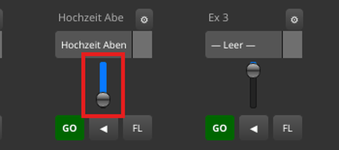
3. Zieh ihn wieder ganz nach oben für volle Helligkeit.
   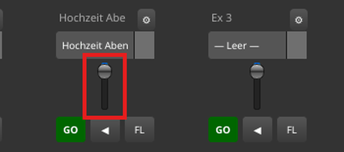
4. Über **Page 1–10** blätterst du die Executor-Seiten. Auf Seite 2 sind die Executoren noch
   leer. Oben in der Leiste steht dabei auch „Page 2“.
   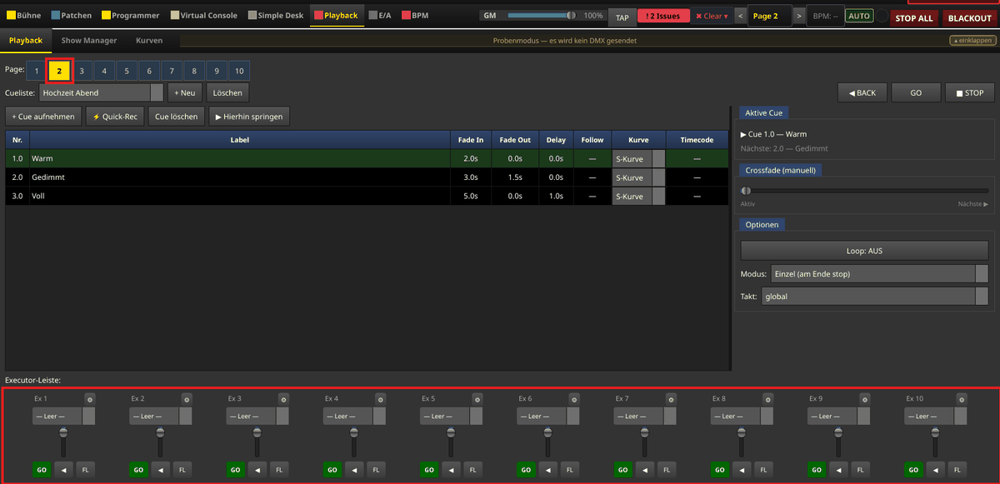
5. Zurück auf Seite 1 sind deine Executoren wieder da. Eine laufende Liste läuft beim Blättern
   weiter.
   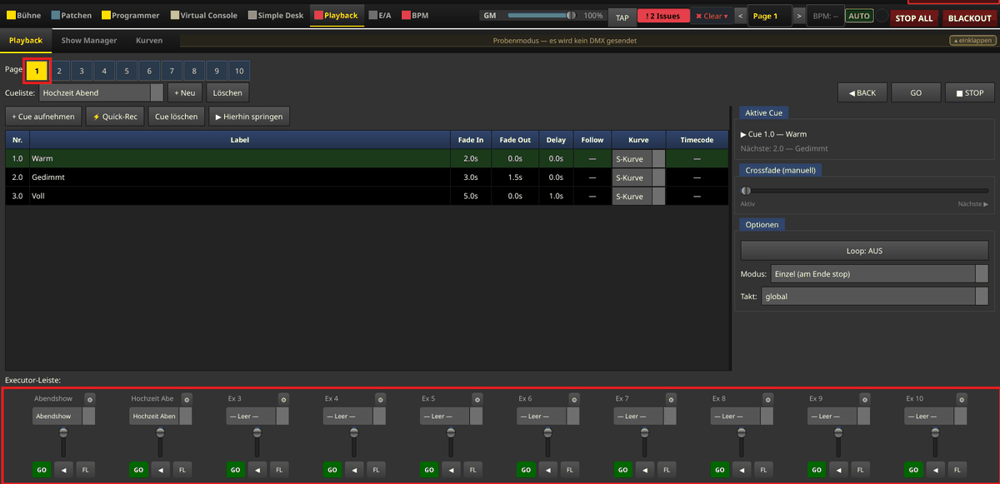
6. In der **Virtual Console** (hier Bank 6) gibt es Cuelisten-Felder. Drück dort **GO ►**.
   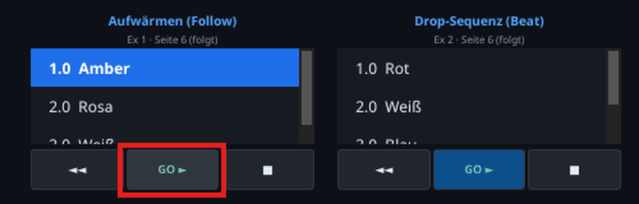
7. Die laufende Cue ist **blau** hinterlegt.
   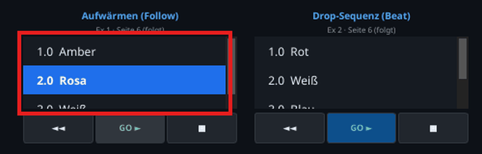
8. Läuft die nächste Cue (per GO oder Follow), wandert die blaue Markierung mit. Die Liste
   scrollt von selbst mit.
   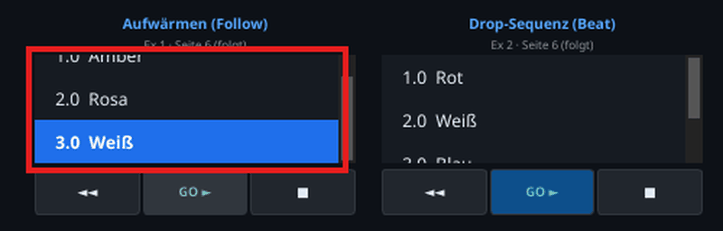
