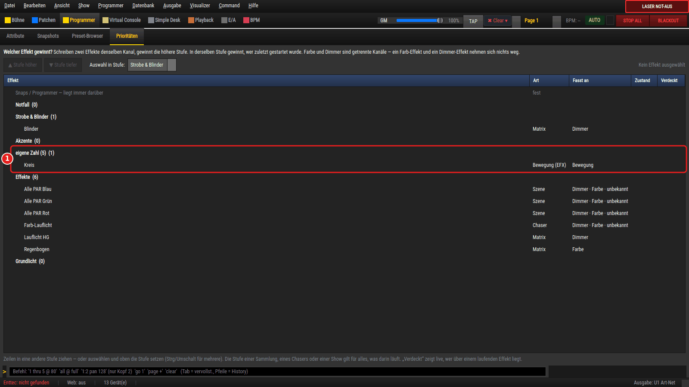
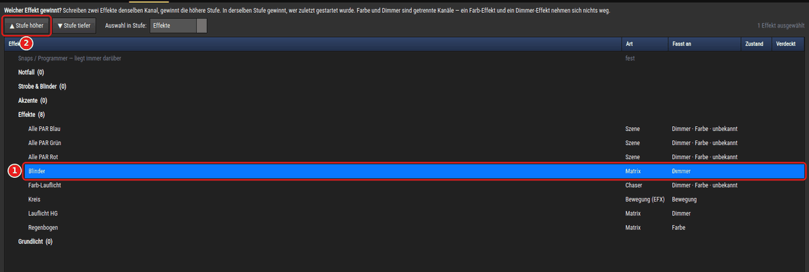
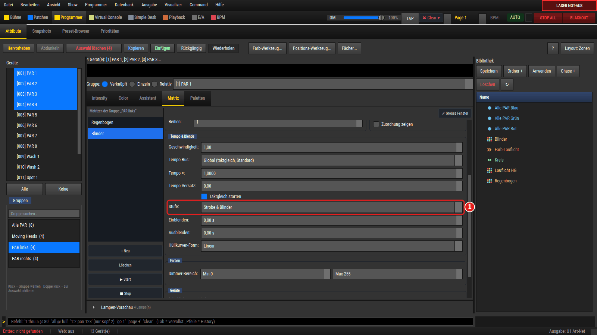
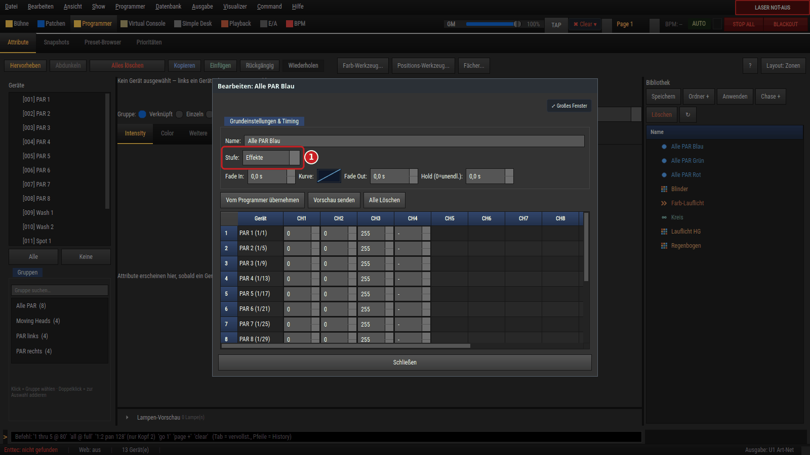
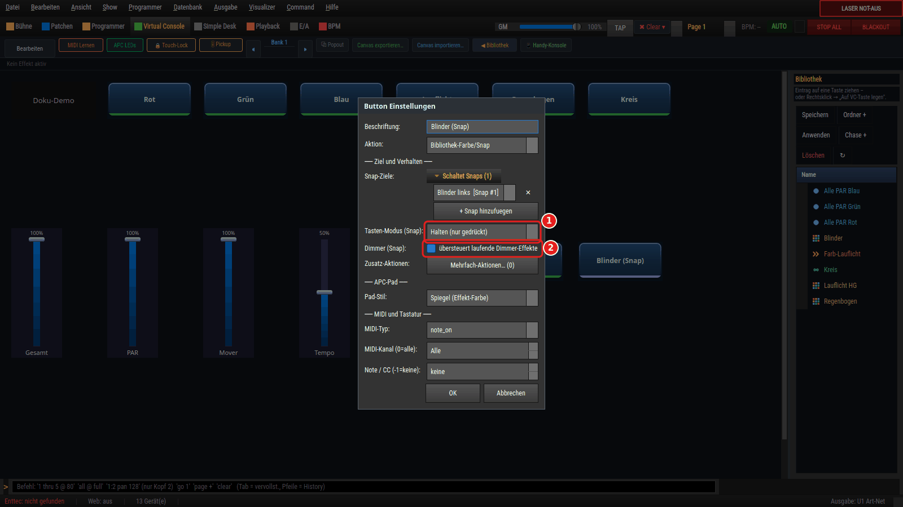

# Wer gewinnt? Prioritäten für Effekte einstellen und prüfen

Laufen zwei Dinge gleichzeitig auf derselben Lampe, muss LightOS entscheiden, wessen Wert
am Ende gesendet wird. Diese Anleitung zeigt die ganze Reihenfolge von unten nach oben und
wie du die Reihenfolge deiner **Effekte** selbst festlegst: über fünf benannte **Stufen**.

Du brauchst dafür keine besondere Show — jede Show mit ein paar Effekten genügt.

## 1. Die Reihenfolge in einem Bild

Jedes Bild (44-mal je Sekunde) wird neu aufgebaut, Schicht für Schicht. Was weiter unten in
der Tabelle steht, kommt später und setzt sich durch.

| # | Schicht | Regel in einem Satz |
|---|---|---|
| 1 | Grundwerte | Jedes Bild beginnt mit den Ruhewerten der Geräte — nichts „bleibt hängen“. |
| 2 | **Effekte und Funktionen** (Szene, Chaser, Sequenz, Bewegung, Matrix …) | Schreiben zwei denselben Kanal, gewinnt die höhere **Stufe**; bei gleicher Stufe gewinnt, wer **zuletzt gestartet** wurde. Es gibt hier kein „höchster Wert gewinnt“ — auch nicht beim Dimmer. |
| 3 | Cue-Listen (Wiedergabe) | Liegen über allen Effekten und ersetzen deren Werte. |
| 4 | Programmer — dazu gehören **alle Snap-Tasten** der Virtual Console | Liegt über Effekten und Cue-Listen, mit zwei Ausnahmen: Einen Kanal für Farbe, Bewegung oder Gobo, den ein laufender Effekt gerade treibt, behält der Effekt. Und einen Dimmer, den ein laufender Effekt schreibt, behält ebenfalls der Effekt — außer die Snap-Taste hat den Haken **übersteuert laufende Dimmer-Effekte** ([Abschnitt 6](#6-blinder-und-strobe-als-snap-taste)). |
| 5 | Automatische Helligkeit | Leuchtet eine Farbe und treibt niemand den Dimmer, wird er von selbst geöffnet (abschaltbar über **Programmer → Farbe macht automatisch hell**). |
| 6 | „Alles Weiß“ | Überschreibt alles darunter, auch laufende Farb-Effekte. |
| 7 | Gruppen-Fader, Geräte-Dimmer, Submaster | Multiplizieren die Helligkeit, ersetzen nichts. |
| 8 | Eingemischtes DMX von außen | Je Universum einstellbar: höchster Wert gewinnt oder ersetzt. |
| 9 | Simple Desk mit „Manueller Override“ | Nur bei gesetztem Haken; dann gewinnen die dort gezogenen Kanäle. |
| 10 | Laser-NOT-AUS, Grand Master, Blackout, Ziel-Blackout | Wirken ganz am Ende und behalten immer das letzte Wort. Ein Ziel-Blackout macht nur seine Geräte dunkel. |

Nicht in der Tabelle: die **Szenen-Vorschau** aus dem Editor. Sie gilt für ein einzelnes Bild,
liegt zwischen Schicht 5 und 6 und wird von Fadern, Master und Blackout genauso begrenzt.

**Die Stufen ordnen nur Schicht 2.** Snap-Tasten, Cue-Listen, Fader und Master behalten
ihren festen Platz.

## 2. Die fünf Stufen

| Stufe (stärkste oben) | Gedacht für |
|---|---|
| **Notfall** | Was immer durchkommen muss, solange es läuft. |
| **Strobe & Blinder** | Kurze, laute Effekte über allem anderen. |
| **Akzente** | Effekte, die sich über das laufende Programm legen. |
| **Effekte** | Die Vorgabe. Alles aus älteren Shows steht hier. |
| **Grundlicht** | Ruhiges Licht, das jeder andere Effekt überdecken darf. |

Ein Effekt hat genau **eine** Stufe. Innerhalb einer Stufe gibt es keine Reihenfolge: dort
gewinnt, wer zuletzt gestartet wurde.

**Alte Shows** öffnen sich unverändert — alles steht in „Effekte“. Hattest du im Matrix- oder
Bewegungs-Editor eine eigene Zahl eingetragen (das Feld hieß früher „Layer-Priorität“), bleibt
sie erhalten und wird als **eigene Zahl (n)** angezeigt, bis du bewusst eine Stufe wählst.
Eine höhere Zahl gewinnt weiterhin; die Stufen entsprechen den Zahlen −20, 0, 20, 40 und 60.
Auch eine **Kanal-Kopplung** steht als „eigene Zahl (10)“ in der Liste: sie liest die Bewegung
der Effekte darunter und rechnet deshalb absichtlich direkt nach der Stufe „Effekte“.

## 3. Stufe vergeben — in der Ansicht „Prioritäten“

1. Öffne die Sektion **Programmer** und dort den Reiter **Prioritäten**.
2. Ganz oben steht ausgegraut **Snaps / Programmer — liegt immer darüber**. Die Zeile ist
   fest; sie erinnert daran, dass Snap-Tasten keine Effekte sind.
3. Darunter die fünf Stufen, die stärkste zuerst. Jeder Effekt der Show steht in seiner
   Stufe mit **Art** (Szene, Chaser, Matrix …) und **Fasst an**: Dimmer, Farbe, Bewegung,
   Gobo oder Sonstiges. Steht dort **unbekannt**, lässt sich das nicht aus der Show ablesen
   (zum Beispiel bei einem Skript oder einer Szene mit Geräten, die nicht mehr gepatcht sind).
4. Ein laufender Effekt ist fett und trägt **● läuft**.

   

5. Die Spalte **Verdeckt** zeigt live, ob ein laufender Effekt wirklich ankommt. Liegt
   jemand darüber, steht dort zum Beispiel **verdeckt von Blinder auf 4 Geräten** — oder
   **verdeckt von Programmer auf 2 Geräten**, **verdeckt von Snap auf 1 Gerät**,
   **verdeckt von Cueliste auf 3 Geräten**. Leer heißt: der Effekt läuft nicht, schreibt
   gerade nichts oder kommt auf allen seinen Geräten an. Der Tooltip der Zelle nennt
   zusätzlich, auf wie vielen Geräten der Effekt **gewinnt**, und alle Verdecker.
   - Ein Gerät zählt als verdeckt, sobald **ein** Kanal, den der Effekt dort schreibt, am
     Ende von jemand anderem kommt (zum Beispiel nur der Dimmer).
   - **Modify-Effekte** verdecken nie: sie rechnen auf das fertige Bild drauf.
   - **Snap** heißt eine Snap-Taste mit dem Haken **übersteuert laufende Dimmer-Effekte**;
     alle anderen Werte aus Programmer und Snap-Tasten heißen **Programmer**.
   - Läuft ein Effekt in einer **Sammlung** oder **Show**, schreibt er für sie — die Spalte
     steht dann an der Zeile der Sammlung bzw. Show, an der des Mitglieds bleibt sie leer.
   - Die Spalte zieht etwa dreimal je Sekunde nach, nur solange der Reiter zu sehen ist.
     Ausgeblendet kostet sie nichts.

   

6. Stufe ändern — vier Wege, alle auch für mehrere Zeilen (Strg oder Umschalt beim Klicken):
   - die Zeile in eine andere Stufe **ziehen**,
   - **▲ Stufe höher** / **▼ Stufe tiefer**,
   - im Feld **Auswahl in Stufe** die Stufe wählen,
   - Rechtsklick → **In Stufe „…“**.

   

7. Jede Änderung ist **ein** Schritt für **Bearbeiten → Rückgängig**, auch wenn sie mehrere
   Effekte betrifft.

Nicht in der Liste stehen Audio-Funktionen (sie schreiben kein DMX) und ungespeicherte
Entwürfe aus dem Bewegungs-Editor.

## 4. Stufe vergeben — im Editor

Jeder Editor hat das feste Feld **Stufe**: Szene, Chaser, Sequenz, Sammlung, Skript,
Ebenen-Effekt, Carousel, Matrix und Bewegung (EFX). Im Matrix- und im Bewegungs-Editor steht
es in der Gruppe *Tempo & Blende* bzw. *Tempo & Richtung*, dort wo früher das Zahlenfeld war.

Die Auswahl im Editor und die Ansicht **Prioritäten** zeigen dasselbe — ändert man es an der
einen Stelle, zieht die andere nach.

## 5. Farbe und Dimmer konkurrieren nicht

Eine Farb-Matrix und ein Dimmer-Lauflicht auf denselben Lampen nehmen sich nichts weg: sie
schreiben getrennte Kanäle. Die Stufe spielt erst eine Rolle, wenn zwei Effekte **denselben**
Baustein derselben Lampe treiben — zwei Dimmer-Effekte, zwei Farb-Effekte, zwei Bewegungen.
Die Spalte **Fasst an** zeigt dir das auf einen Blick.

## 6. Blinder und Strobe als Snap-Taste

Eine Blinder- oder „Strobe Weiß“-Taste, die als **Snap** gebaut ist, kommt gegen ein
laufendes Dimmer-Lauflicht zunächst **nicht** durch: der Effekt behält den Dimmer (Schicht 4).
Dafür gibt es je Snap-Taste einen Haken:

1. In der Virtual Console **Bearbeiten** einschalten und die Snap-Taste doppelt anklicken.
2. Unter **Ziel und Verhalten**, direkt unter **Tasten-Modus (Snap)**, den Haken
   **übersteuert laufende Dimmer-Effekte** setzen (Zeile **Dimmer (Snap)**).

   

3. Solange die Taste aktiv ist — gehalten, umgeschaltet oder gesetzt —, gewinnt der
   **Dimmer-Wert des Snaps** an genau den Lampen, für die der Snap einen Dimmer-Wert enthält.
   Lampen, die der Snap nicht nennt, laufen im Effekt weiter.
4. Nach dem Loslassen bzw. Ausschalten läuft der Effekt an diesen Lampen weiter, als wäre
   nichts gewesen.

Was der Haken **nicht** tut:

- Er fasst nur den **Dimmer** an. Die Farbe bleibt getrennt: treibt ein Effekt die Farbe,
  behält er sie; der Dimmer zieht keine Farbe nach.
- Er wirkt nur an Lampen mit **eigenem Dimmer-Kanal**. Eine reine RGB-Lampe hat keinen
  Dimmer, den die Taste übersteuern könnte.
- **Master, Gruppen-Fader, Blackout und Laser-NOT-AUS** behalten das letzte Wort — eine
  Blinder-Taste hellt einen Blackout nicht auf.
- Drückst du danach eine zweite Snap-Taste auf dieselben Lampen, gilt deren Dimmer-Wert **und**
  deren Haken (zuletzt gedrückt gewinnt); beim Loslassen geht beides an die erste zurück.

Ohne Haken bleibt alles wie bisher. Die Alternative ohne Haken: den Blinder als **Effekt**
bauen und auf die Stufe „Strobe & Blinder“ legen.

## 7. Hinweis bei Überschneidungen

Beim Bauen der Virtual Console sagt dir LightOS, wenn zwei Tasten dasselbe anfassen.

1. In der Virtual Console **Bearbeiten** einschalten und eine Taste mit der Aktion
   **Funktion an/aus** oder **Funktion (nur gehalten)** anklicken.
2. Steuert eine **andere Taste** oder ein **Effekt-Fader** an **denselben
   Geräten denselben Baustein**, steht gleich unter **Aktion** ein gelber **Hinweis** über
   die ganze Breite, zum Beispiel:

   > Diese Taste und „Lauflicht HG“ steuern beide den Dimmer der Gruppe „Hintergrund“ —
   > gleiche Stufe, es gewinnt, wer zuletzt gestartet wurde.

   oder

   > Diese Taste und „Blinder“ steuern beide den Dimmer der Gruppe „Hintergrund“ —
   > „Blinder“ liegt eine Stufe höher und gewinnt.

   

3. Der Text nennt die Gruppe, wenn die gemeinsamen Geräte genau eine Gruppe sind, bei einem
   einzelnen Gerät dessen Namen, sonst die Zahl der Geräte.
4. **Reihenfolge:** zuerst alle Effekte, gegen die diese Taste **verliert**, dann die auf
   gleicher Stufe, dann die, gegen die sie gewinnt. Höchstens drei Treffer werden
   ausgeschrieben — die Effekte, gegen die die Taste verliert, aber immer (auch wenn es mehr
   als drei sind). Der Rest steht in einer Zeile, die sagt, wie es um ihn steht, zum Beispiel
   **… und 3 weitere Überschneidungen: bei 1 entscheidet, wer zuletzt gestartet wurde; gegen
   2 gewinnt diese Taste.** Die **vollständige Liste** zeigt der Tooltip der gelben Zeile.
5. Ändere die Stufe (Abschnitt 3 oder 4) oder das Ziel der Taste — der Hinweis zieht sofort
   nach. Ohne Überschneidung ist die Zeile nicht da.

**Fader zählen immer mit.** Ein Fader in den Modi **Effekt-Helligkeit**, **Effekt-Tempo**
oder **Effekt-Parameter** mit einem festen Ziel in der Liste **Steuert** zählt wie eine
Taste — mit und ohne den Haken **bei 0 wirklich stoppen (sonst nur runterregeln)**. Ohne
den Haken stoppt der Fader seinen Effekt bei 0 nicht: der Effekt läuft unsichtbar weiter
und belegt die Geräte. Genau das überrascht auf der Bühne, deshalb steht es ausdrücklich
dabei:

> Diese Taste und „Wash HG“ steuern beide den Dimmer der Gruppe „Hintergrund“ — gleiche
> Stufe, es gewinnt, wer zuletzt gestartet wurde. Ein Fader hält „Wash HG“ auch bei 0 am
> Laufen — der Effekt belegt die Geräte dann weiter.

Der Fader selbst zeigt denselben gelben **Hinweis** in seinen Eigenschaften, gleich unter
**Steuert** („Dieser Fader und …“). Fehlt der Haken, endet er mit der Zeile:

> Dieser Fader hält den Effekt auch bei 0 am Laufen — er belegt die Geräte dann weiter.

Setzt du den Haken, verschwindet dieser Satz; die Überschneidung selbst bleibt gemeldet.
Liegt derselbe Effekt noch auf einem zweiten Fader ohne den Haken (zum Beispiel einem
Tempo-Fader), steht stattdessen da, dass ein anderer Fader ihn hält:

> Ein anderer Fader hält „Wash HG“ auch bei 0 am Laufen — der Effekt belegt die Geräte dann weiter.

Der Hinweis ist **nur eine Auskunft**: er ändert nichts, sperrt nichts und fragt nichts ab.
Dieselben Sätze stehen im Reiter **Prioritäten** als Tooltip an der Zeile des Effekts
(„Dieser Effekt und …“) — dort immer vollständig.

Wann **kein** Hinweis kommt:

- **Farbe gegen Dimmer** auf denselben Lampen — das sind getrennte Kanäle, da stört sich nichts.
- Dieselbe **Geräteart**, aber andere Geräte.
- Der andere Effekt liegt auf **keiner Taste** und keinem Effekt-Fader. Ein Fader, der nur
  den „aktiven Effekt“ regelt (leere Liste **Steuert**), hat kein festes Ziel und zählt nicht.
- Beide Tasten liegen im selben **Solo-Rahmen** (Rahmen mit dem Haken **Solo-Frame (nur 1
  Button gleichzeitig aktiv)**) — sie schalten sich gegenseitig aus, es läuft immer nur eine.
  Gegen Tasten und Fader **außerhalb** des Rahmens kommt der Hinweis weiterhin. Zur Gruppe
  gehören nur die Tasten, die **direkt** im Solo-Rahmen liegen:
  - Eine Taste in einem **Unter-Rahmen** des Solo-Rahmens gehört nicht dazu — der Solo-Rahmen
    schaltet sie nicht aus.
  - Ein **Fader** im Solo-Rahmen gehört nicht dazu — er wird nie ausgeschaltet.
  - Zwei **verschiedene** Solo-Rahmen sind zwei Gruppen: eine Taste aus dem einen und eine aus
    dem anderen können gleichzeitig laufen, also kommt der Hinweis.
  - Liegt derselbe Effekt zusätzlich auf einer Taste außerhalb, zählt er über diese Taste.
  - Startet eine Taste im Solo-Rahmen eine **Sammlung** oder einen **Chaser** und die
    Nachbartaste eines der Mitglieder, gibt es zwischen den beiden ebenfalls keinen Hinweis.
- Mehrere Funktionen **derselben** Taste: die startest du absichtlich gemeinsam.
- Zwei Tasten **stoppen sich beim Start gegenseitig** — über den Haken **Andere Funktionen
  stoppen (nur diese aktiv)**, den Haken **Andere Effekte auf denselben Geräten stoppen**
  (auch gemischt: an der einen der eine, an der anderen der andere Haken) oder denselben
  **Live-Edit-Slot** an beiden. Dann läuft immer nur eine. Mit Live-Edit-Slot zählt der
  Haken „nur diese aktiv“ nicht — die Taste stoppt dann nur das Ziel ihres Slots. Hat nur
  **eine** der beiden Tasten so eine Regel, laufen beide, sobald die andere danach startet:
  der Hinweis bleibt und sagt das dazu („Beim Start stoppt diese Taste „…“ — erst wenn „…“
  danach startet, laufen beide.“). Startet die andere Taste deine Funktion selbst mit,
  stoppt sie sie nicht — dann bleibt der Hinweis ebenfalls. Das gilt für die gelbe Zeile an der Taste und am Fader;
  der Tooltip im Reiter **Prioritäten** kennt diese Regeln noch nicht.
- Es lässt sich nicht sicher ablesen, was ein Effekt anfasst (Skript, **unbekannt** in der
  Spalte **Fasst an**), oder es ist nur **Sonstiges** wie Shutter oder Zoom.

Bei einer **Sammlung**, einem **Chaser** oder einer **Show** auf der Taste zählt das Ganze:
alle Geräte der Mitglieder und die Stufe des Behälters.

## 8. Was die Stufen nicht regeln

- **Sammlung, Chaser, Show:** Was *in* einer Sammlung, einem Chaser oder einer Show läuft,
  läuft auf **deren** Stufe. Die eigene Stufe eines Mitglieds zählt nur, wenn du es einzeln
  startest. Der Hinweis steht in der Ansicht als Tooltip an der Zeile („Läuft auch in: …“).
- **Snap-Tasten:** liegen immer über den Effekten (Schicht 4), unabhängig von jeder Stufe —
  mit den dort genannten Ausnahmen für laufende Effekte.
- **Kein „Untergrund“:** Ein Dimmer-Lauflicht schreibt für *jede* seiner Lampen einen Wert,
  auch 0 für die gerade dunklen. Liegt es über einem anderen Dimmer-Effekt, verdeckt es ihn
  auf diesen Lampen vollständig — eine höhere Stufe macht daraus keinen Läufer *über* einem
  Untergrund. Dafür gibt es im Matrix-Editor (Stil Dimmer) den Haken **Dunkle Lampen
  durchlassen**: dann setzt der Effekt nur seine hellen Lampen (auch den Schweif) genau auf
  seinen Wert, in seiner Stufe — die dunklen gehören dem, was darunter läuft. Anders als ein
  **Modify-Effekt** in der Betriebsart *Addieren* (legt obendrauf, 40 % + 70 % = 100 %;
  Anleitung [Dimmer-Matrix, Abschnitt 5](../anleitung_dimmermatrix/ANLEITUNG_DIMMERMATRIX.md))
  stehen dort genau 70 %.
- **Master und Blackout:** Grand Master, Gruppen-Fader, Blackout und Laser-NOT-AUS wirken
  nach allen Effekten, egal auf welcher Stufe.

## Noch fehlendes Bild

Das **Schichten-Schaubild** (Grundwerte bis NOT-AUS) aus Abschnitt 1 ist noch nicht gezeichnet;
bis dahin gilt die Tabelle dort.
