# Programmer, Paletten und Befehlszeile — Schritt für Schritt

> Nach diesen drei kurzen Anleitungen kannst du ein Gerät wählen und Farbe und Helligkeit
> setzen, eine Farbpalette aufzeichnen und abrufen und mit der Befehlszeile mehrere Geräte auf
> einmal einstellen und den Programmer wieder leeren. Jede Anleitung beginnt mit einem GIF vom
> ganzen Ablauf, danach kommt ein Bild je Schritt. Rote Rahmen zeigen, wo du klickst oder
> hinschaust.

Die Bilder stammen aus einer Übungs-Show im Probelauf (es geht kein DMX hinaus). Die Sektion
Programmer von Grund auf: [Programmer-Grundlagen](../anleitung_programmer_grundlagen/ANLEITUNG.md).
Alle Anleitungen: [Übersicht](../ANLEITUNGEN.md).

---

## Anleitung 1: Ein Gerät wählen, Farbe und Helligkeit setzen

**Ziel:** Ein Gerät leuchtet rot, mit 80 % Helligkeit.
**Wichtig:** Farbe und Helligkeit (Dimmer) sind getrennt. Eine Farbe allein macht das Gerät
**nicht** hell.

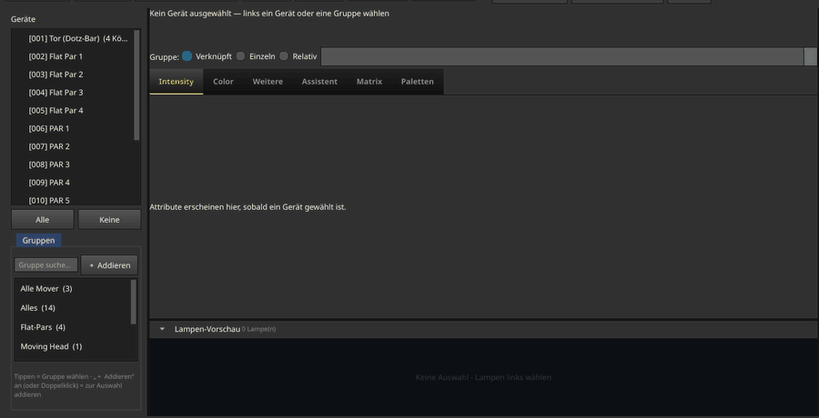

1. Klick oben auf den Reiter **Programmer**.
   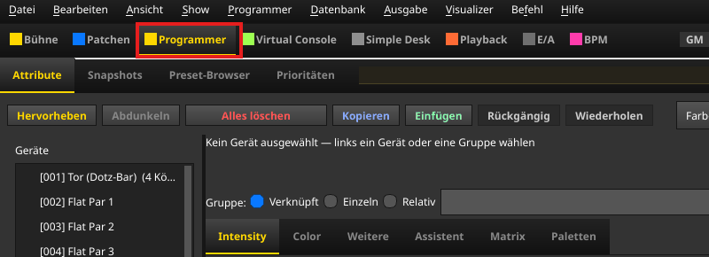
2. Klick links in der Liste **Geräte** auf ein Gerät, zum Beispiel **Flat Par 1**. Die Zeile
   wird blau. Rechts erscheinen jetzt die Einstellungen für das Gerät.
   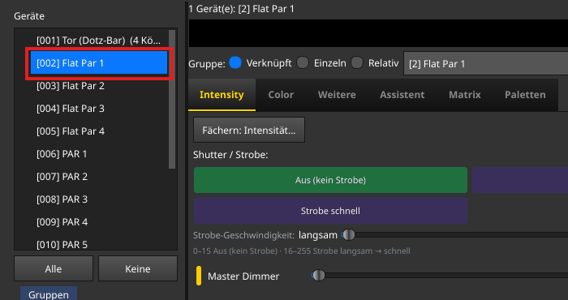
3. Klick auf den Reiter **Color**.
   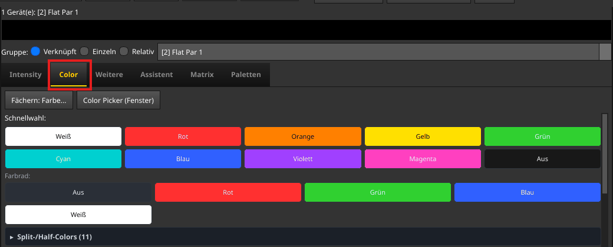
4. Klick unter **Schnellwahl** auf **Rot**. Der Balken oben wird rot. Das ist die Farbe, die
   jetzt im Programmer steht.
   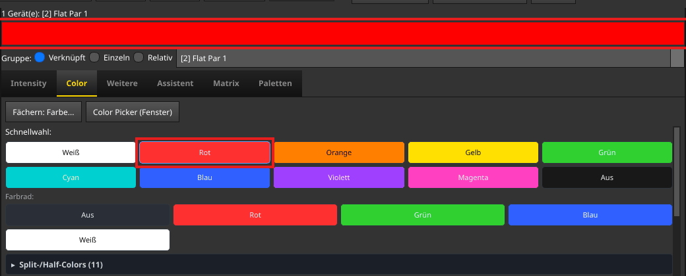
5. Wechsle zum Reiter **Intensity**. Der **Master Dimmer** steht noch auf **0**. Die
   Lampen-Vorschau unten bleibt dunkel. Das ist richtig so: Die Farbe zieht den Dimmer nicht mit.
   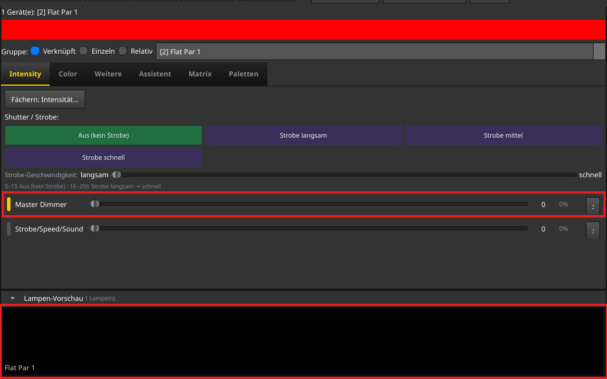
6. Zieh den Regler **Master Dimmer** nach rechts, bis rechts **80 %** steht. Jetzt leuchtet die
   Lampen-Vorschau rot.
   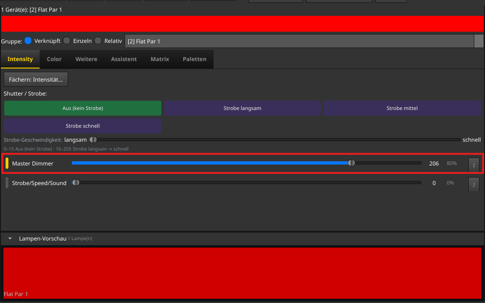

**Gut zu wissen**
- Oben in der Leiste zeigt **Programmer 5** an, wie viele Werte gerade im Programmer stehen.
- **Rückgängig** und **Wiederholen** nehmen deinen letzten Schritt zurück oder holen ihn
  wieder. Eine ganze Ziehbewegung zählt dabei als **ein** Schritt.

---

## Anleitung 2: Eine Farbpalette aufzeichnen und wieder abrufen

**Ziel:** Die rote Farbe als Palette speichern und dann auf ein anderes Gerät legen.

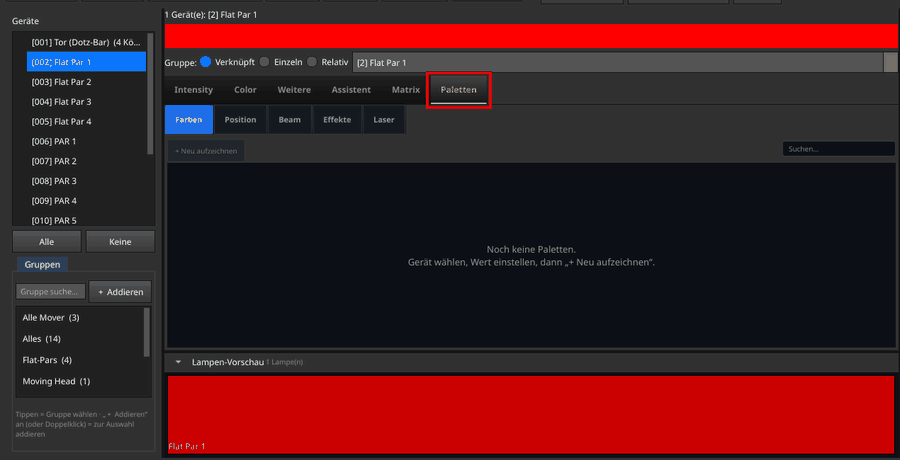

1. Du hast ein Gerät gewählt und eine Farbe gesetzt (siehe Anleitung 1). Klick auf den Reiter
   **Paletten**. Der Unterreiter **Farben** ist schon offen.
   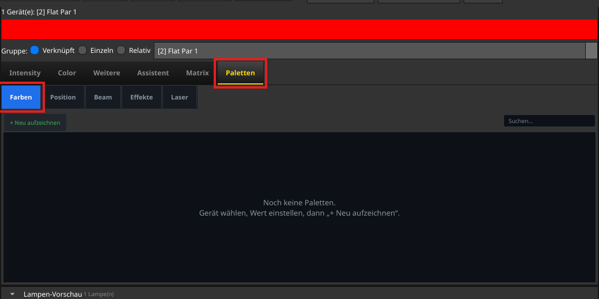
2. Klick auf **+ Neu aufzeichnen**.
   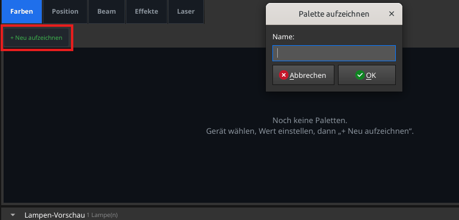
3. Gib einen Namen ein, zum Beispiel **Rot Buehne**. Klick auf **OK** oder drück die
   Eingabetaste. Mit **Abbrechen** oder der Esc-Taste wird nichts gespeichert.
   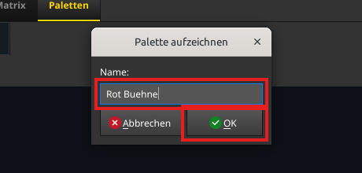
4. Die neue Palette erscheint als rote Kachel.
   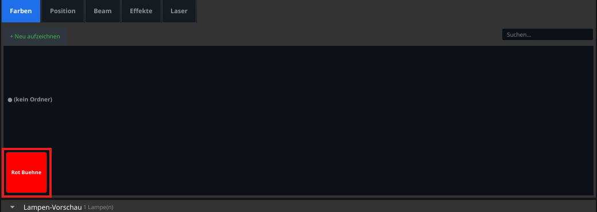
5. Wähl links ein anderes Gerät, zum Beispiel **Flat Par 2**.
   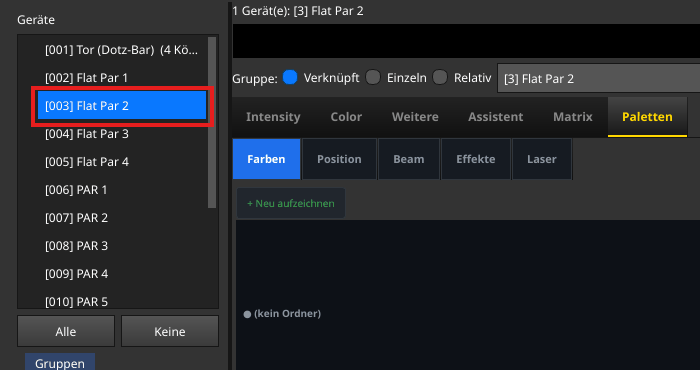
6. Klick auf die Kachel **Rot Buehne**. Das Gerät bekommt die rote Farbe. Die Vorschau bleibt
   dunkel, bis du den Dimmer aufziehst. Eine Farbpalette ändert nur die Farbe.
   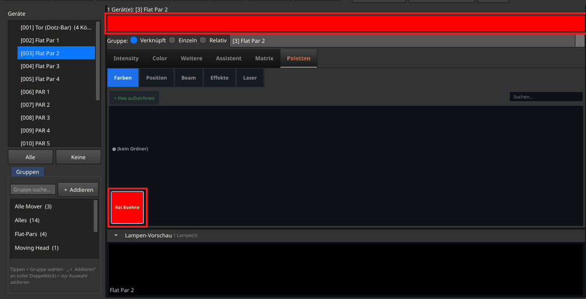
7. Mit einem **Rechtsklick** auf eine Kachel kannst du sie **anwenden**, mit den aktuellen
   Werten **überschreiben**, **in einen Ordner verschieben** oder **löschen**.
   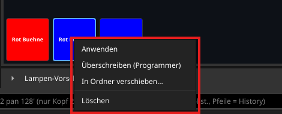

**Gut zu wissen**
- Ohne Namen wird keine Palette angelegt.
- Ist der Name sehr lang, zeigt die Kachel nur einen Teil. Fahr mit der Maus darüber, dann
  siehst du den ganzen Namen.
- Paletten werden mit der Show gespeichert (Strg+S) und sind nach dem nächsten Start wieder da.

---

## Anleitung 3: Schnell arbeiten mit der Befehlszeile und dem Clear-Menü

**Ziel:** Mehrere Geräte mit einem Befehl einstellen und den Programmer wieder leeren.

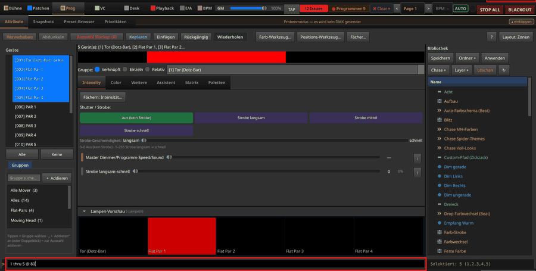

1. Klick unten in die Befehlszeile (rechts neben dem gelben **>**). Tipp **1 thru 5 @ 80** und
   drück die Eingabetaste.
   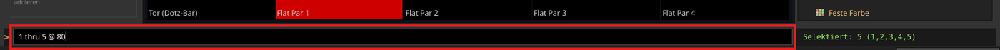
2. Die Geräte 1 bis 5 sind jetzt gewählt (links blau) und stehen auf 80 %. Rechts neben der
   Befehlszeile steht **5x intensity=204**.
   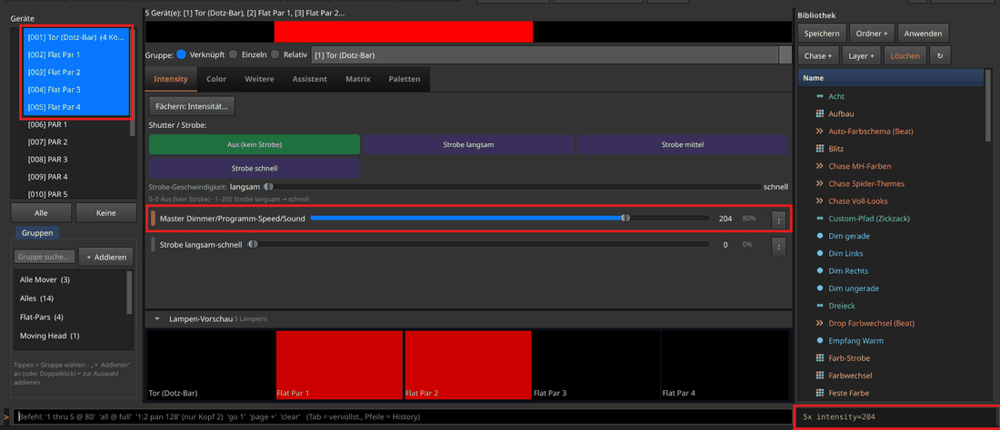
3. Tipp **all @ full** und drück die Eingabetaste.
   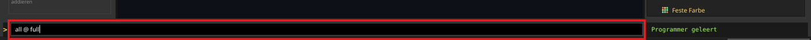
4. Alle Geräte stehen auf voller Helligkeit. Rechts steht **14x intensity=255**.
   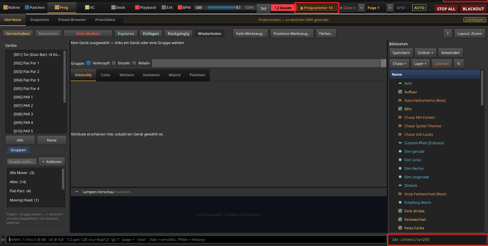
5. Tippst du etwas, das LightOS nicht kennt, erscheint rechts eine rote Meldung mit Beispielen.
   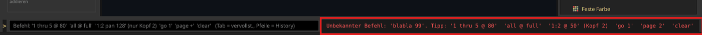
6. Zum Leeren klick oben auf **Clear ▾** und dann auf **Programmer leeren**. Die Zahl in
   Klammern zeigt, wie viele Werte gelöscht werden.
   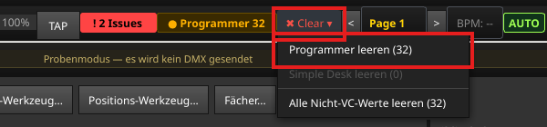
7. Die Anzeige **Programmer …** oben verschwindet. Deine Auswahl links bleibt erhalten.
   
8. Alternativ tippst du **clear** in die Befehlszeile. Rechts steht dann **Programmer geleert**.
   Dabei wird auch die Geräteauswahl aufgehoben.
   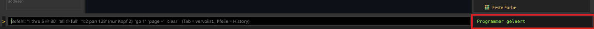

**Gut zu wissen**
- Mit den Pfeiltasten hoch/runter holst du frühere Befehle zurück.
- Weitere Beispiele: **12 pan 220** (Kopf 12 nach rechts drehen), **12 tilt 200**.
- Schreib den Wert immer mit **@** (z. B. `1 thru 5 @ 80`).
