# Show-Dateien, Auto-Save und Rückgängig — Schritt für Schritt

> Nach diesen vier kurzen Anleitungen kannst du eine Show unter neuem Namen speichern, Auto-Save
> einstellen und nach einem Absturz wiederherstellen, Änderungen über mehrere Bereiche
> rückgängig machen und weißt, was bei einer fehlenden oder kaputten Datei passiert. Jede
> Anleitung beginnt mit einem GIF vom ganzen Ablauf, danach kommt ein Bild je Schritt.

**Show:** Die Bilder zeigen die Show „Hochzeit Komplett 2026“ (Generator
`build_hochzeit_komplett.py`, siehe [Übersicht](../ANLEITUNGEN.md)), aufgenommen im Probelauf
(es geht kein DMX hinaus). Darum steht in der Titelleiste „PROBELAUF“ und ein Pfad im
Temp-Ordner; bei dir steht dort der Name und Ort deiner Show.

---

## Anleitung 1: Show unter neuem Namen speichern

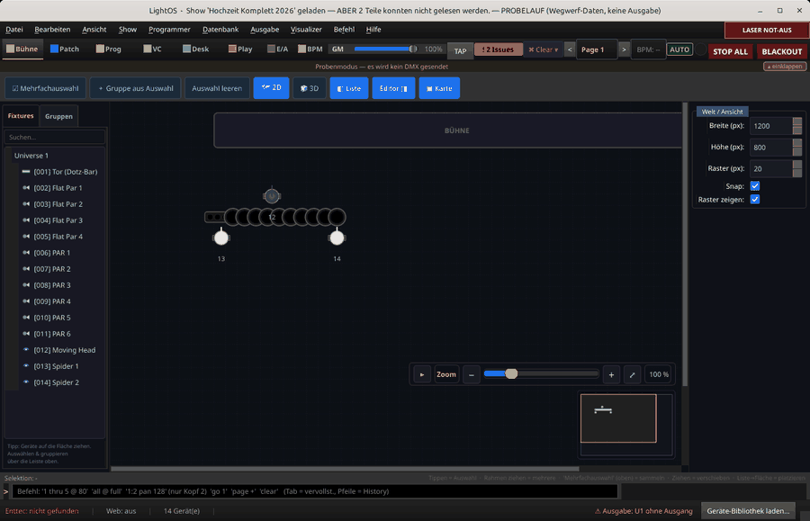

1. **Öffne das Menü „Datei“.** Klick oben links auf „Datei“ und dann auf **„Speichern unter…“**.
   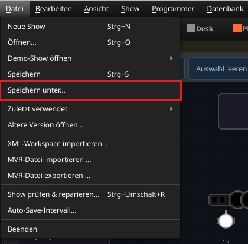
2. **Gib einen Namen ein.** Das Fenster „Show speichern“ geht auf. Der Cursor steht schon im
   Feld „Name“. Tippe den neuen Namen ein, zum Beispiel `Hochzeit Kopie`. Die Endung `.lshow`
   musst du nicht tippen, die kommt von selbst.
   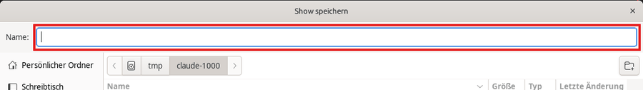
3. **Klick auf „Speichern“** (oder drück Enter). Solange das Namensfeld leer ist, bleibt der
   Knopf grau.
   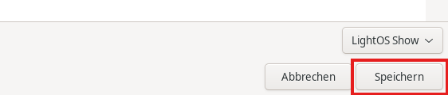
4. **Prüf das Ergebnis.** Oben in der Titelleiste steht jetzt der neue Dateiname. Unten links
   steht kurz „Gespeichert: …“. Ab jetzt speichert **Strg+S** immer in diese neue Datei.
   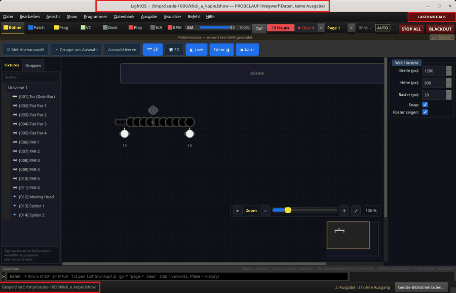

**Tipp:** Mit **Strg+S** speicherst du schnell in die gleiche Datei. „Speichern unter…“ brauchst
du nur für eine Kopie oder einen neuen Namen.

---

## Anleitung 2: Auto-Save einstellen und nach einem Absturz wiederherstellen

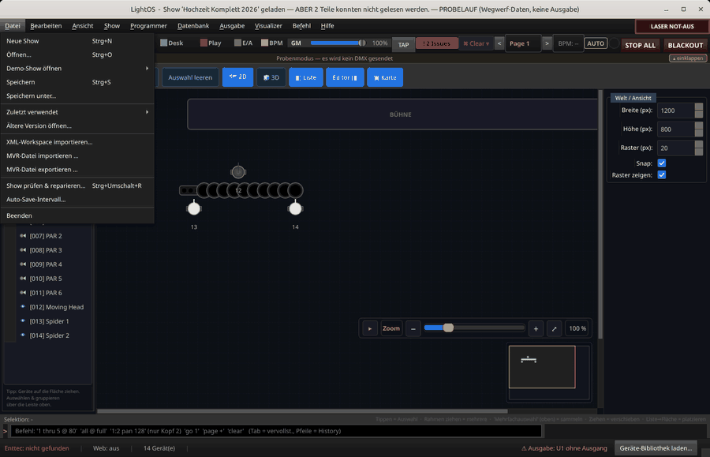

1. **Öffne „Datei“ → „Auto-Save-Intervall…“.**
   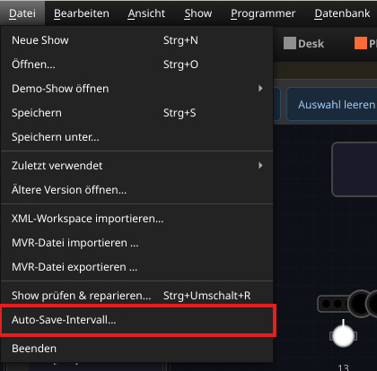
2. **Stell die Minuten ein.** Erlaubt sind 1 bis 60 Minuten. Vorgabe sind 5 Minuten. Bei 0
   bleibt „OK“ grau. Klick auf **„OK“**. LightOS sichert die Show jetzt regelmäßig im
   Hintergrund — aber nur, wenn sich etwas geändert hat.
   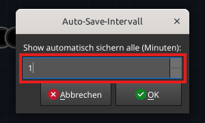
3. **Nach einem Absturz:** Starte LightOS neu. Ist die Auto-Save-Sicherung neuer als deine
   zuletzt gespeicherte Show, fragt LightOS: „Eine Auto-Save Datei existiert …
   Wiederherstellen?“ Klick auf **„Ja“**. Mit „Nein“ startest du mit der normal geladenen Show.
   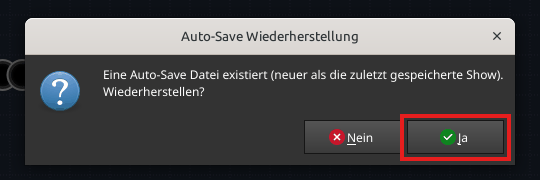
4. **Prüf den Stand.** Deine letzte Änderung ist wieder da. Oben steht „wiederhergestellt
   (nicht gespeichert)“, unten steht „Auto-Save wiederhergestellt — bitte speichern“.
   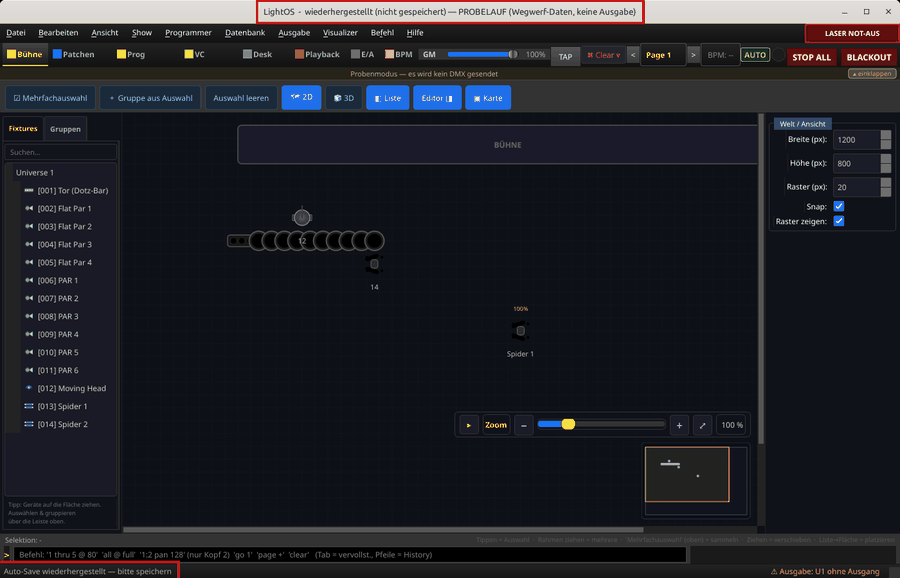
5. **Speichere sofort.** Drück **Strg+S**. Weil die gerettete Show noch keinen Dateinamen hat,
   öffnet sich „Show speichern“ im Show-Ordner. Gib einen Namen ein und klick auf „Speichern“.
   Erst danach ist der Stand sicher in einer eigenen Datei.
   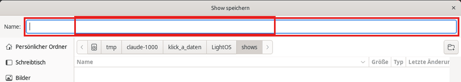

---

## Anleitung 3: Rückgängig und Wiederholen — auch über mehrere Bereiche

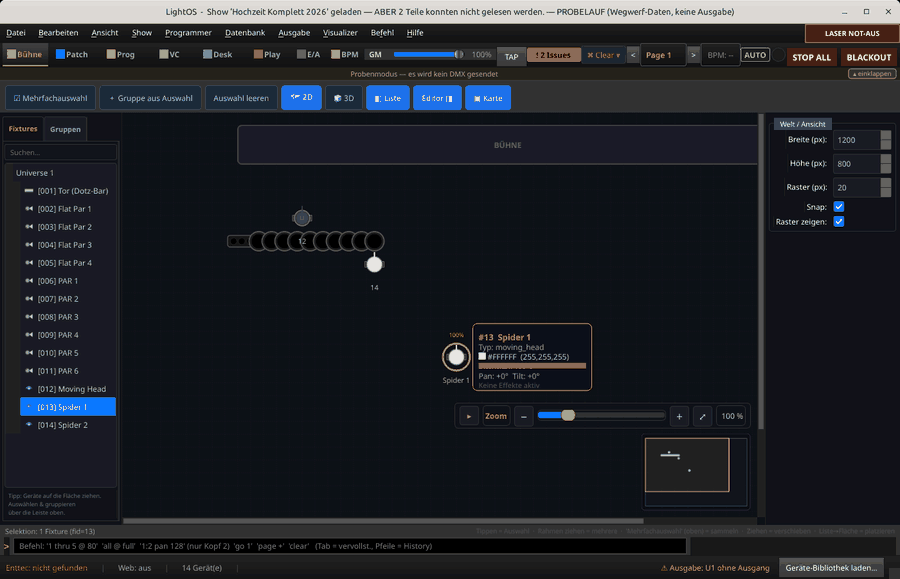

1. **Ändere etwas auf der Bühne.** Zieh im Reiter „Bühne“ ein Gerät an eine neue Stelle.
   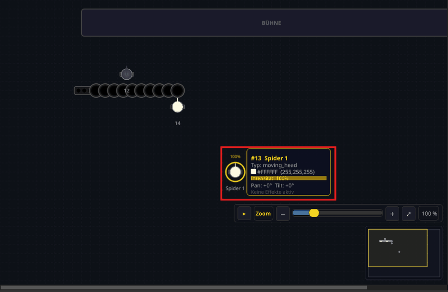
2. **Ändere etwas im Patch.** Wechsle in den Reiter „Patch“. Doppelklick auf ein Gerät, ändere
   das „Label“ und klick auf „Speichern“.
   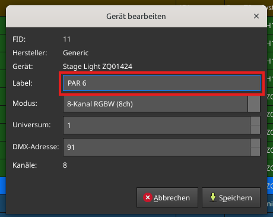
3. **Schau ins Menü „Bearbeiten“.** Hinter „Rückgängig:“ steht, was als Nächstes
   zurückgenommen wird — hier „Gerät „…“ geändert“ mit dem alten Namen des Geräts.
   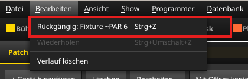
4. **Drück Strg+Z.** Die letzte Änderung (das Label) ist zurück. Unten links steht
   „Rückgängig: …“.
   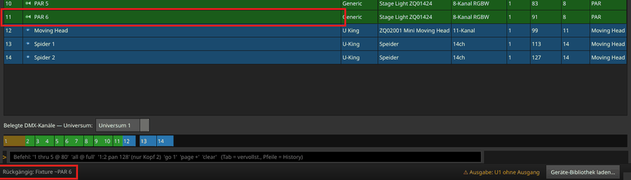
5. **Drück noch einmal Strg+Z.** Jetzt wird auch die Änderung auf der Bühne zurückgenommen —
   egal, in welchem Reiter du gerade bist.
   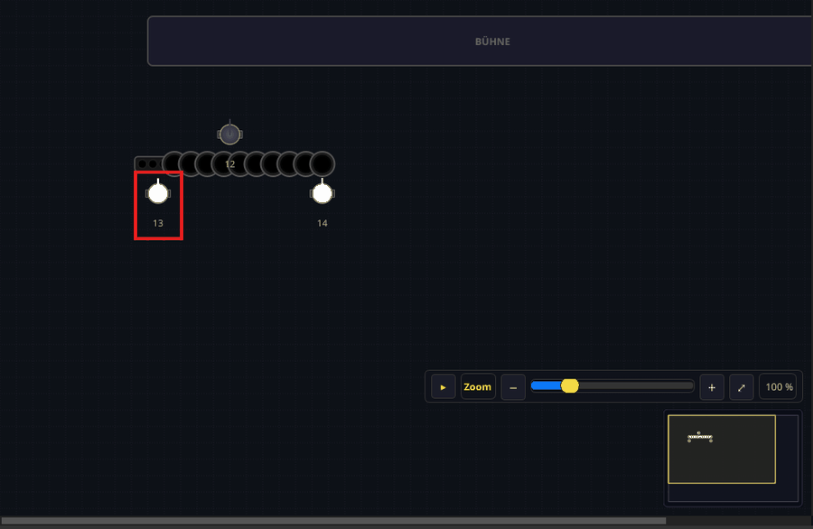
6. **Wiederholen: Strg+Umschalt+Z.** Jeder Druck holt eine Änderung zurück, in der gleichen
   Reihenfolge. Unten steht „Wiederholt: …“.
   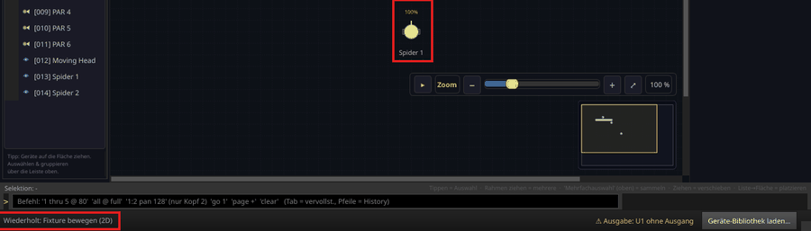
7. **Ungespeicherte Änderungen** erkennst du am Stern vorn in der Titelleiste („* LightOS …“).
   Nach dem Speichern ist er wieder weg. **Beim Schließen mit ungespeicherten Änderungen** fragt LightOS nach: **„Speichern“** sichert
   und beendet, **„Verwerfen“** beendet ohne Sichern, **„Abbrechen“** lässt die App offen.
   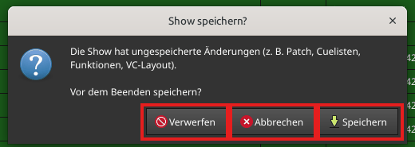

**Gut zu wissen:** Nach „Neue Show“ oder nach dem Laden einer anderen Show ist die
Rückgängig-Liste leer. Du kannst also nicht versehentlich in eine alte Show zurückspringen.

---

## Anleitung 4: Wenn etwas schiefgeht — fehlende oder kaputte Datei, Neue Show

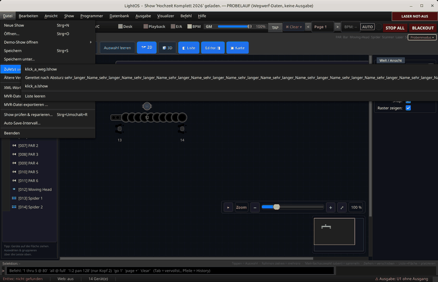

1. **Datei fehlt.** Du klickst in „Datei → Zuletzt verwendet“ auf eine Show, die verschoben oder
   gelöscht wurde. LightOS meldet „Die Show-Datei … wurde nicht gefunden“ und nimmt den Eintrag
   aus „Zuletzt verwendet“. Deine aktuelle Show bleibt unverändert offen. Mit „Liste leeren“
   räumst du die ganze Liste auf. Sehr lange Namen stehen in der Liste in der Mitte gekürzt
   („…“); der volle Pfad erscheint, wenn du mit der Maus darauf zeigst.
   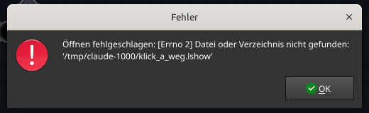
2. **Datei kaputt.** Ist eine `.lshow`-Datei beschädigt, leer oder abgeschnitten, meldet LightOS
   in Worten, was los ist: „keine gültige LightOS-Show“ (fremde, leere oder zerstörte Datei)
   oder „beschädigt“ (Inhalt abgeschnitten). Die technischen Einzelheiten stehen nur im
   Protokoll. Auch hier bleibt die aktuelle Show offen. Versuch dann
   **„Datei → Ältere Version öffnen…“**.
   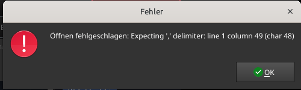
3. **Neue Show mit ungespeicherten Änderungen.** Bei **Strg+N** fragt LightOS „Vor dem Leeren
   speichern?“. Wähl „Speichern“, „Verwerfen“ oder „Abbrechen“. Ohne Änderungen fragt LightOS
   nur „Aktuelle Show komplett verwerfen?“ mit Ja/Nein.
   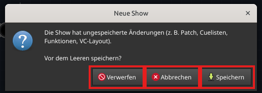

**Gut zu wissen:** Effekte, die gerade laufen, werden beim Laden einer anderen Show automatisch
gestoppt.
