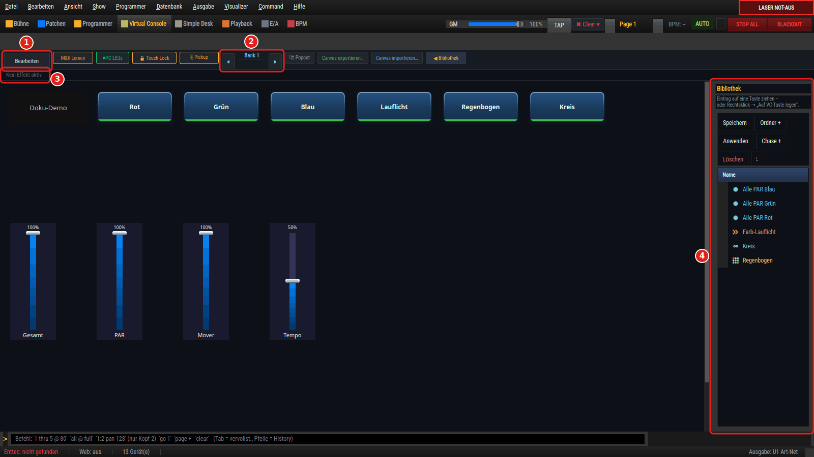
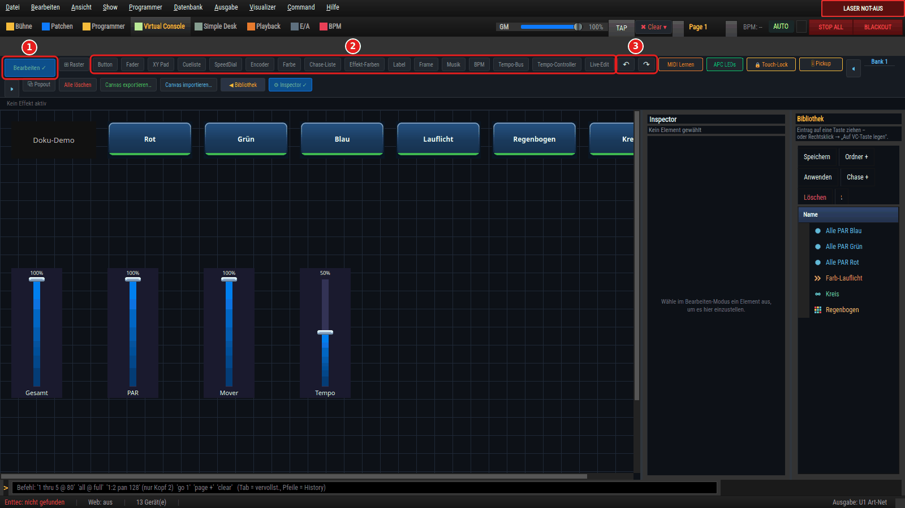
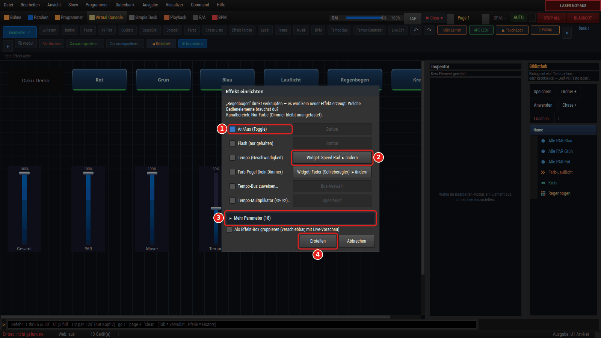
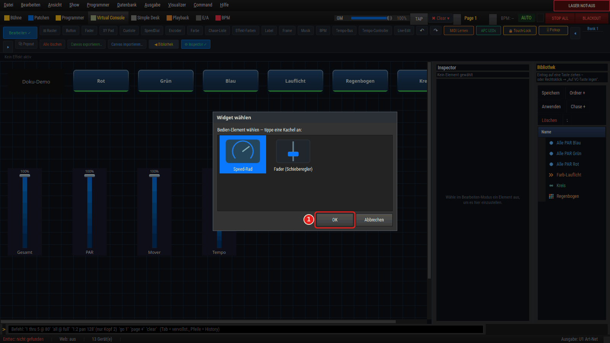
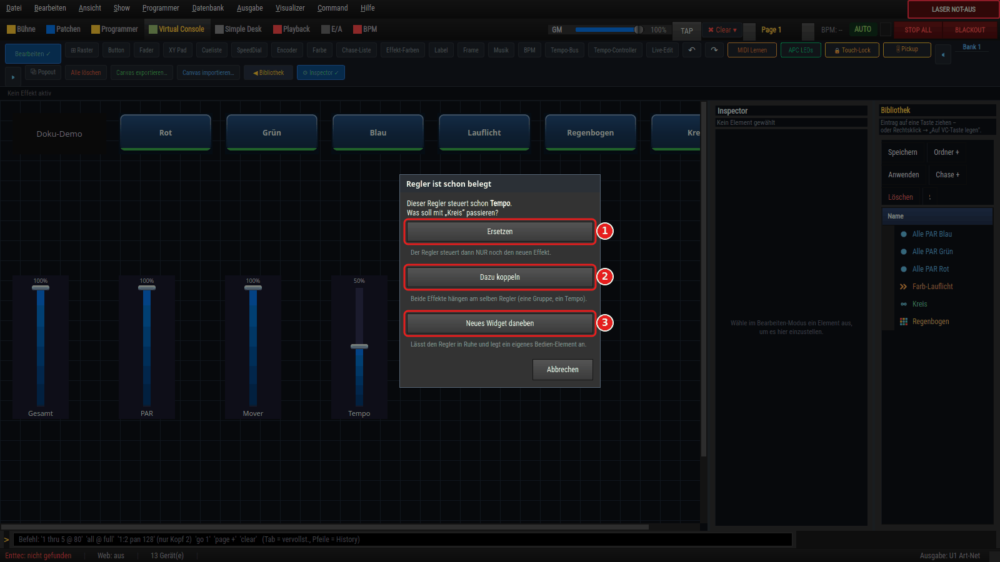
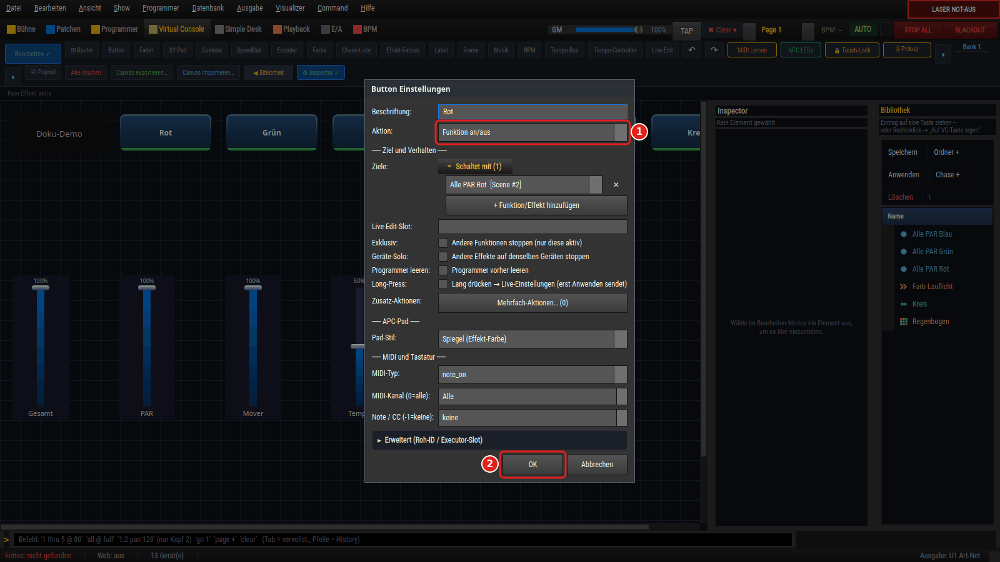
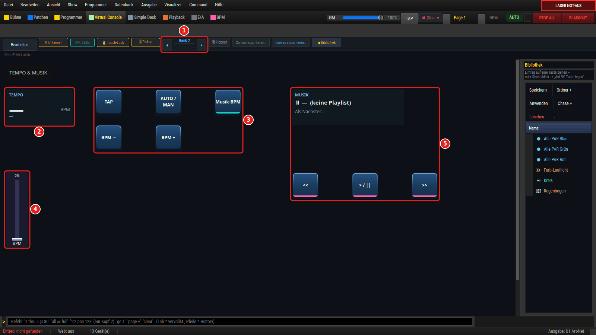
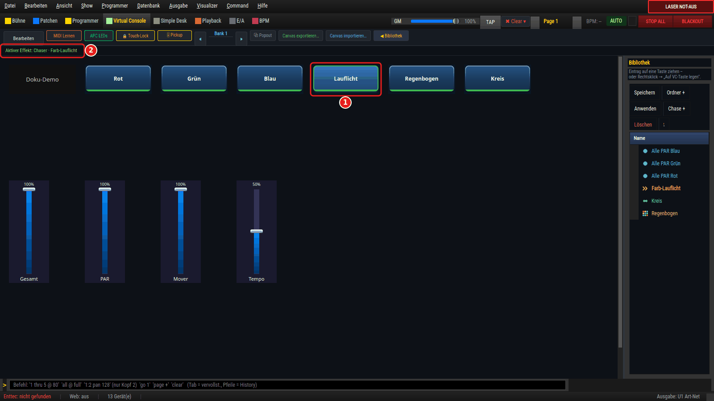
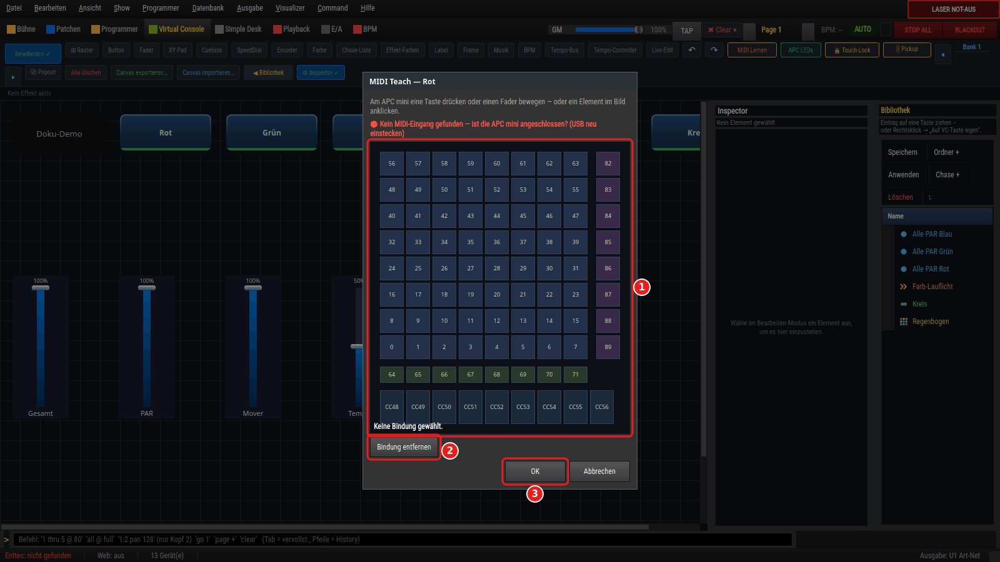

# Anleitung: Virtuelle Konsole (VC) bauen & designen

> Die **Virtuelle Konsole** ist deine eigene Bedienoberfläche: Buttons, Fader und Farb-Kacheln,
> frei platziert, optional auf den **APC mini** gemappt. Hier baust du sie Schritt für Schritt —
> alles in der Oberfläche, ohne Code.

**Zum Mitklicken:** Die Bilder zeigen die **Doku-Demo-Show** (acht PAR, zwei Wash, zwei Spot,
eine LED-Leiste, drei Farb-Szenen, ein Lauflicht, ein Regenbogen, ein Kreis). Dieselbe Show
erzeugst du aus dem Repo mit
`venv/bin/python tools/anleitungsbilder.py --demo-show Doku_Demo.lshow`
(Windows: `venv\Scripts\python tools\anleitungsbilder.py --demo-show Doku_Demo.lshow`) und
öffnest sie über **Datei → Öffnen...**.

---

## 1. VC öffnen & Bearbeiten-Modus

In der Sektionsleiste oben **Virtual Console** wählen (Strg+4). Die Konsole zeigt die aktuelle
**Bank**; in der Doku-Demo liegen auf Bank 1 eine Beschriftung, sechs Funktions-Tasten und vier
Fader. Rechts ist die **Bibliothek** mit deinen Funktionen und Farb-Snaps.

1. **Bearbeiten** — schaltet zwischen Bedienen und Bauen um.
2. **◀ / Bank 1 / ▶** — zwischen den Bänken wechseln (oder **Strg + Bild↑ / Bild↓**).
3. Die **Statuszeile** unter der Werkzeugleiste nennt den zuletzt gestarteten, noch laufenden
   Effekt („Kein Effekt aktiv", wenn nichts läuft). Sie hat einen festen Platz — die Konsole
   verrutscht nicht, wenn ein Effekt startet.
4. **Bibliothek** — Funktionen und Farb-Snaps zum Ziehen auf die Konsole
   (**◀ Bibliothek** blendet sie aus).

Klick oben links auf **Bearbeiten** (Schalter wird blau mit grüner Schrift, Beschriftung „Bearbeiten ✓"). Jetzt erscheinen
die Widget-Werkzeugleiste, das Raster zum Platzieren und rechts der **Inspector** (Eigenschaften des
gewählten Widgets). Die Werkzeugleiste hat **16 Schnell-Anlegen-Knöpfe** für je einen Widget-Typ:

**Button**, **Fader**, **XY Pad**, **Cueliste**, **SpeedDial**, **Encoder**, **Farbe**,
**Chase-Liste**, **Effekt-Farben**, **Label**, **Frame**, **Musik**, **BPM**, **Tempo-Bus**,
**Tempo-Controller**, **Live-Edit**.

Rechts daneben **↶ / ↷** (Rückgängig/Wiederholen; per Tastatur **Strg+Z** und **Strg+Y** oder
**Strg+Umschalt+Z** – beide Wiederholen-Tasten gehen unter Windows wie unter Linux). Solange die
Virtual Console zu sehen ist, gibt es **einen gemeinsamen Verlauf**: Layout-Schritte der Konsole und
Änderungen an Patch und Geräten stehen darin in der Reihenfolge, in der du sie gemacht hast.
**Strg+Z** nimmt den zuletzt gemachten Schritt zurück, **Wiederholen** holt den zuletzt
zurückgenommenen wieder – egal, aus welchem der beiden Bereiche er stammt. Die Tasten, die Knöpfe
**↶ / ↷** und das Menü **Bearbeiten → Rückgängig / Wiederholen** tun dabei dasselbe; das Menü nennt
den Schritt, der als nächster dran ist (ein Layout-Schritt heißt dort **Layout der Virtual
Console**). Das gilt auch im Bedienmodus, wenn das Layout gar nicht bearbeitet wird. Machst du nach
einem Rückgängig etwas Neues, ist der Wiederholen-Zweig für beide Bereiche verworfen. Auf den anderen
Seiten der App bleibt das Layout der Konsole unberührt – dort gilt nur der Verlauf von Patch und
Geräten. In einem Textfeld mit Schreibmarke gelten die Tasten für den getippten Text. Eine fertige
**Controller-Vorlage** (etwa ein komplettes APC-mini-Layout) lässt sich derzeit **nicht** per Knopf in
die VC einfügen; den Aufbau übernimmst du Widget für Widget (siehe *APC mini mappen*).

1. **Bearbeiten ✓** — der Bearbeiten-Modus ist an.
2. Die 16 Knöpfe zum Anlegen der Widgets.
3. **↶ / ↷** — Rückgängig / Wiederholen.

## 2. Widgets anlegen

**Schnellster Weg — Effekt aus der Bibliothek ziehen → Drop-Karte:** Eine **Funktion/einen Effekt**
(z. B. `Regenbogen`) aus der rechten Bibliothek **auf eine freie Stelle des Rasters ziehen** → es öffnet
sich die Drop-Karte **„Effekt einrichten"**. Statt einer starren Dialog-Kette zeigt sie **eine Zeile je
steuerbarem Aspekt** als Häkchen — du kreuzt an, was der Effekt können soll. **„An/Aus (Toggle)"** ist
vorangekreuzt: ein Klick auf **Erstellen** liefert den klassischen Toggle-Button. Setzt du **mehrere
Häkchen**, entstehen **mehrere fertig verdrahtete Widgets in EINEM Schritt** (ein einziges **Strg+Z**
macht alles rückgängig). Die Karte ist intelligent — sie zeigt nur Aspekte, die für genau diesen Effekt
sinnvoll sind (eine Dimmer-Matrix hat z. B. keine „Farben"-Zeile). Selten gebrauchte Parameter liegen
im **zugeklappten** Bereich **„Mehr Parameter (N)"** — zum Öffnen anklicken. Mit
**„Als Effekt-Box gruppieren"** landen alle gewählten Bedienelemente in einem verschiebbaren
Container mit Live-Vorschau statt einzeln auf dem Raster.

1. **„An/Aus (Toggle)"** — vorangekreuzt.
2. **„Widget: … ▸ ändern"** — für diesen Aspekt passen mehrere Bedien-Elemente.
3. **„Mehr Parameter (N)"** — zugeklappt.
4. **Erstellen** — legt alle angekreuzten Widgets an.

Gibt es für einen Aspekt **mehrere passende Bedien-Elemente** (z. B. Tempo = Speed-Rad **oder** Fader),
steht in der Zeile **„Widget: … ▸ ändern"**. Ein Klick öffnet die **grafische Widget-Galerie**
(„Widget wählen") als eigenes Fenster — du siehst die Möglichkeiten als Kacheln, tippst eine an und
bestätigst mit **OK** (oder tippst sie doppelt an):

**Drop auf einen schon belegten Regler:** Ziehst du einen Effekt auf ein **bereits belegtes**
Bedien-Element (im Bild: `Kreis` auf den Fader **Tempo**, der schon den Regenbogen steuert), wird
*nicht* mehr stumm gekoppelt — es erscheint die Konflikt-Karte **„Regler ist schon belegt"** mit drei
Wegen:
1. **Ersetzen** — der Regler steuert dann nur noch den neuen Effekt.
2. **Dazu koppeln** — beide Effekte hängen am selben Regler (eine Gruppe, ein Tempo).
3. **Neues Widget daneben** — der Regler bleibt unberührt, ein eigenes Element entsteht.

**Widget-Typ nachträglich tauschen:** bei effektgebundenen Widgets, für deren Aspekt mehrere Bedien-Typen
passen (z. B. Tempo: Speed-Rad oder Fader), per **Rechtsklick → „↔ Widget ändern…"** → dieselbe Galerie.
(An/Aus-Tasten, Bus-Auswahl, Effekt-Farben oder XY-Feld haben den Eintrag nicht.) Der Typ wird getauscht, die Effekt-Bindung (Effekt, Beschriftung, Position) bleibt.

**Farb-Snap aus der Bibliothek:** Ein **Farb-Snap** (`blau`) erzeugt beim Ziehen **direkt eine
Snap-Taste** (Button mit Aktion „Bibliothek-Farbe/Snap", farbiger Strich) — ohne Drop-Karte. Alternativ
**Rechtsklick auf einen Bibliothek-Eintrag → „➡ Auf VC-Taste legen"** und danach einen **vorhandenen**
VC-Button anklicken; er übernimmt Snap bzw. Funktion. (Das Widget **Farbe** — Dialog
„Farb-Kachel Einstellungen" — ist etwas anderes.)

**Alternativweg — manuell über die Werkzeugleiste** (für Bedienelemente ohne Funktion): Werkzeugleiste →
**Button** / **Fader** / **Farbe** anklicken → das Widget landet auf dem Raster → **Doppelklick** öffnet
die Eigenschaften (im Rechtsklick-Menü heißt dieser Eintrag **„Einstellungen..."**):
- **Button → Aktion:** z. B. „Funktion an/aus", „Funktion (nur gehalten)", „Snapshot abrufen",
  „Tap-Tempo", „Musik-BPM", „BPM +1 (Nudge)" / „BPM -1 (Nudge)", „Blackout", „Alles stoppen" …
- **Fader → Modus:** „Grand Master", „Effekt-Tempo", „Effekt-Helligkeit", „Tempo (BPM)" (30–300 BPM),
  „Programmer-Attribut" (z. B. Dimmer) …
- **Farbe → Ziel:** „Programmer/Selektion" / „Alle Fixtures" / „Effekt (aktive Farbe)".

1. **Aktion** — hier „Funktion an/aus" mit der Szene „Alle PAR Rot" als Ziel.
2. **OK** übernimmt die Einstellungen.

## 3. Bänke mit Labels gliedern

Oben über **◀ / Bank X / ▶** (oder Tastatur **Strg + Bild↑ / Bild↓**) zwischen Bänken wechseln.
Ein neu angelegtes Widget landet auf der **gerade sichtbaren** Bank. Mit **Label-Widgets** als
Zonen-Überschriften wird die Konsole übersichtlich. Eine bewährte Aufteilung:

- **Bank 1 — Looks und Master:** Funktions-Tasten für die Looks (grüner Strich unten =
  Funktions-Toggle), daneben die Fader **Gesamt** (Grand Master), Gruppen-Dimmer und das
  **Tempo** eines Effekts — so wie Bank 1 der Doku-Demo oben.
- **Bank 2 — Tempo & Musik:** die BPM- und Musik-Bausteine aus den Abschnitten 6 und 7:

1. **◀ / Bank 2 / ▶** — die zweite Bank ist sichtbar.
2. **TEMPO** — BPM-Anzeige (zeigt Tempo und Quelle; ohne Tempo steht dort „—").
3. **TAP**, **AUTO / MAN** (Umschalter), **Musik-BPM** (Audio-Erkennung an/aus), **BPM −** /
   **BPM +** (Nudge).
4. **BPM** — Fader im Modus „Tempo (BPM)" (30–300 BPM).
5. **MUSIK** — Song-Anzeige (Now Playing / Als Nächstes) mit den Media-Tasten
   **`<<` / `> / ||` / `>>`** (Zurück / Play-Pause / Vor).

Weitere Bänke je nach Show, zum Beispiel **Strobe** (gehaltene Taste + Tempo-Fader, siehe
Abschnitt 8), **Effekt-Farben** (eine Farbreihe, die pro Beat umfärbt: Klick = Farbe wählen,
Rechtsklick = an/aus) oder **Moving Heads** (Gobo-Tasten, Bewegungs-Effekte).

## 4. Fertig & testen

**Bearbeiten** wieder ausschalten → Run-Modus. Jetzt sind die Widgets bedienbar. Ein Klick auf
**Lauflicht** startet das Farb-Lauflicht — die Taste leuchtet aktiv (heller Rahmen, Strich unten
hell), und die Statuszeile nennt den laufenden Effekt:

1. Die aktive Taste **Lauflicht**.
2. Statuszeile **„Aktiver Effekt: Chaser · Farb-Lauflicht"**.

Ein zweiter Klick stoppt den Effekt wieder. Was die Geräte gerade tun, siehst du in der Sektion
**Bühne** (2D-Ansicht) oder im 3D-Visualizer.

**Nur bedienen: Kiosk-Modus.** Mit `--kiosk` gestartet (`python main.py --kiosk`) zeigt LightOS
die fertige Konsole im Vollbild **ohne Bearbeitungswege**: Die **Bibliothek**-Seitenleiste fehlt
ganz (kein Ziehen auf Tasten, kein „➡ Auf VC-Taste legen"), und **Bearbeiten**, **MIDI Lernen**,
**Canvas importieren…** sowie Rückgängig/Wiederholen (`Strg+Z`/`Strg+Y`) gibt es dort nicht. Auch das Effekte-Menü des
**Tempo-Bus-Controllers** (Effekt entfernen, „Effekte hinzufügen / Parameter…") öffnet sich im Kiosk
nicht. Die Tasten, Fader, Bänke, Touch-Lock und Pickup bleiben bedienbar — beim Tempo-Bus-Controller
auch Quelle, Faktor, SYNC und die Bus-Wahl.

Oben rechts bleibt im Kiosk ein **Streifen** mit den Not-Bedienungen, von links nach rechts:
**GM** (Grand-Master-Regler mit Prozentwert), **STOP ALL**, **BLACKOUT** und **LASER NOT-AUS**.
Sind Laser gepatcht, hat die Show aber keine Sperrzonen (obwohl auf diesem Rechner schon
mit Sperrzonen gearbeitet wurde), steht links davor zusätzlich eine
kleine gelbe Hinweiszeile (siehe [Laser → Sperrzonen](../anleitung_laser/ANLEITUNG_LASER.md#9-sperrzonen-vorschau)).
Sie wirken wie ihre Gegenstücke im normalen Fenster und zeigen denselben Zustand
(Einzelheiten: [Erste Schritte](../anleitung_erste_schritte/ANLEITUNG.md)). Löst du den
LASER NOT-AUS aus, erscheint unter dem Streifen für einige Sekunden ein **roter Balken** mit
der Bestätigung „⏹ LASER NOT-AUS ausgelöst — alle Laser dunkel …" — im Kiosk gibt es keine
Statusleiste, die das sonst anzeigt. Gelöst wird der NOT-AUS auch hier nur mit dem Knopf
samt Rückfrage ([Laser-Anleitung](../anleitung_laser/ANLEITUNG_LASER.md#blackout-ziel-blackout-und-not-aus)).

### Konsole auf einen zweiten Bildschirm legen (Popout)

**⧉ Popout** in der Werkzeugleiste holt die ganze Konsole in ein eigenes Fenster, zum Beispiel
auf einen Touch-Bildschirm; Schließen des Fensters holt sie ins Hauptfenster zurück. Das
Fenster merkt sich Bildschirm, Lage, Größe und ob es maximiert war, und öffnet beim nächsten
**Popout** wieder genau dort – auch nach einem Neustart. Beim allerersten Mal mit zwei
Bildschirmen öffnet es von selbst maximiert auf dem Bildschirm, auf dem das Hauptfenster
**nicht** liegt. Ist der gemerkte Bildschirm nicht angeschlossen, erscheint das Fenster beim
Hauptfenster; sein Platz auf dem fehlenden Bildschirm bleibt dabei gemerkt, solange du das
Ersatz-Fenster nicht verschiebst.

**Der Bildschirm fällt weg, während das Popout offen ist** (Touch-Bildschirm ausgeschaltet
oder abgezogen): Das Fenster rutscht auf den verbleibenden Bildschirm, die Konsole bleibt
bedienbar. Gemerkt bleibt der alte Platz. Wird der Bildschirm wieder angeschlossen, springt
das Popout nach einem Augenblick von selbst dorthin zurück – in derselben Größe und wieder
maximiert oder im Vollbild, wenn es das vorher war. Ein anderer, neu angesteckter Bildschirm
löst nichts aus.

Eine Ausnahme, damit dir das Fenster nicht wegspringt: Verschiebst du das Popout am
Ersatzplatz selbst oder änderst seine Größe, gilt das als deine neue Wahl. Dann wird dieser
Platz gemerkt, und das Fenster bleibt dort, auch wenn der Bildschirm zurückkommt. In der
ersten guten Sekunde nach dem Wegfall zählt eine Bewegung noch nicht als deine – in dieser
Zeit räumt das Betriebssystem die Fenster um.

## 5. APC mini anbinden

Es gibt **zwei Wege**, ein VC-Widget auf eine APC-mini-Taste/-Fader zu legen:

**A — Schnell per „MIDI Lernen" (nur Buttons):** Toolbar **MIDI Lernen** aktivieren (orange) → einen
VC-**Button** anklicken → am APC mini die Taste **drücken** → Bindung wird gespeichert (Note). Fader
(CC) bindest du über Weg B.

**B — Per MIDI-Teach-Dialog (mit APC-Abbild):** im **Bearbeiten**-Modus das Widget **rechtsklicken**
→ **🎹 MIDI Teach...**. Es öffnet sich ein Abbild der APC mini — entweder am Gerät die Taste/den Fader
betätigen **oder** das Element im Bild direkt anklicken (geht auch **ohne** angeschlossene APC):

1. Das APC-mini-Abbild: Pad-Grid, Track-Tasten, Scene-Tasten, Fader.
2. **Bindung entfernen** — löst eine vorhandene Bindung.
3. **OK** speichert die gewählte Bindung. Ohne angeschlossene APC meldet der Dialog
   „Kein MIDI-Eingang gefunden" — anklicken im Bild geht trotzdem.

**APC-mini-Belegung** (Original): **Pad-Grid Note 0–63** (Reihe×Spalte), **Track-Tasten 64–71**
(unter dem Grid), **Scene-Tasten 82–89** (rechte Spalte), **Fader CC 48–56** (CC56 = Master). Der
**mk2** hat dasselbe Eingangs-Layout (RGB-LED-Ausgabe abweichend, wird automatisch erkannt).

**LED-Feedback:** Toolbar **APC LEDs** einschalten. Beim **APC mini mk2** spiegeln die Pads die
VC-Tasten zurück (aktiv, gedrückt, Farbe der Farb-Kachel, Beat-Blitzen am TAP-Pad). Die
**Original-APC-mini** zeigt nur Executor-Zustände (GO-Reihe grün, Flash-Reihe rot, Track-Tasten) und die
aktive Page (Scene-Tasten gelb), keine VC-Tasten. Bindungen werden **mit der
Show** gespeichert (auf dem Widget: `midi_data1`/`midi_type` bzw. `midi_cc`). Ohne angeschlossene
APC funktioniert die Bedienung weiter per Touch/Tastatur — nur ohne LED-Rückmeldung.

→ **Ausführlich** (Belegung, LED-Feedback, mk2): [APC mini mappen](../anleitung_apc_mapping/ANLEITUNG_APC.md).

## 6. Tempo / BPM-Bedienelemente

LightOS bringt fertige BPM-Bausteine mit — einfach als Button/Fader/Widget anlegen und die Aktion wählen:
- **Tap-Tempo** (TAP), **Musik-BPM** (AUTO-Audio-Erkennung an/aus), **BPM +/−** (Nudge),
  **AUTO/MANUAL-Umschalter**, **BPM-Fader** (30–300) und ein **BPM-Anzeige-Widget** (zeigt Tempo + Quelle).
- AUTO-Audio aktivierst du in der **Sektion BPM** (Navigations-Button **BPM** → Unter-Tab
  **„Erkennung"**, Quelle **„PC-Audio (Systemstandard)"**) — dann folgen alle
  Beat-Effekte taktgenau der Musik. Die TEMPO-Anzeige auf Bank 2 zeigt die Live-BPM grün an.

## 7. Musik-Player

Es gibt ein **Song-Anzeige-Widget** (zeigt „Now Playing"/nächstes Lied) sowie Media-Buttons
(**`> / ||`** = Play/Pause, **`<<`** = Zurück, **`>>`** = Vor) — als Button mit der jeweiligen
Media-Aktion. So steuerst du den
internen Player direkt aus der VC (siehe Bank 2 oben). Ohne geladene Playlist steht dort
„— (keine Playlist)".

→ **Ausführlich** (Playlist, Auto-Show, BPM-Sync): [Musik-Sync & Auto-Show](../anleitung_musik_sync/ANLEITUNG_MUSIK_SYNC.md).

## 8. Strobe

Der **STROBE**-Knopf ist ein **gehaltener** Master-Strobe: Aktion **„Funktion (nur gehalten)"** auf eine
RGB-Matrix mit Algorithmus **Strobe** (treibt alle PAR + Spider weiß an/aus). Der **Tempo**-
Fader daneben (Modus **Effekt-Tempo**, fest auf die Strobe-Matrix gebunden) regelt die Blitzrate —
ideal für Hardstyle-Drops: Knopf halten, Tempo nachziehen.

## 9. Speichern

Die VC wird **mit der Show** gespeichert (Datei → Speichern bzw. Strg+S). Optional lässt sich ein
Layout über **Canvas exportieren…** als Datei sichern und später wieder **importieren**.

---

**Kurz:** Virtual Console → Bearbeiten → Effekt aus der Bibliothek aufs Raster ziehen → in der Karte
„Effekt einrichten" ankreuzen → Erstellen (Farb-Snaps werden direkt zur Kachel; manuell geht es auch über
die Werkzeugleiste + Doppelklick→Einstellungen) → 5 Bänke füllen → Bearbeiten aus → testen → optional APC
mini per „MIDI Lernen" mappen → mit der Show speichern.
