# Virtual Console: Pixelraster, Bank lösen, Pop-up-Felder — Schritt für Schritt

> Nach diesen drei kurzen Anleitungen kannst du ein Pixelraster anlegen, an Lampen binden und
> darauf malen, eine Bank als eigenes Fenster lösen und ein Pop-up-Feld mit eigener Taste bauen.
> Jede Anleitung beginnt mit einem GIF vom ganzen Ablauf, danach kommt ein Bild je Schritt.

**Show:** Die Bilder zeigen die Show „Hochzeit Komplett 2026“ (Generator
`build_hochzeit_komplett.py`, siehe [Übersicht](../ANLEITUNGEN.md)), aufgenommen im Probelauf
(es geht kein DMX hinaus). Die VC von Grund auf: [Virtual Console bauen & designen](../anleitung_vc/ANLEITUNG_VC.md) ·
[VC-Widget-Referenz](../anleitung_vc_widgets/README.md).

---

## Anleitung 1: Ein Pixelraster anlegen und an Lampen binden

Mit dem Pixelraster malst du Farben direkt auf deine Lampen. Vorher sagst du dem Raster, welche
Lampen es zeigen soll.

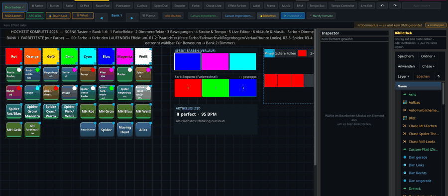

1. **Bearbeiten einschalten.** Öffne den Reiter „Virtual Console“. Tippe oben links auf
   **Bearbeiten**. Die Werkzeugleiste mit allen Elementen erscheint.
   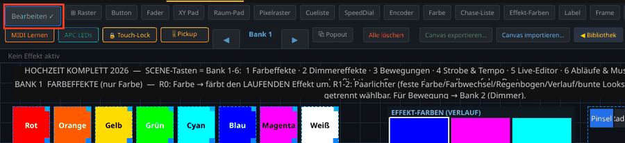
2. **Pixelraster hinzufügen.** Tippe in der Leiste auf **Pixelraster**. Ein leeres Raster
   erscheint auf der Fläche. Darin steht „Kein Raster zugeordnet“. Zieh es an eine freie Stelle.
   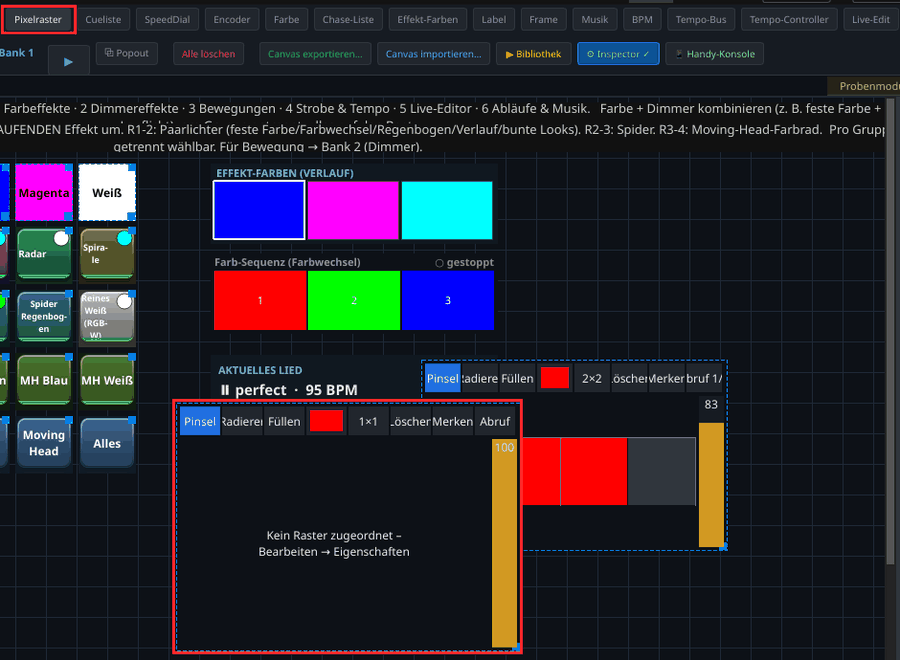
3. **Raster zuordnen.** Tippe das Raster einmal an. Rechts im Inspector tippst du auf
   **Raster zuordnen…**.
   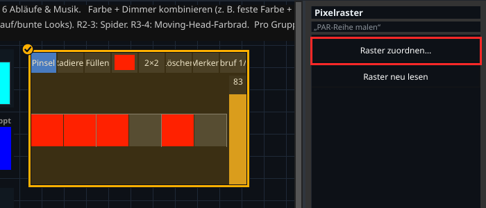
4. **Einstellungen.** Ein kleines Fenster geht auf. Oben steht die Beschriftung. Darunter steht
   „Raster aus“.
   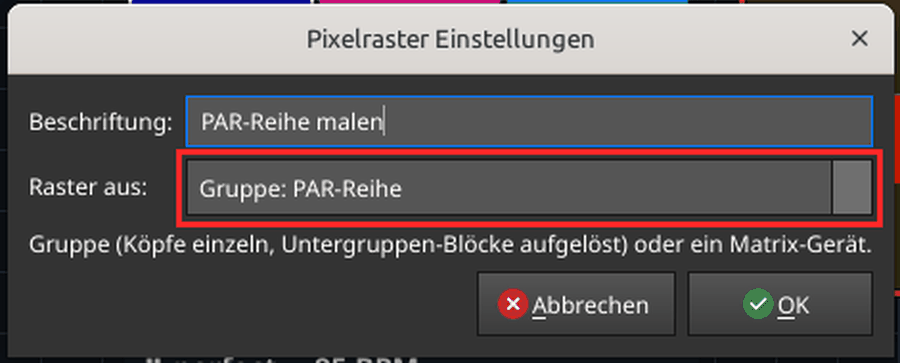
5. **Lampen wählen.** Öffne die Liste „Raster aus“. Oben stehen die **Matrix-Geräte**, zum
   Beispiel eine LED-Bar mit 4 Köpfen. Darunter stehen die **Gruppen**. Bei einer Gruppe zählt
   jeder Kopf als eigene Zelle.
   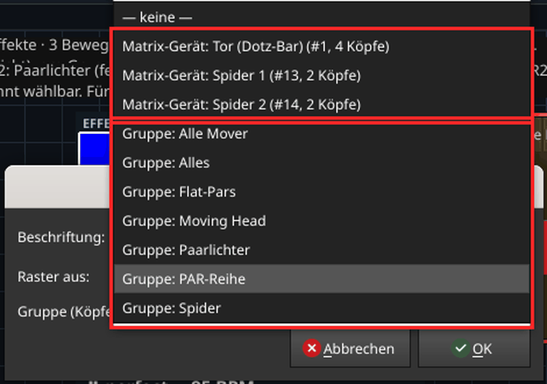
6. **Bestätigen.** Tippe auf **OK**. Das Raster zeigt jetzt so viele Zellen, wie die Lampen Köpfe
   haben. Im Beispiel sind das 4 Zellen für die LED-Bar.
   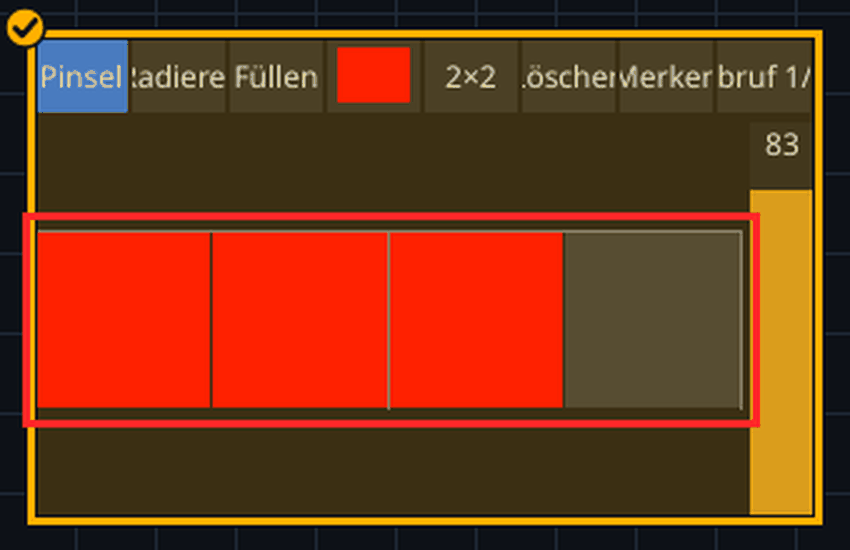

**Tipp:** Lässt du die Beschriftung leer, heißt das Element einfach „Pixelraster“. Umbenennen der
Gruppe löst die Bindung nicht.

---

## Anleitung 2: Auf dem Pixelraster malen

Malen geht nur, wenn **Bearbeiten aus** ist. Im Bearbeiten-Modus verschiebst du das Raster nur.

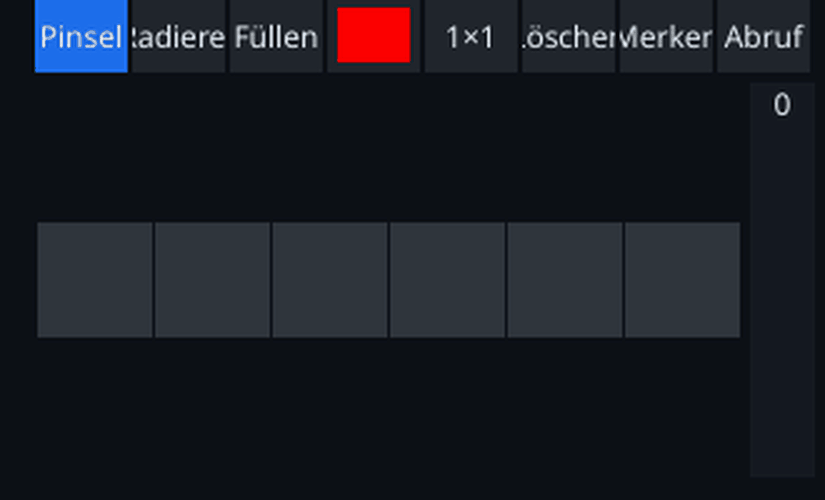

1. **Pinsel und Farbe.** Tippe auf **Pinsel**. Das Farbfeld daneben zeigt die Malfarbe. Tippe
   darauf, um eine andere Farbe zu wählen.
   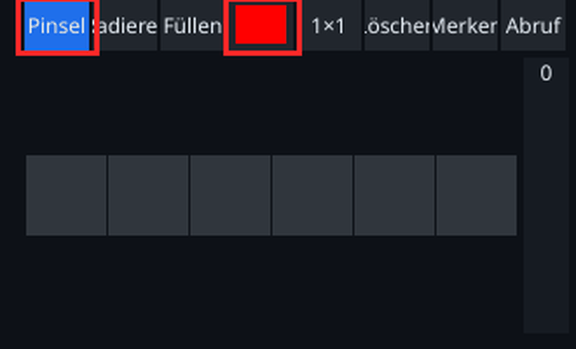
2. **Malen.** Tippe auf eine Zelle oder zieh den Finger über mehrere Zellen. Sie werden in deiner
   Farbe gefüllt.
   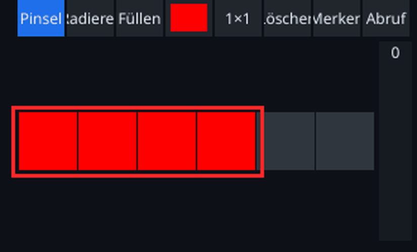
3. **Radieren.** Tippe auf **Radierer** und dann auf eine Zelle. Sie wird wieder leer.
   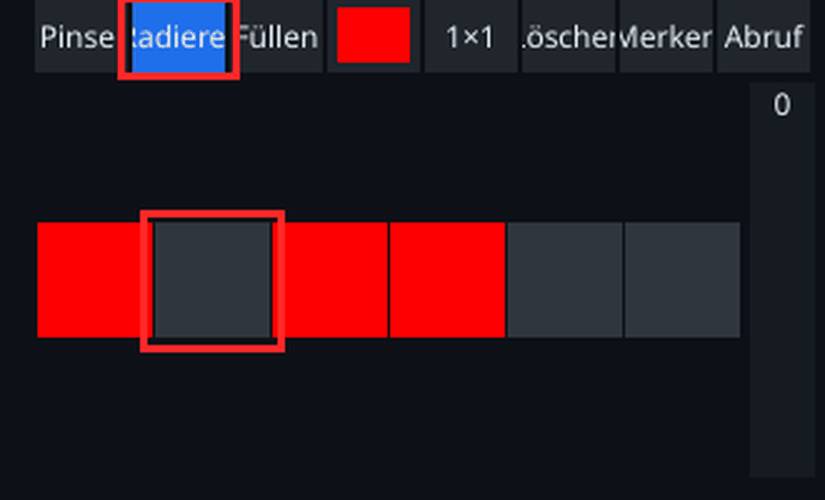
4. **Füllen.** Tippe auf **Füllen** und dann auf eine leere Fläche. Alle zusammenhängenden
   Zellen in derselben Farbe werden umgefärbt.
   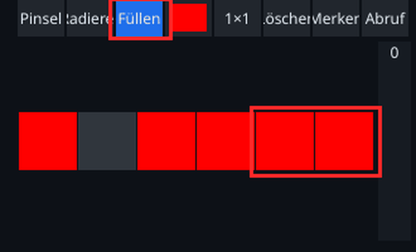
5. **Auflösung.** Der Knopf **1×1** schaltet weiter auf 2×2 und 4×4. Ein Malpunkt färbt dann
   einen ganzen Block. Beim Umschalten geht nichts verloren.
   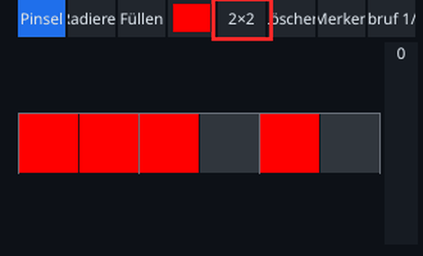
6. **Merken und Abrufen.** **Merken** speichert dein Bild am Element. **Abruf** holt die
   gemerkten Bilder der Reihe nach zurück. Auf dem Knopf steht dann zum Beispiel „Abruf 1/1“.
   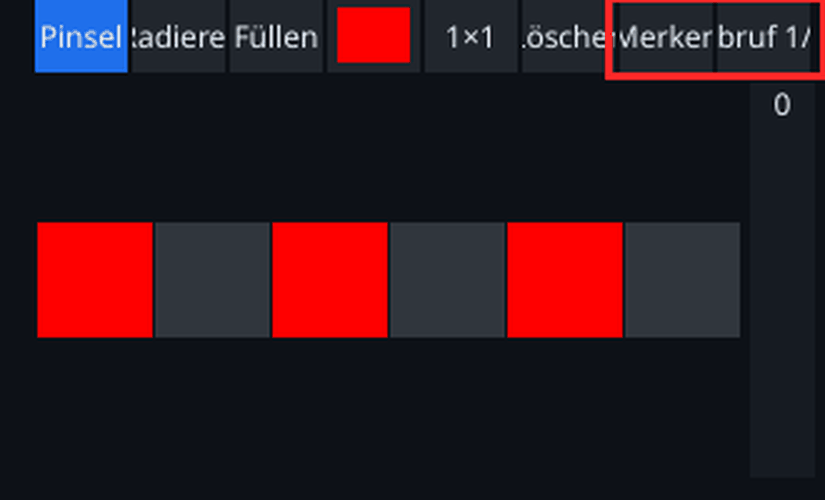
7. **Pegel.** Der senkrechte Regler rechts bestimmt, wie stark dein Bild über allem anderen
   liegt. Steht er auf **0**, siehst du auf der Bühne nichts. Zieh ihn nach oben.
   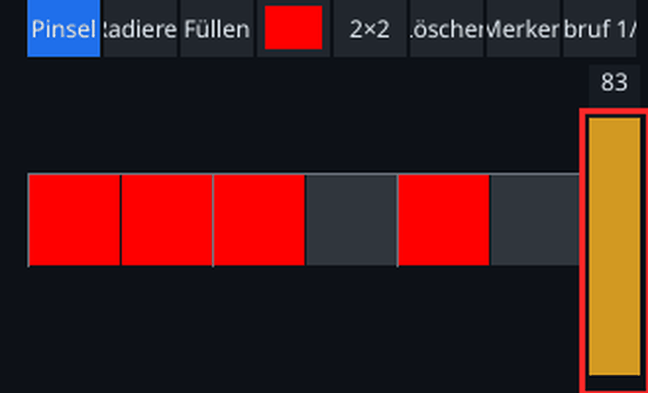
8. **Alles löschen.** Tippe einmal auf **Löschen**. Der Knopf wird rot und zeigt **Sicher?**.
   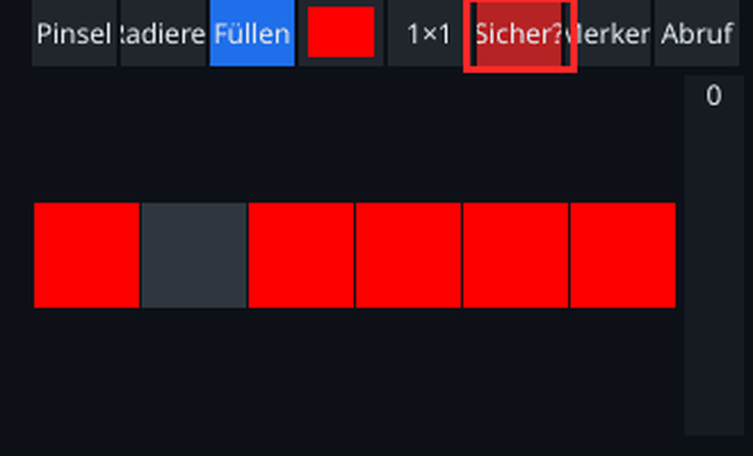
9. **Bestätigen.** Tippe innerhalb von 3 Sekunden ein zweites Mal. Jetzt ist das Bild weg. Ein
   schneller Doppeltipp löscht absichtlich **nicht**. Der zweite Tipp muss ein eigener Tipp sein.
   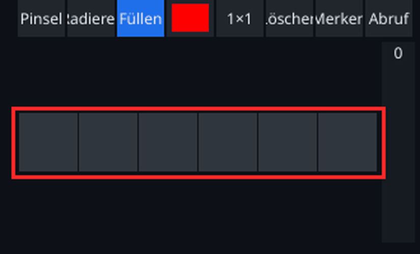

Bei **Touch-Lock** („Gesperrt“) kannst du nicht malen und nichts löschen. So verhinderst du
versehentliche Tipps in der Show.

---

## Anleitung 3: Eine Bank lösen und ein Pop-up-Feld bauen

### Teil A: Bank als eigenes Fenster

Damit legst du eine Bank auf einen zweiten Bildschirm, zum Beispiel einen Touch-Bildschirm.

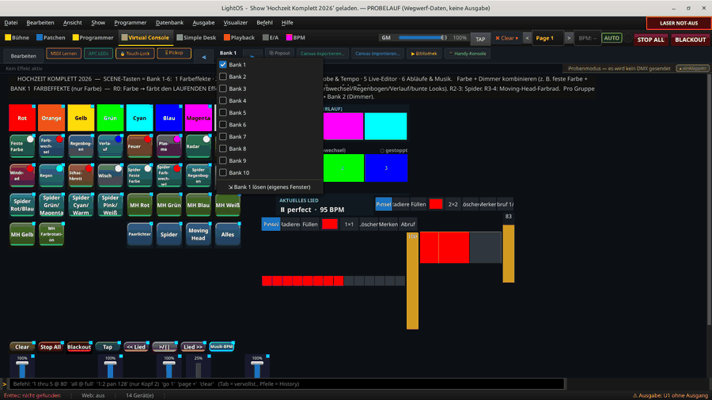

1. **Bankmenü öffnen.** Bearbeiten muss aus sein. Tippe oben auf **Bank 1**. Ganz unten steht
   **Bank 1 lösen (eigenes Fenster)**.
   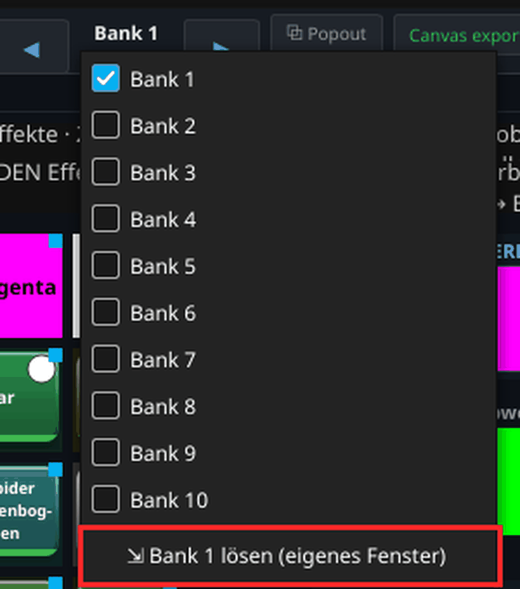
2. **Gelöst.** Die Bank geht als eigenes Fenster auf. Oben steht „Bank 1 — gelöst“. Alles darin
   funktioniert wie vorher, auch das Malen. Zieh das Fenster auf den Bildschirm, den du willst.
   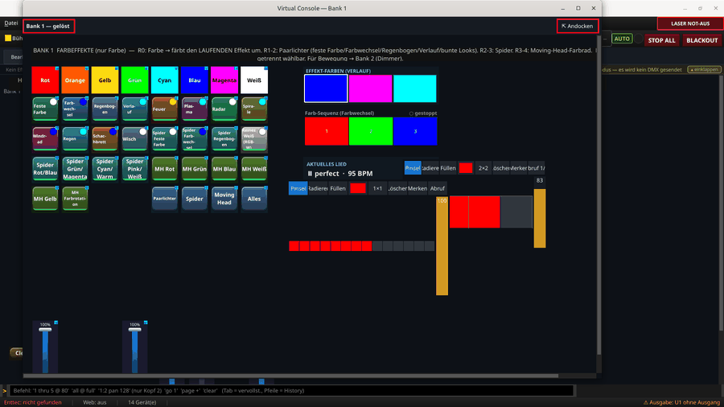
3. **Andocken.** Tippe oben rechts im Fenster auf **Andocken** oder schließe das Fenster. Die
   Bank ist wieder in der Hauptfläche.
   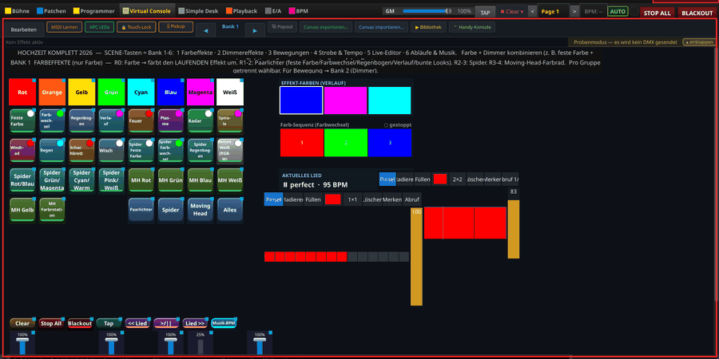

**Gut zu wissen:** Schaltest du Bearbeiten ein, dockt die Bank von selbst an. Schaltest du
Bearbeiten wieder aus, löst sie sich wieder.

### Teil B: Pop-up-Feld mit eigener Taste

Ein Pop-up-Feld ist ein Rahmen, der erst aufgeht, wenn du seine Taste drückst.

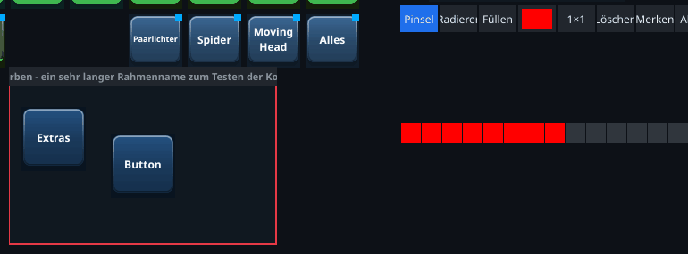

1. **Rahmen anlegen.** Bearbeiten an. Tippe in der Leiste auf **Frame**. Ein neuer Rahmen
   erscheint. Zieh ihn an eine freie Stelle.
   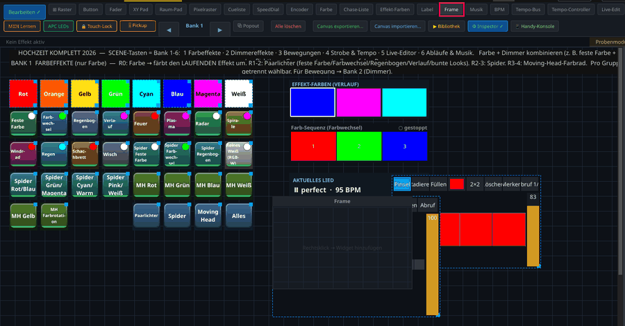
2. **Zum Pop-up machen.** Rechts im Inspector auf **Einstellungen öffnen…**. Gib einen Namen ein,
   zum Beispiel „Extras“. Setze den Haken bei **Pop-up-Feld**. Dann **OK**. Der Rahmen hat jetzt
   einen lila Rand. Der Haken **Solo-Frame** darüber macht etwas anderes: dort ist immer nur
   eine Taste gleichzeitig aktiv. Solo-Rahmen haben einen roten Rand.
   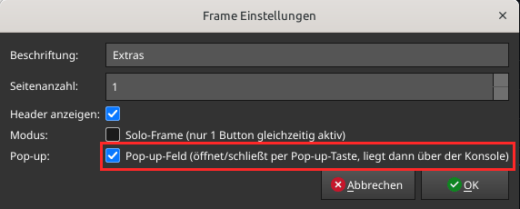
3. **Taste anlegen.** Lege eine Taste an (Leiste: **Button**). Wähle sie aus. Stelle im Inspector
   bei **Aktion** auf **Pop-up-Feld öffnen/schließen**.
   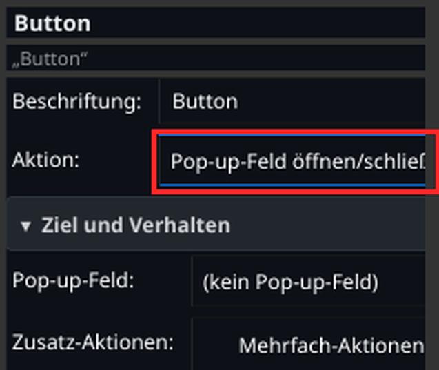
4. **Feld wählen.** Darunter bei **Pop-up-Feld** wählst du deinen Rahmen „Extras“.
   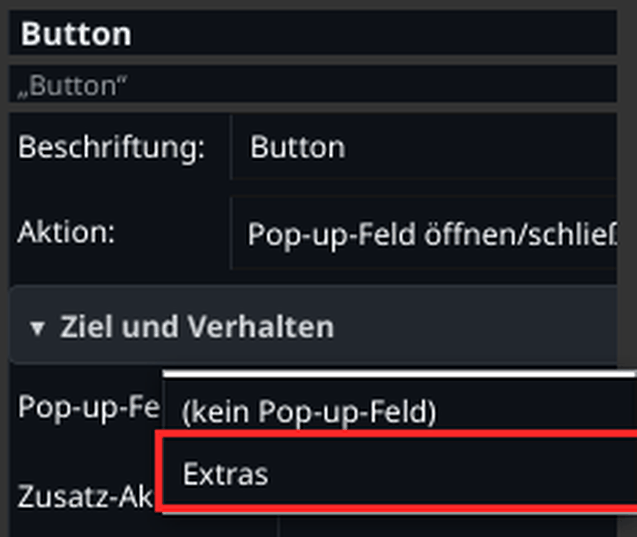
5. **Ausprobieren.** Bearbeiten aus. Tippe die Taste. Das Feld geht auf und liegt über allem.
   Tippe noch einmal, und es geht wieder zu.
   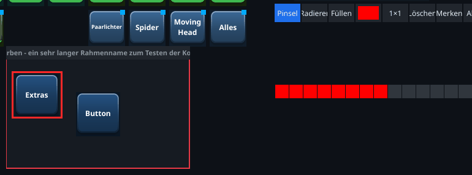
   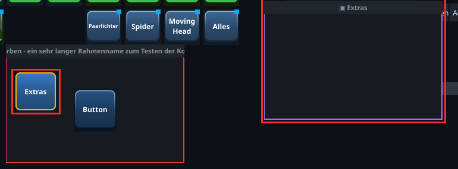

**Regeln:** Ein Pop-up-Feld darf keine Pop-up-Taste und kein weiteres Pop-up-Feld enthalten.
Beim Laden der Show sind alle Pop-up-Felder zu. Im Kiosk-Modus (nur Virtual Console)
funktionieren Pop-ups, Malen und Bank lösen genauso; Bearbeiten und Rechtsklick-Menüs gibt es
dort nicht.
