# Web-Fernbedienung und Handy-Konsole — Schritt für Schritt

> Nach diesen drei kurzen Anleitungen kannst du die Web-Fernbedienung einschalten, deine
> Handy-Konsole aus Seiten und Kacheln bauen und eine Handy-Gruppe anlegen und am Handy
> bedienen. Jede Anleitung beginnt mit einem GIF vom ganzen Ablauf, danach kommt ein Bild je
> Schritt. Rote Rahmen zeigen, wo du klickst.

**Show:** Die Bilder zeigen die Show „Hochzeit Komplett 2026“ (Generator
`build_hochzeit_komplett.py`, siehe [Übersicht](../ANLEITUNGEN.md)), aufgenommen im Probelauf
(es geht kein DMX hinaus). Die Schlüssel in den Bildern stammen aus diesem Probelauf und gelten
nirgends. Deinen eigenen Link mit Schlüssel stellst du nie öffentlich ins Netz. Ausführlich:
[Web-Remote — das Handy als Konsole](../anleitung_web_remote/ANLEITUNG.md).

---

## Anleitung 1: Web-Fernbedienung einschalten (nur dieser PC)

**Ziel:** LightOS nimmt Befehle über den Browser an. Erst nur am eigenen PC, ohne WLAN.

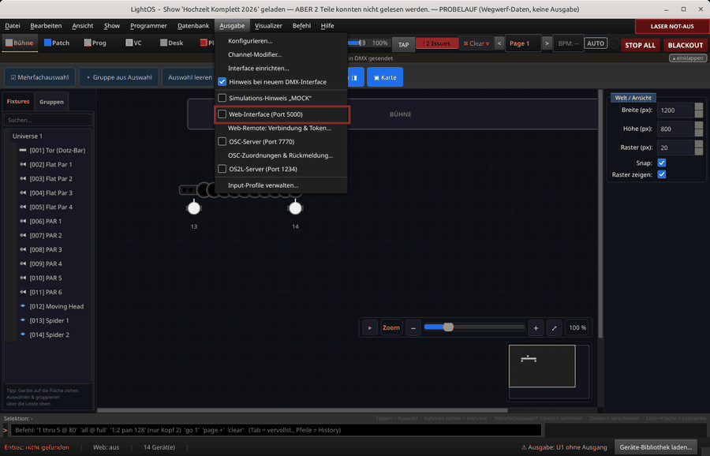

1. Öffne oben das Menü **Ausgabe**. Klick auf **Web-Interface (Port 5000)**.
   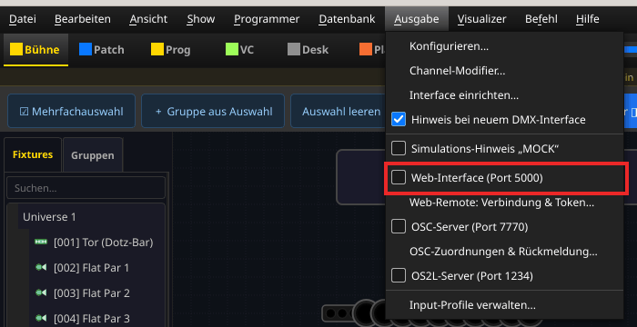
2. Der Dialog **Web-Remote: Verbindung & Token** geht von selbst auf. Oben steht:
   „Web-Interface läuft — nur dieser PC (127.0.0.1:5000)“.
   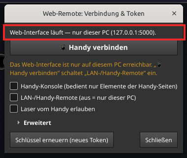
3. Setz den Haken bei **Handy-Konsole**. Jetzt erscheint der Link mit dem Schlüssel. Mit
   **Link kopieren** holst du ihn in die Zwischenablage.
   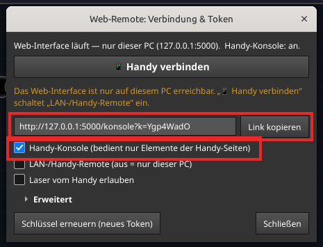
4. Brauchst du die feste Fernbedienung (GO, Fader, Blackout)? Klapp **Erweitert** auf.
   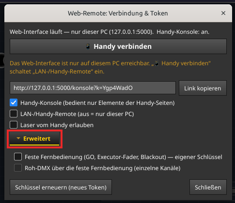
5. Setz den Haken bei **Feste Fernbedienung**. Sie hat einen eigenen Link mit eigenem Schlüssel.
   Roh-DMX bleibt aus.
   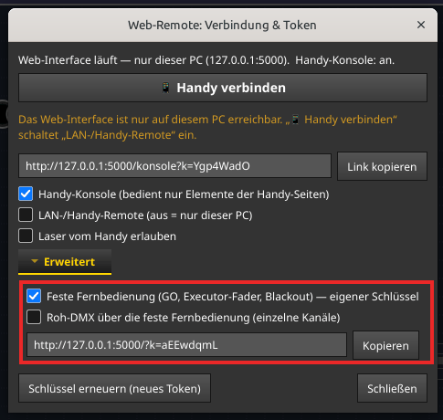
6. Unten in der Statuszeile steht jetzt **Web: :5000 OK**.
   
7. Test: Ein GO über die Fernbedienung startet die Cueliste. Im Reiter **Playback** siehst du die
   aktive Cue.
   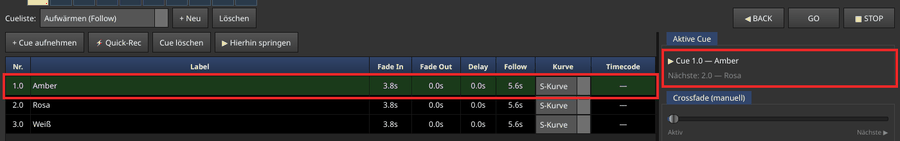

**Gut zu wissen**

- Ist Port 5000 schon belegt, meldet LightOS das klar. Die App läuft weiter, der Haken im Menü
  bleibt aus.
  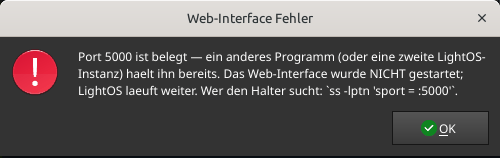
- **Schlüssel erneuern** macht alle alten Links und QR-Codes sofort ungültig. Vorher kommt eine
  Rückfrage.
  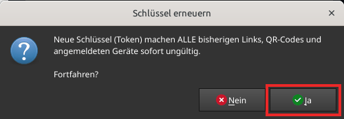
- Fürs echte Handy im WLAN klickst du auf **Handy verbinden**. Das schaltet „LAN-/Handy-Remote“
  mit ein und zeigt einen QR-Code.
- Einen Blackout vom Handy hebt nur dasselbe Handy wieder auf — oder du am Pult.

---

## Anleitung 2: Handy-Konsole bauen — Seiten und Kacheln

**Ziel:** Du legst fest, welche Tasten am Handy erscheinen. Das Original bleibt in der Konsole,
aufs Handy kommt nur eine Verknüpfung.

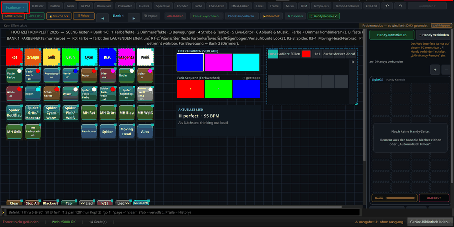

1. Geh in den Reiter **VC**. Klick oben auf **Handy-Konsole**. Rechts geht die Seitenleiste auf.
   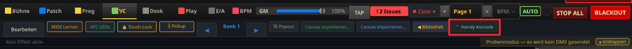
2. Schalte **Bearbeiten** ein. Klick dann in der Leiste auf **+**.
   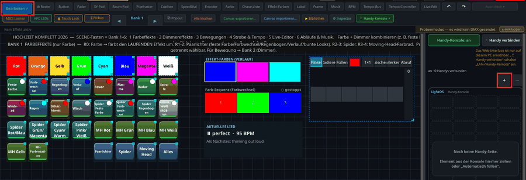
3. Die erste Handy-Seite heißt „Seite 1“.
   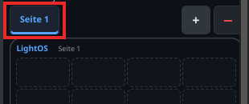
4. Rechtsklick auf eine Taste der Konsole, z. B. **Feuer**. Wähle **Auf Handy-Konsole legen**.
   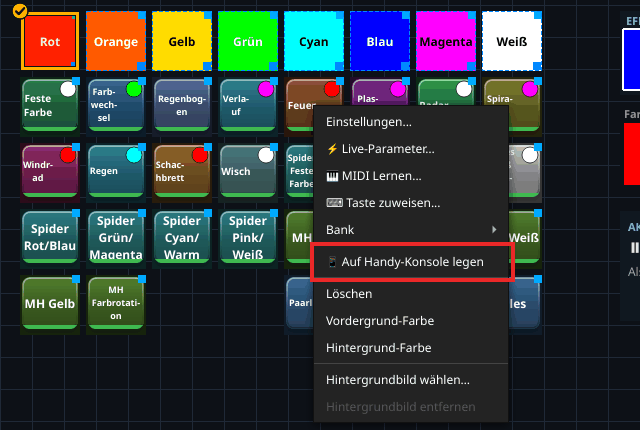
5. Mach das auch mit **Regen** und **Radar**. Die drei Kacheln stehen jetzt im Handy-Raster.
   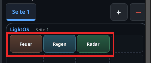
6. Farbwähler gehen nicht aufs Handy. Das Menü sagt dir das direkt.
   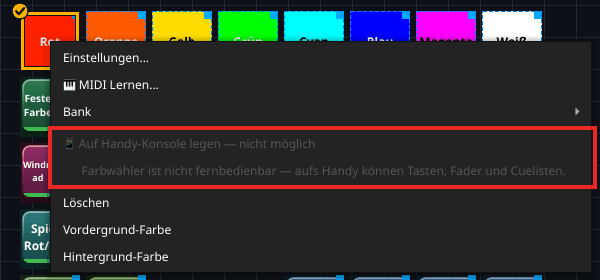
7. Doppelklick auf einen Seiten-Reiter benennt ihn um. Höchstens 24 Zeichen. Leer lassen behält
   den alten Namen.
   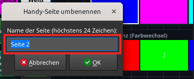
8. So sieht es mit zwei Seiten aus. Mit **−** löschst du die gewählte Seite.
   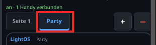
9. Vertan? Der Rückgängig-Pfeil holt jede Änderung zurück.
   

Speichere danach die Show. Seiten und Gruppen sind beim nächsten Laden wieder da.

---

## Anleitung 3: Handy-Gruppe anlegen und am Handy bedienen

**Ziel:** Von mehreren Tasten ist am Handy immer nur eine an. Tippst du eine an, gehen die
anderen aus.

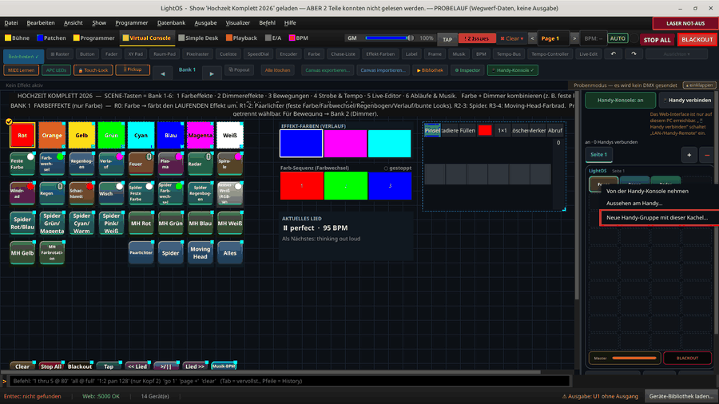

1. Rechtsklick auf eine Kachel im Handy-Raster. Wähle **Neue Handy-Gruppe mit dieser Kachel…**
   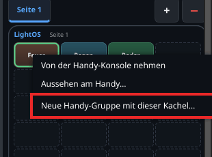
2. Hak alle Kacheln an, die zusammengehören.
   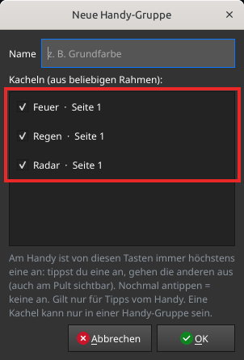
3. Gib einen Namen ein (bis 24 Zeichen). Ohne Namen heißt sie „Gruppe 1“. Klick **OK**.
   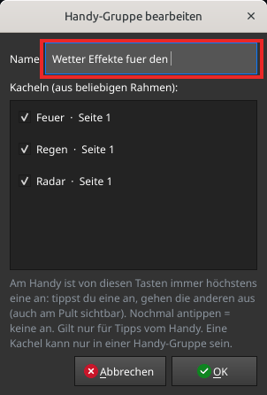
4. Die Gruppe hat jetzt einen gelb gestrichelten Rahmen.
   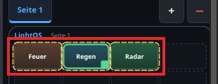
5. Öffne den Link der Handy-Konsole im Browser. Oben rechts steht **verbunden**. Am Pult steht
   „1 Handy verbunden“.
   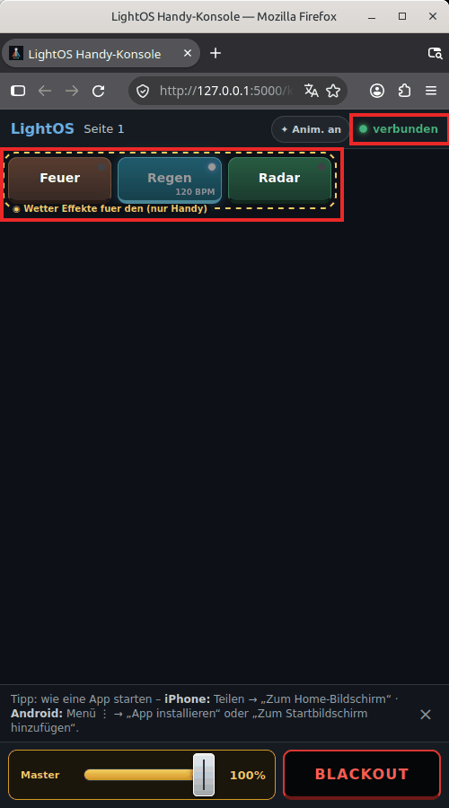
6. Tipp am Handy auf **Feuer**. Am Pult geht Feuer an, Regen geht aus.
   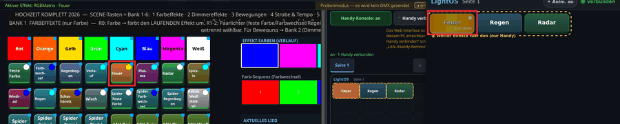
7. **BLACKOUT** unten am Handy wirkt sofort auch am Pult. Nochmal tippen hebt ihn auf.
   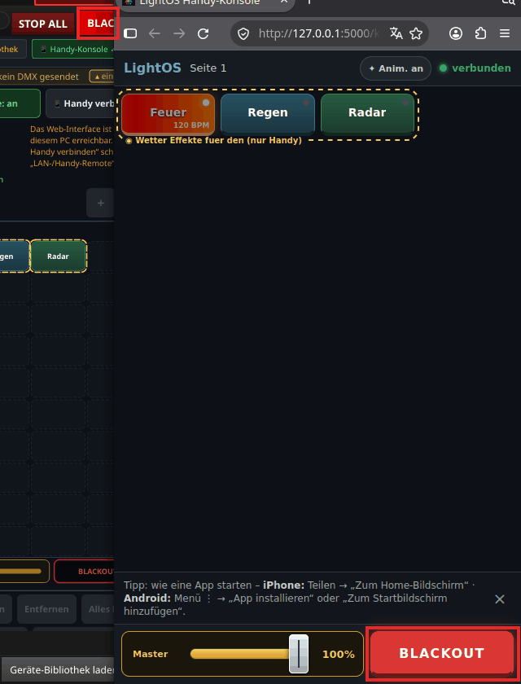
8. Ist LightOS weg (beendet oder Netz weg), sperrt das Handy die Bedienung und zeigt
   **Getrennt**.
   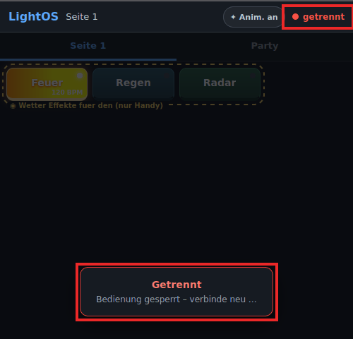

Handy und Pult nebeneinander:

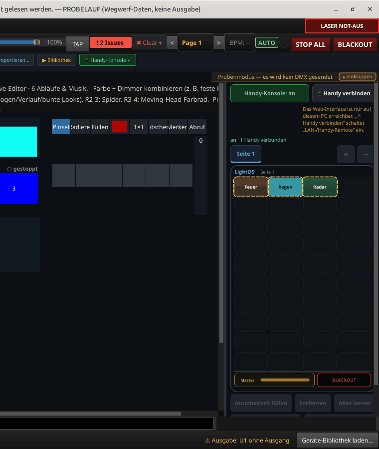
