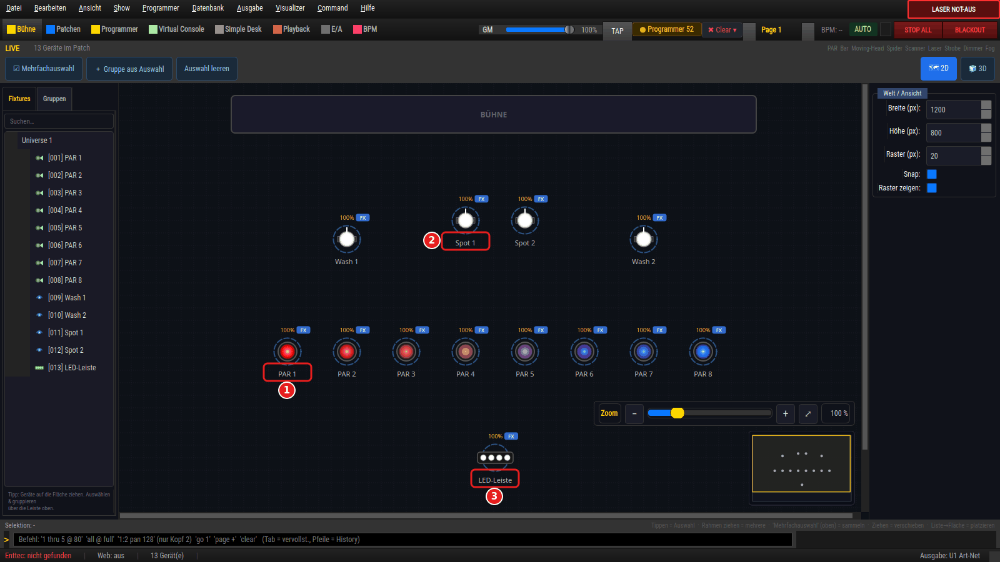
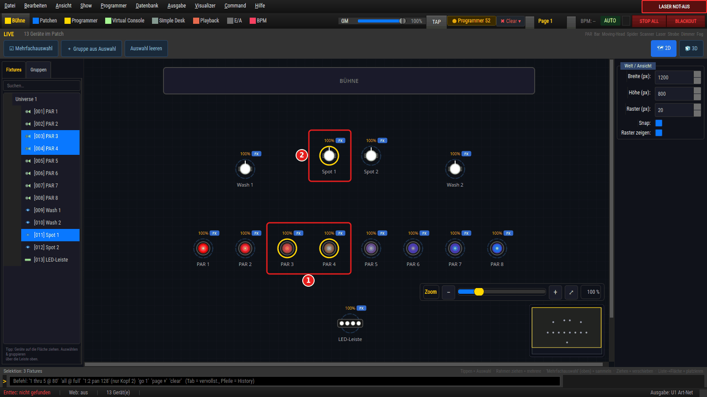
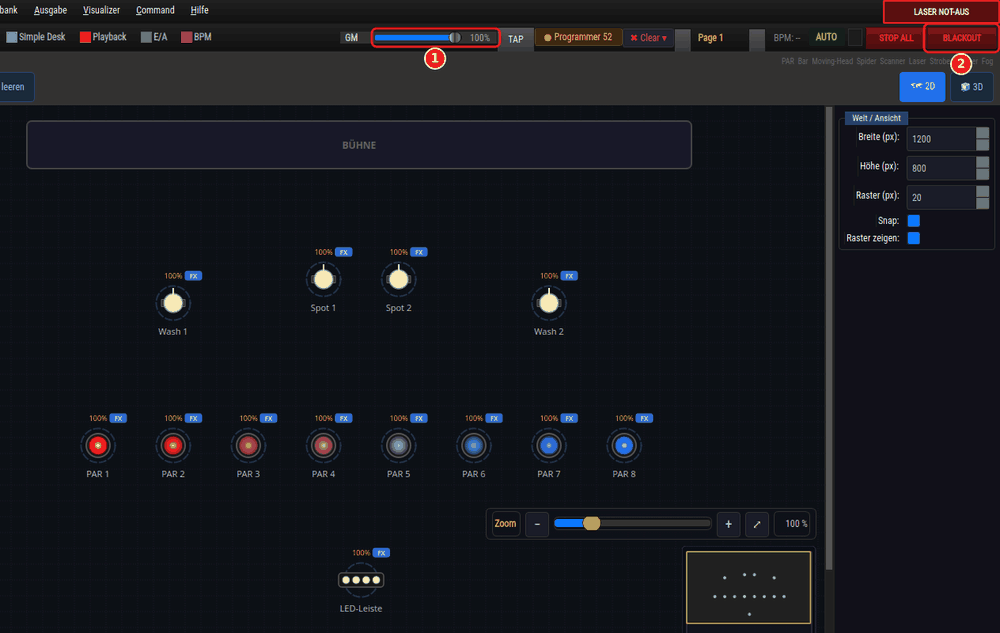

# live_view (StageCanvas / Live-View)

> 2D-Top-Down-Ansicht der Bühne: zeigt alle gepatchten Fixtures aus der
> Vogelperspektive mit live gerendertem DMX-Zustand (Farbe, Dimmer, Pan/Tilt).

## Zweck

Visuelles Live-Feedback. `StageCanvas` malt die Bühne von oben; `FixtureRenderer`
zeichnet jedes Fixture typ-abhängig unterscheidbar und rechnet DMX-Werte in
Auslenkung/Farbe/Helligkeit um. Antippen/Auswählen von Fixtures synchronisiert
mit der linken Geräteliste und dem Programmer. Ein 10-FPS-Timer
(`StageCanvas.RENDER_INTERVAL_MS`, seit 2026-07-23 von 20 auf 10 FPS gesenkt)
treibt das Rendering und pausiert, wenn die View nicht sichtbar ist. Das betrifft
nur die Vorschau — DMX-Ausgabe und Playback haben ihren eigenen Takt.

## Bedienung / Optionen

| Bedienung | Wirkung |
|---|---|
| Fixture anklicken | Auswahl setzen (spiegelt in Liste/Programmer) |
| Touch-Modus | Antippen toggelt Fixtures in die Auswahl (statt zu ersetzen) |
| Zoom | Zoomfaktor `[0.25, 4.0]`; Canvas-Größe folgt Welt × Zoom |
| Welt-Größe/Raster | Bühnenmaße setzen; Koordinaten snappen ans Raster |
| Gruppen-Highlight | Fremd gesetzte Auswahl als cyan Ring hervorheben |

## Was die 2D-Bühne zeigt

- **Ausgabebild (WYSIWYG, VIZ-78/DOC-63):** Die Farben/Helligkeiten kommen aus
  `OutputManager.get_display_frame(u)` — dem zuletzt gesendeten Frame **nach**
  Grand Master, Blackout und NOT-AUS-Masken (`_display_frame`, `_wert_leser`).
  Solange noch kein Frame gesendet wurde (Ausgabe aus), fällt die Ansicht auf den
  Rohpuffer des Universums zurück.
- **Beschriftung (DEMO-9):** Unter dem Symbol steht der Gerätename aus dem Patch
  (`buehnen_beschriftung`), über 16 Zeichen gekürzt (`BUEHNEN_NAME_MAX`); eine
  Endnummer („… 3") bleibt dabei erhalten. Kommt ein (gekürzter) Name mehrfach vor
  (`buehnen_beschriftungen`) oder hat das Gerät keinen Namen, steht Typ-Kürzel +
  Gerätenummer da („MH 9"). Bei LOD 0 erscheint der Name nur, wenn er in den Abstand
  zum Nachbarn passt (`buehnen_label_waehlen`), sonst Kürzel + Nummer; LOD 1 zeigt die
  Nummer, LOD 2 keine Beschriftung. Ausgewählte und hervorgehobene Geräte werden immer
  mit LOD 0 und ohne Platzprüfung beschriftet (Name, sofern eindeutig).

Bilder: `tools/anleitungsbilder.py erste_schritte` (Szenen `12_`–`14_`, DOC-77).

## Verknüpfungen

- **Bus:** abonniert Auswahl-/Gruppen-Events (`bus.subscribe`) für Highlight und
  externe Selektion.
- **AppState/DMX:** liest Patch + aktuellen DMX-/Programmer-Zustand pro Frame.
- **Meta-Persistenz:** Positionen/Welt-Größe werden in `ui_prefs.json` bzw.
  Fixture-Meta gesichert.

## Zugehörige Tests

- `tests/test_live_view_zoom.py` — Zoom-Klemmung/Canvas-Größe.
- `tests/test_live_view_tree.py` — Liste ⇄ Canvas-Auswahl.
- `tests/test_live_view_meta_persist.py` — Positions-Persistenz.
- `tests/test_live_view_2d_3d_consistency.py`, `test_live_view_3d_toggle.py`,
  `test_live_view_fixes.py`.

## Quelle (file:line)

- `src/ui/views/live_view.py:1042` — `StageCanvas`
- `src/ui/views/live_view.py:420` — `FixtureRenderer` (typ-abhängiges Zeichnen)
- `src/ui/views/live_view.py:1056` — `RENDER_INTERVAL_MS` (10 FPS, sichtbarkeitsgekoppelt)
- `src/ui/views/live_view.py:2261` — `_display_frame` (Ausgabebild nach GM/Blackout/NOT-AUS)
- `src/ui/views/live_view.py` — `buehnen_beschriftung` / `buehnen_beschriftungen` / `buehnen_label_waehlen` (DEMO-9)
- `src/ui/views/live_view.py:68` — `dmx_to_angle_deg` (DMX→Grad-Umrechnung)
